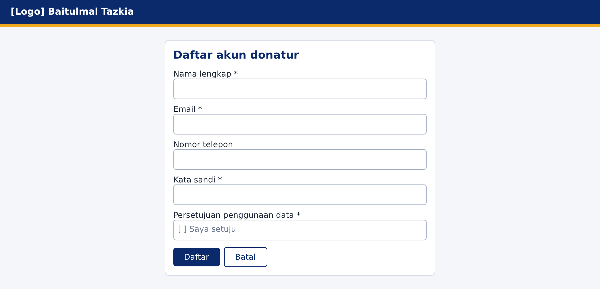

# FR-ADBD-01 Pendaftaran akun donatur · Akun Donatur dan Bukti Donasi

Kelompok 2 · Business Analyst: Eli Nur Aulia · Project Manager: Destri · Status: draf

| **Atribut** | **Isi**                                                                                                                    |
|-------------|----------------------------------------------------------------------------------------------------------------------------|
| Prioritas   | Must                                                                                                                       |
| Sumber      | v0.2; usulan tim                                                                                                           |
| Aktor       | Donatur                                                                                                                    |
| Deskripsi   | Sistem membuat akun donatur dari nama, email, kata sandi, dan persetujuan penggunaan data; email diverifikasi lewat tautan |
| Task proses | T-01                                                                                                                       |

**Alur**

- Prakondisi: belum punya akun.

- Alur utama: (1) donatur memilih “Daftar”; (2) mengisi data dan persetujuan; (3) sistem memvalidasi; (4) akun dibuat.

- Alur alternatif: donatur mendaftar tanpa nomor telepon.

- Alur kegagalan: email sudah dipakai atau kolom wajib kosong, sistem menolak.

- Pascakondisi: akun donatur aktif.

**Acceptance criteria**

- **Given** email belum terdaftar, **When** donatur mendaftar sebagai “Donatur Contoh”, **Then** akun dibuat dan tautan verifikasi dikirim.

- **Given** email sudah dipakai, **When** donatur mendaftar, **Then** sistem menolak.

- **Given** persetujuan tidak dicentang, **When** donatur menekan Daftar, **Then** sistem menolak.

**Mockup**

*Pendaftaran akun donatur*

| **Elemen**           | **Jenis**   | **Perilaku**               |
|----------------------|-------------|----------------------------|
| Nama, Email, Telepon | Kolom       | Nama dan email wajib       |
| Kata sandi           | Tersembunyi | Minimal 8                  |
| Persetujuan          | Centang     | Wajib                      |
| Daftar, Batal        | Tombol      | Memvalidasi lalu menyimpan |

Pesan galat: “Email tidak valid atau sudah dipakai.”; “Kata sandi minimal 8 karakter.”; “Persetujuan wajib diberikan.”

Test scenario: TS-ADBD-01.
