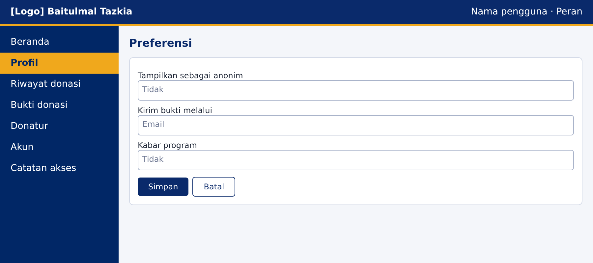

# FR-ADBD-03 Preferensi anonimitas dan pengiriman · Akun Donatur dan Bukti Donasi

Kelompok 2 · Business Analyst: Eli Nur Aulia · Project Manager: Destri · Status: draf

| **Atribut** | **Isi**                                                                                                                         |
|-------------|---------------------------------------------------------------------------------------------------------------------------------|
| Prioritas   | Should                                                                                                                          |
| Sumber      | v0.2 FR-008, BR-005                                                                                                             |
| Aktor       | Donatur                                                                                                                         |
| Deskripsi   | Sistem menyimpan preferensi anonim, cara kirim bukti, dan kabar program; anonim mengatur tampilan tanpa menghapus data internal |
| Task proses | T-01                                                                                                                            |

**Alur**

- Prakondisi: donatur sudah login.

- Alur utama: (1) membuka preferensi; (2) memilih; (3) menyimpan.

- Alur alternatif: tidak mengubah, default dipakai.

- Alur kegagalan: nilai tidak sah ditolak.

- Pascakondisi: preferensi tersimpan.

**Acceptance criteria**

- **Given** donatur memilih anonim, **When** namanya akan tampil pada daftar umum, **Then** tampil “Hamba Allah”.

- **Given** preferensi belum diisi, **When** sistem memakainya, **Then** default tidak anonim.

**Mockup**

*Preferensi anonimitas dan pengiriman*

| **Elemen**                | **Jenis** | **Perilaku**         |
|---------------------------|-----------|----------------------|
| Anonim, Cara kirim, Kabar | Pilihan   | Default tidak anonim |
| Simpan, Batal             | Tombol    | Menyimpan preferensi |

Pesan galat: “Pilih preferensi anonim.”; “Pilih cara pengiriman.”

Test scenario: TS-ADBD-03.
