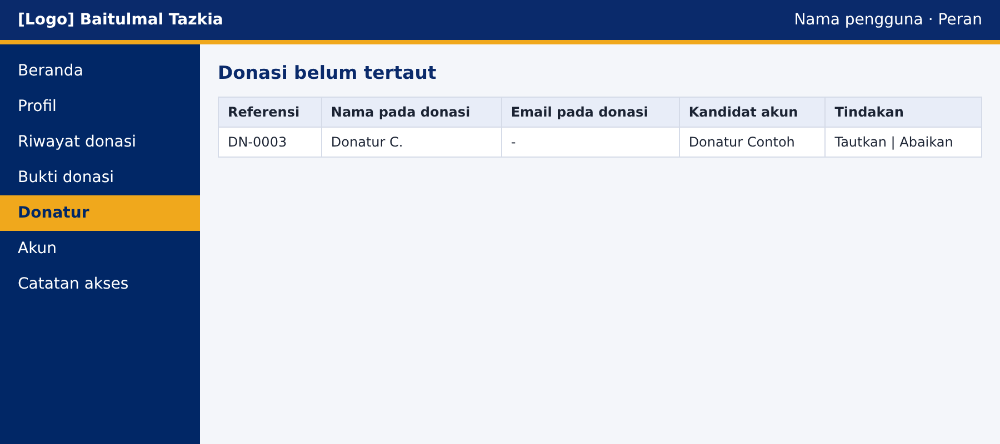

# FR-ADBD-04 Penautan donasi ke akun · Akun Donatur dan Bukti Donasi

Kelompok 2 · Business Analyst: Eli Nur Aulia · Project Manager: Destri · Status: draf

| **Atribut** | **Isi**                                                                                                                                  |
|-------------|------------------------------------------------------------------------------------------------------------------------------------------|
| Prioritas   | Must                                                                                                                                     |
| Sumber      | v0.2 FR-007                                                                                                                              |
| Aktor       | Sistem, petugas donasi                                                                                                                   |
| Deskripsi   | Sistem menautkan donasi ke akun bila email terverifikasi sama; kasus tidak pasti ditinjau petugas; tidak menautkan berdasarkan nama saja |
| Task proses | T-03                                                                                                                                     |

**Alur**

- Prakondisi: akun terverifikasi; data donasi tersedia.

- Alur utama: (1) sistem menerima data donasi; (2) mencocokkan email terverifikasi; (3) menautkan.

- Alur alternatif: tidak pasti, petugas meninjau dan memberi alasan.

- Alur kegagalan: donasi sudah tertaut ke akun lain, sistem menolak.

- Pascakondisi: donasi tertaut.

**Acceptance criteria**

- **Given** donasi beremail sama dengan akun terverifikasi, **When** data diterima, **Then** donasi tertaut.

- **Given** hanya nama yang mirip, **When** data diterima, **Then** tidak ditautkan otomatis.

- **Given** petugas menautkan tanpa alasan, **When** menyimpan, **Then** sistem menolak.

**Mockup**

*Penautan donasi ke akun*

| **Elemen**           | **Jenis** | **Perilaku**  |
|----------------------|-----------|---------------|
| Daftar belum tertaut | Tabel     | Kandidat akun |
| Tautkan, Abaikan     | Tautan    | Alasan wajib  |

Pesan galat: “Donasi tidak ditemukan.”; “Alasan wajib diisi.”

Test scenario: TS-ADBD-04.
