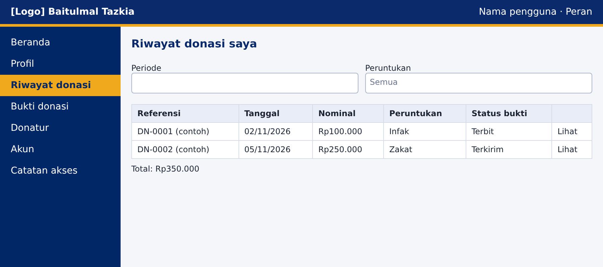

# FR-ADBD-05 Riwayat donasi · Akun Donatur dan Bukti Donasi

Kelompok 2 · Business Analyst: Eli Nur Aulia · Project Manager: Destri · Status: draf

| **Atribut** | **Isi**                                                                                                      |
|-------------|--------------------------------------------------------------------------------------------------------------|
| Prioritas   | Must                                                                                                         |
| Sumber      | v0.2 FR-007, US-004                                                                                          |
| Aktor       | Donatur, petugas donasi                                                                                      |
| Deskripsi   | Sistem menampilkan donasi tertaut dengan filter periode dan peruntukan serta total donasi berstatus Berhasil |
| Task proses | T-06                                                                                                         |

**Alur**

- Prakondisi: pengguna sudah login.

- Alur utama: (1) membuka riwayat; (2) menyaring; (3) sistem menampilkan daftar dan total.

- Alur alternatif: belum ada donasi, tampil “tidak ada data”.

- Alur kegagalan: membuka data donatur lain, 403.

- Pascakondisi: riwayat tampil.

**Acceptance criteria**

- **Given** donatur memiliki donasi Berhasil Rp100.000 dan Rp250.000, **When** membuka riwayat, **Then** tampil 2 donasi dan total Rp350.000.

- **Given** donatur A, **When** membuka riwayat donatur B, **Then** ditolak 403.

**Mockup**

*Riwayat donasi*

| **Elemen**          | **Jenis** | **Perilaku**              |
|---------------------|-----------|---------------------------|
| Periode, Peruntukan | Filter    | Awal tidak melewati akhir |
| Tabel               | Baca saja | Donasi milik sendiri      |

Pesan galat: “Tanggal akhir tidak boleh sebelum tanggal awal.”; “Tidak ada data.”

Test scenario: TS-ADBD-05.
