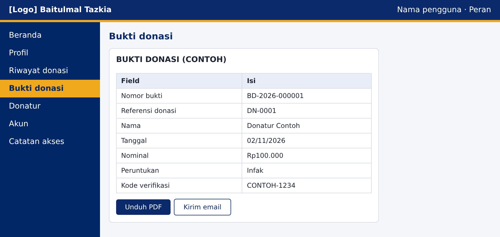

# FR-ADBD-06 Penerbitan bukti donasi · Akun Donatur dan Bukti Donasi

Kelompok 2 · Business Analyst: Eli Nur Aulia · Project Manager: Destri · Status: draf

| **Atribut** | **Isi**                                                                                                                                                                                                                       |
|-------------|-------------------------------------------------------------------------------------------------------------------------------------------------------------------------------------------------------------------------------|
| Prioritas   | Must                                                                                                                                                                                                                          |
| Sumber      | Usulan tim (judul proyek)                                                                                                                                                                                                     |
| Aktor       | Sistem, petugas donasi                                                                                                                                                                                                        |
| Deskripsi   | Sistem menerbitkan satu bukti per donasi berstatus Berhasil, berisi nomor bukti unik, referensi, nama, tanggal, nominal, peruntukan, dan kode verifikasi. Bila donasi dibatalkan atau dikembalikan, bukti ditandai Dibatalkan |
| Task proses | T-04                                                                                                                                                                                                                          |

**Alur**

- Prakondisi: donasi berstatus Berhasil.

- Alur utama: (1) sistem atau petugas memicu penerbitan; (2) sistem memberi nomor bukti; (3) menyimpan.

- Alur alternatif: donasi tanpa identitas, bukti beratas nama “Hamba Allah”.

- Alur kegagalan: status bukan Berhasil, ditolak.

- Pascakondisi: satu bukti tersimpan.

**Acceptance criteria**

- **Given** donasi Berhasil Rp100.000, **When** bukti diterbitkan, **Then** bukti memuat nomor unik dan nominal Rp100.000.

- **Given** donasi berstatus Menunggu, **When** penerbitan diminta, **Then** sistem menolak.

- **Given** bukti sudah ada, **When** penerbitan diminta lagi, **Then** bukti yang sama dikembalikan.

**Mockup**

*Penerbitan bukti donasi*

| **Elemen**   | **Jenis** | **Perilaku**                                        |
|--------------|-----------|-----------------------------------------------------|
| Isi bukti    | Baca saja | Diambil dari data donasi; tidak dapat diubah manual |
| Unduh, Kirim | Tombol    | Lihat FR-ADBD-07                                    |

Pesan galat: “Bukti hanya untuk donasi berstatus Berhasil.”

Test scenario: TS-ADBD-06.
