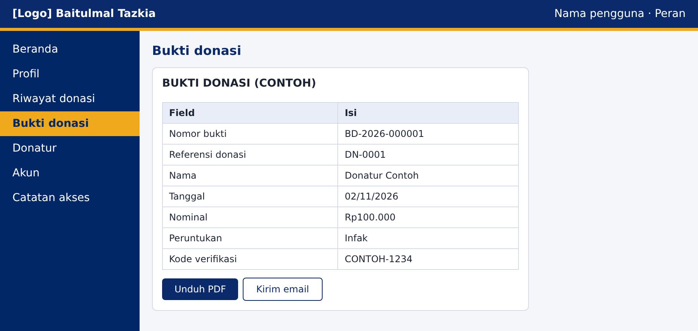

# FR-ADBD-07 Unduh dan kirim bukti · Akun Donatur dan Bukti Donasi

Kelompok 2 · Business Analyst: Eli Nur Aulia · Project Manager: Destri · Status: draf

| **Atribut** | **Isi**                                                                                                   |
|-------------|-----------------------------------------------------------------------------------------------------------|
| Prioritas   | Must                                                                                                      |
| Sumber      | Usulan tim                                                                                                |
| Aktor       | Donatur, petugas donasi                                                                                   |
| Deskripsi   | Bukti dapat diunduh sebagai PDF dan dikirim ke email donatur sesuai preferensi; status pengiriman dicatat |
| Task proses | T-05                                                                                                      |

**Alur**

- Prakondisi: bukti sudah terbit.

- Alur utama: (1) membuka bukti; (2) mengunduh PDF atau mengirim email.

- Alur alternatif: kirim ulang atas permintaan.

- Alur kegagalan: pengiriman gagal, status tidak menjadi Terkirim.

- Pascakondisi: donatur menerima bukti.

**Acceptance criteria**

- **Given** bukti Terbit, **When** donatur menekan Unduh PDF, **Then** berkas PDF terunduh.

- **Given** layanan email gagal, **When** bukti dikirim, **Then** status tidak menjadi Terkirim dan kegagalan dicatat.

**Mockup**

*Unduh dan kirim bukti*

| **Elemen**  | **Jenis** | **Perilaku**               |
|-------------|-----------|----------------------------|
| Unduh PDF   | Tombol    | Hanya pemilik atau petugas |
| Kirim email | Tombol    | Ke email terverifikasi     |

Pesan galat: “Pengiriman gagal, coba lagi.”

Test scenario: TS-ADBD-07.
