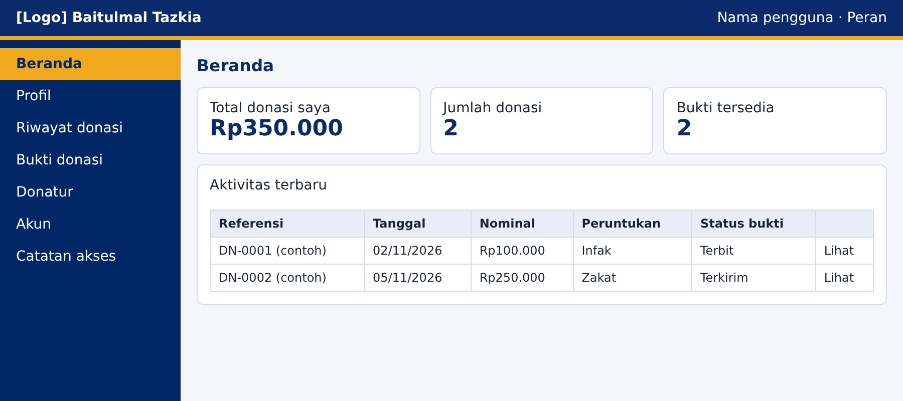

# FR-ADBD-09 Pembatasan akses menurut peran · Akun Donatur dan Bukti Donasi

Kelompok 2 · Business Analyst: Eli Nur Aulia · Project Manager: Destri · Status: draf

| **Atribut** | **Isi**                                                                            |
|-------------|------------------------------------------------------------------------------------|
| Prioritas   | Must                                                                               |
| Sumber      | v0.2 NFR-001, BR-006                                                               |
| Aktor       | Semua peran                                                                        |
| Deskripsi   | Sistem membatasi data menurut peran dan kepemilikan, diterapkan terpusat di server |
| Task proses | T-01 sampai T-06                                                                   |

**Acceptance criteria**

- **Given** pengguna Donatur, **When** memanggil API kelola akun, **Then** server menolak 403.

- **Given** donatur A, **When** meminta bukti donatur B, **Then** ditolak.

**Mockup**

*Pembatasan akses menurut peran*

*Pembatasan akses menurut peran*

| **Elemen**            | **Jenis** | **Perilaku** |
|-----------------------|-----------|--------------|
| Menu samping          | Navigasi  | Sesuai peran |
| Halaman akses ditolak | Pesan     | Kode 403     |

Pesan galat: “Anda tidak berhak membuka halaman ini.”

Test scenario: TS-ADBD-09.
