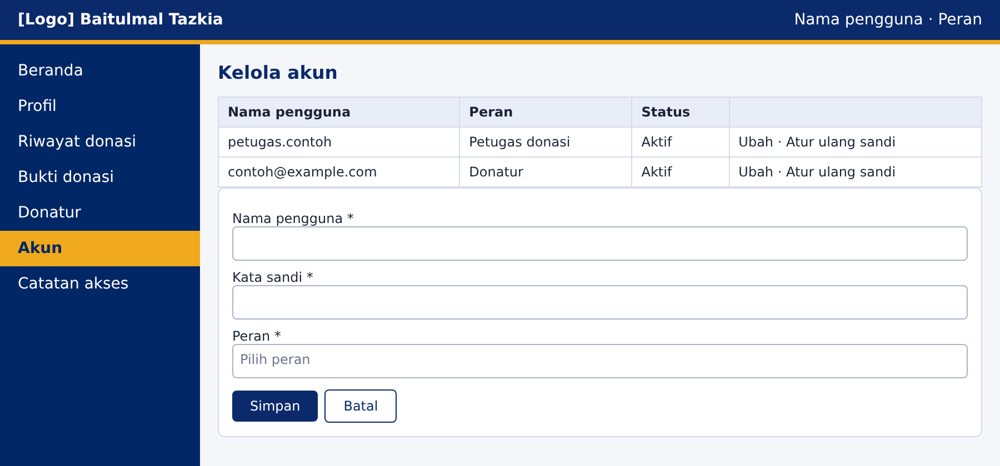

# FR-ADBD-10 Pengelolaan akun dan peran · Akun Donatur dan Bukti Donasi

Kelompok 2 · Business Analyst: Eli Nur Aulia · Project Manager: Destri · Status: draf

| **Atribut** | **Isi**                                                                                          |
|-------------|--------------------------------------------------------------------------------------------------|
| Prioritas   | Must                                                                                             |
| Sumber      | Usulan tim; v0.2 NFR-001                                                                         |
| Aktor       | Admin                                                                                            |
| Deskripsi   | Admin membuat akun internal, menonaktifkan akun, dan menetapkan peran. Login mengikuti FR Umum 1 |
| Task proses | T-01 sampai T-06                                                                                 |

**Alur**

- Prakondisi: berperan Admin.

- Alur utama: (1) membuat akun; (2) menetapkan peran; (3) menyimpan.

- Alur alternatif: Admin menonaktifkan akun.

- Alur kegagalan: non-Admin ditolak 403.

- Pascakondisi: akun tersimpan.

**Acceptance criteria**

- **Given** pengguna Admin, **When** membuat akun petugas unik, **Then** akun aktif tampil.

- **Given** akun dinonaktifkan, **When** pemiliknya login, **Then** ditolak.

- **Given** nama pengguna sudah dipakai, **When** Admin membuat akun, **Then** ditolak.

**Mockup**

*Pengelolaan akun dan peran*

| **Elemen**             | **Jenis** | **Perilaku**        |
|------------------------|-----------|---------------------|
| Tabel akun             | Tabel     | Nama, peran, status |
| Akun baru              | Formulir  | Sesuai 3.1.1.2      |
| Ubah, Atur ulang sandi | Tautan    | Hanya Admin         |

Pesan galat: “Nama pengguna tidak valid atau sudah dipakai.”; “Kata sandi minimal 8 karakter.”; “Pilih peran.”

Test scenario: TS-ADBD-10.
