# Functional Requirements (FR)

Sistem Akun Donatur dan Bukti Donasi · Baitulmal Tazkia

| **Item**         | **Isi**                                                                                                                    |
|------------------|----------------------------------------------------------------------------------------------------------------------------|
| Dokumen          | Dokumen FR                                                                                                                 |
| Kelompok         | 2                                                                                                                          |
| Business Analyst | Eli Nur Aulia                                                                                                              |
| Project Manager  | Destri                                                                                                                     |
| Versi            | 0.1 (draf)                                                                                                                 |
| Tanggal          | 25 November 2026                                                                                                           |
| Acuan            | SRS Akun Donatur dan Bukti Donasi v0.3                                                                                     |
| Status           | DRAF, belum ada sign-off. \[USULAN\] = usulan tim; \[DUGAAN\] = belum dikonfirmasi klien; \[DRAF\] = belum disetujui final |

## 1. Daftar kebutuhan fungsional

| **ID**     | **Nama**                             | **Prioritas** | **Aktor**               |
|------------|--------------------------------------|---------------|-------------------------|
| FR Umum 1  | Layar login                          | Must          | Semua pengguna          |
| FR Umum 2  | Beranda setelah login                | Must          | Semua pengguna          |
| FR Umum 3  | Tampilan tabel                       | Must          | Semua pengguna          |
| FR Umum 4  | Tampilan formulir input              | Must          | Semua pengguna          |
| FR-ADBD-01 | Pendaftaran akun donatur             | Must          | Donatur                 |
| FR-ADBD-02 | Pengelolaan profil donatur           | Must          | Donatur                 |
| FR-ADBD-03 | Preferensi anonimitas dan pengiriman | Should        | Donatur                 |
| FR-ADBD-04 | Penautan donasi ke akun              | Must          | Sistem, petugas donasi  |
| FR-ADBD-05 | Riwayat donasi                       | Must          | Donatur, petugas donasi |
| FR-ADBD-06 | Penerbitan bukti donasi              | Must          | Sistem, petugas donasi  |
| FR-ADBD-07 | Unduh dan kirim bukti                | Must          | Donatur, petugas donasi |
| FR-ADBD-08 | Verifikasi keaslian bukti            | Could         | Penerima bukti          |
| FR-ADBD-09 | Pembatasan akses menurut peran       | Must          | Semua peran             |
| FR-ADBD-10 | Pengelolaan akun dan peran           | Must          | Admin                   |
| FR-ADBD-11 | Log akses data pribadi               | Should        | Admin                   |
| FR-ADBD-12 | Penyediaan data untuk proyek hilir   | Should        | Proyek 11, Proyek 10    |

## 2. FR umum \[DRAF\]

### FR Umum 1: Layar login

| **Atribut** | **Isi**                                                                    |
|-------------|----------------------------------------------------------------------------|
| Prioritas   | Must                                                                       |
| Aktor       | Semua pengguna                                                             |
| Deskripsi   | Satu layar login dengan nama pengguna dan kata sandi untuk semua pengguna. |

**Mockup**

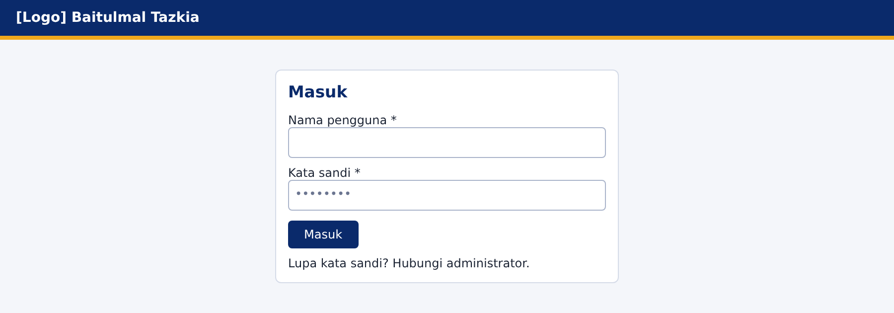

*Layar login*

**Acceptance criteria**

- Akun aktif, kata sandi benar: masuk ke beranda sesuai peran.

- Akun dinonaktifkan: login ditolak.

- Kata sandi salah: pesan umum tanpa menyebut bagian yang salah.

### FR Umum 2: Beranda setelah login

| **Atribut** | **Isi**                               |
|-------------|---------------------------------------|
| Prioritas   | Must                                  |
| Aktor       | Semua pengguna                        |
| Deskripsi   | Ringkasan dan menu sesuai peran akun. |

**Mockup**

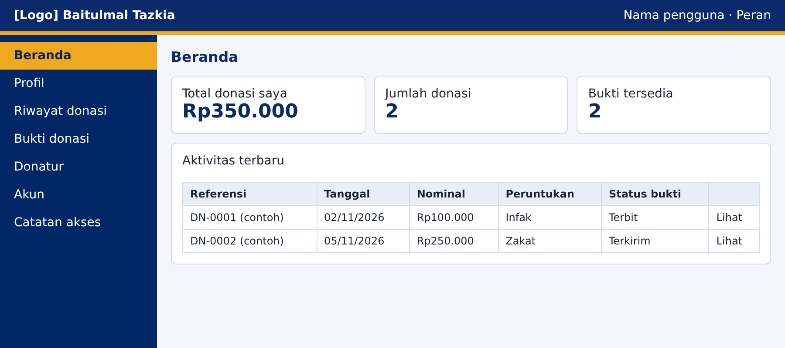

*Beranda setelah login*

**Acceptance criteria**

- Login sebagai Donatur: menu hanya memuat data miliknya.

- Login sebagai Admin: menu kelola akun dan catatan akses tampil.

### FR Umum 3: Tampilan tabel

| **Atribut** | **Isi**                                                      |
|-------------|--------------------------------------------------------------|
| Prioritas   | Must                                                         |
| Aktor       | Semua pengguna                                               |
| Deskripsi   | Daftar data standar: cari, saring, tambah, status, paginasi. |

**Mockup**

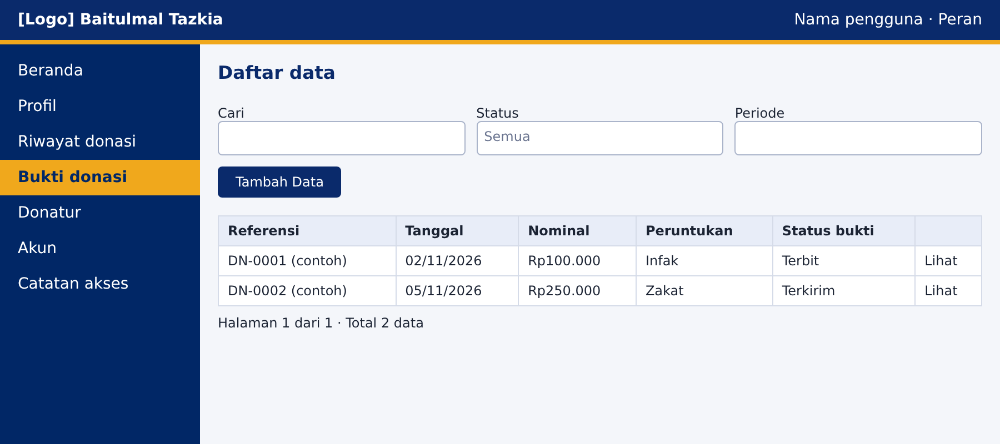

*Tampilan tabel*

**Acceptance criteria**

- Buka tabel berisi 48 data: enam data per halaman dan jumlah total.

- Filter tidak cocok: tampil “tidak ada data”.

### FR Umum 4: Tampilan formulir input

| **Atribut** | **Isi**                                                                   |
|-------------|---------------------------------------------------------------------------|
| Prioritas   | Must                                                                      |
| Aktor       | Semua pengguna                                                            |
| Deskripsi   | Formulir standar: kolom wajib bertanda \*, pesan galat, Simpan dan Batal. |

**Mockup**

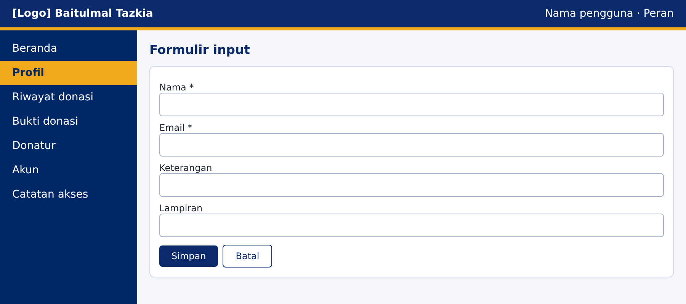

*Tampilan formulir input*

**Acceptance criteria**

- Simpan dengan kolom wajib kosong: ditolak dan kolom yang kurang disebut.

- Simpan dengan data valid: tersimpan dan kembali ke tabel.

## 3. FR proyek

### FR-ADBD-01 Pendaftaran akun donatur \[DUGAAN\]

| **Atribut** | **Isi**                                                                                                                    |
|-------------|----------------------------------------------------------------------------------------------------------------------------|
| Prioritas   | Must                                                                                                                       |
| Sumber      | v0.2; usulan tim                                                                                                           |
| Aktor       | Donatur                                                                                                                    |
| Deskripsi   | Sistem membuat akun donatur dari nama, email, kata sandi, dan persetujuan penggunaan data; email diverifikasi lewat tautan |
| Task proses | T-01                                                                                                                       |

**Alur**

- Prakondisi: belum punya akun.

- Alur utama: (1) donatur memilih “Daftar”; (2) mengisi data dan persetujuan; (3) sistem memvalidasi; (4) akun dibuat.

- Alur alternatif: donatur mendaftar tanpa nomor telepon.

- Alur kegagalan: email sudah dipakai atau kolom wajib kosong, sistem menolak.

- Pascakondisi: akun donatur aktif.

**Acceptance criteria**

- **Given** email belum terdaftar, **When** donatur mendaftar sebagai “Donatur Contoh”, **Then** akun dibuat dan tautan verifikasi dikirim.

- **Given** email sudah dipakai, **When** donatur mendaftar, **Then** sistem menolak.

- **Given** persetujuan tidak dicentang, **When** donatur menekan Daftar, **Then** sistem menolak.

**Mockup**

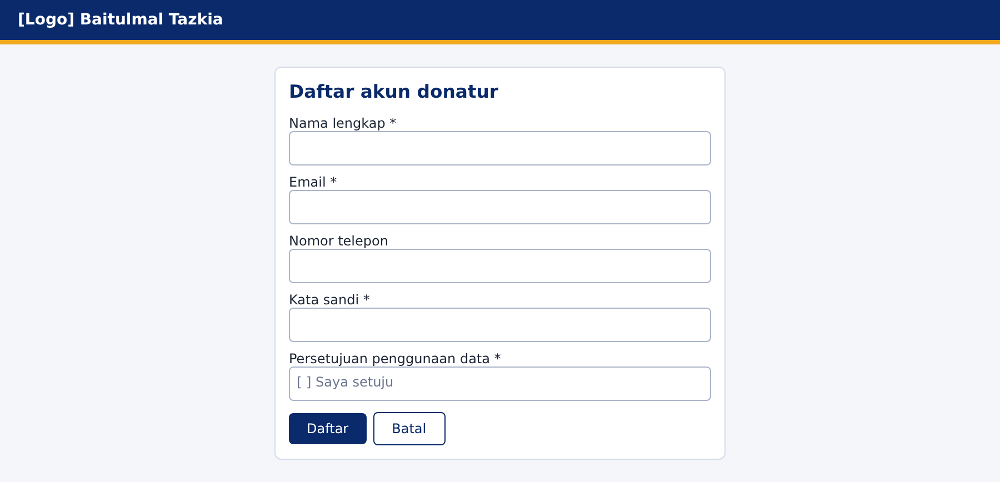

*Pendaftaran akun donatur*

| **Elemen**           | **Jenis**   | **Perilaku**               |
|----------------------|-------------|----------------------------|
| Nama, Email, Telepon | Kolom       | Nama dan email wajib       |
| Kata sandi           | Tersembunyi | Minimal 8                  |
| Persetujuan          | Centang     | Wajib                      |
| Daftar, Batal        | Tombol      | Memvalidasi lalu menyimpan |

Pesan galat: “Email tidak valid atau sudah dipakai.”; “Kata sandi minimal 8 karakter.”; “Persetujuan wajib diberikan.”

### FR-ADBD-02 Pengelolaan profil donatur \[DUGAAN\]

| **Atribut** | **Isi**                                                             |
|-------------|---------------------------------------------------------------------|
| Prioritas   | Must                                                                |
| Sumber      | v0.2 FR-005                                                         |
| Aktor       | Donatur                                                             |
| Deskripsi   | Donatur melihat dan mengubah data yang disetujui; perubahan dicatat |
| Task proses | T-01, T-02                                                          |

**Alur**

- Prakondisi: donatur sudah login.

- Alur utama: (1) membuka profil; (2) mengubah data; (3) menyimpan.

- Alur alternatif: ganti email memerlukan verifikasi.

- Alur kegagalan: data tidak valid, sistem menolak.

- Pascakondisi: profil tersimpan.

**Acceptance criteria**

- **Given** donatur sudah login, **When** mengubah alamat dan menyimpan, **Then** perubahan tersimpan.

- **Given** email baru belum diverifikasi, **When** donatur menyimpan, **Then** email lama tetap berlaku.

**Mockup**

*Pengelolaan profil donatur*

| **Elemen**    | **Jenis** | **Perilaku**      |
|---------------|-----------|-------------------|
| Data diri     | Kolom     | Sesuai 3.1.1.2    |
| Simpan, Batal | Tombol    | Perubahan dicatat |

Pesan galat: “Nama wajib diisi.”; “Nomor telepon tidak valid.”

### FR-ADBD-03 Preferensi anonimitas dan pengiriman \[DUGAAN\]

| **Atribut** | **Isi**                                                                                                                         |
|-------------|---------------------------------------------------------------------------------------------------------------------------------|
| Prioritas   | Should                                                                                                                          |
| Sumber      | v0.2 FR-008, BR-005                                                                                                             |
| Aktor       | Donatur                                                                                                                         |
| Deskripsi   | Sistem menyimpan preferensi anonim, cara kirim bukti, dan kabar program; anonim mengatur tampilan tanpa menghapus data internal |
| Task proses | T-01                                                                                                                            |

**Alur**

- Prakondisi: donatur sudah login.

- Alur utama: (1) membuka preferensi; (2) memilih; (3) menyimpan.

- Alur alternatif: tidak mengubah, default dipakai.

- Alur kegagalan: nilai tidak sah ditolak.

- Pascakondisi: preferensi tersimpan.

**Acceptance criteria**

- **Given** donatur memilih anonim, **When** namanya akan tampil pada daftar umum, **Then** tampil “Hamba Allah”.

- **Given** preferensi belum diisi, **When** sistem memakainya, **Then** default tidak anonim.

**Mockup**

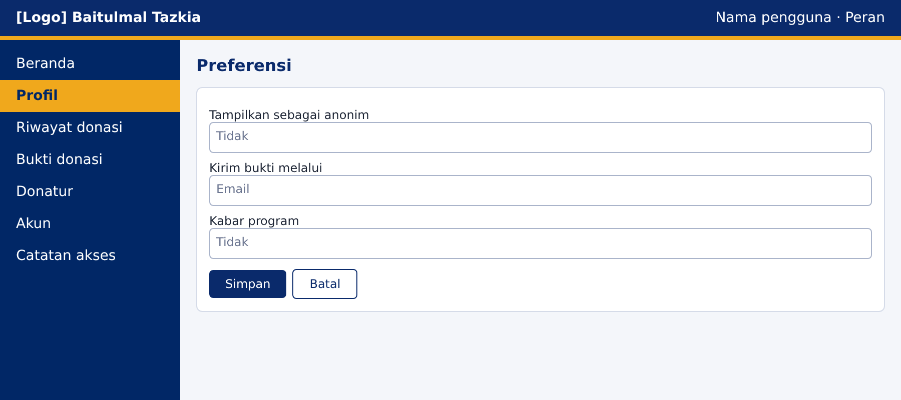

*Preferensi anonimitas dan pengiriman*

| **Elemen**                | **Jenis** | **Perilaku**         |
|---------------------------|-----------|----------------------|
| Anonim, Cara kirim, Kabar | Pilihan   | Default tidak anonim |
| Simpan, Batal             | Tombol    | Menyimpan preferensi |

Pesan galat: “Pilih preferensi anonim.”; “Pilih cara pengiriman.”

### FR-ADBD-04 Penautan donasi ke akun \[DUGAAN\]

| **Atribut** | **Isi**                                                                                                                                  |
|-------------|------------------------------------------------------------------------------------------------------------------------------------------|
| Prioritas   | Must                                                                                                                                     |
| Sumber      | v0.2 FR-007                                                                                                                              |
| Aktor       | Sistem, petugas donasi                                                                                                                   |
| Deskripsi   | Sistem menautkan donasi ke akun bila email terverifikasi sama; kasus tidak pasti ditinjau petugas; tidak menautkan berdasarkan nama saja |
| Task proses | T-03                                                                                                                                     |

**Alur**

- Prakondisi: akun terverifikasi; data donasi tersedia.

- Alur utama: (1) sistem menerima data donasi; (2) mencocokkan email terverifikasi; (3) menautkan.

- Alur alternatif: tidak pasti, petugas meninjau dan memberi alasan.

- Alur kegagalan: donasi sudah tertaut ke akun lain, sistem menolak.

- Pascakondisi: donasi tertaut.

**Acceptance criteria**

- **Given** donasi beremail sama dengan akun terverifikasi, **When** data diterima, **Then** donasi tertaut.

- **Given** hanya nama yang mirip, **When** data diterima, **Then** tidak ditautkan otomatis.

- **Given** petugas menautkan tanpa alasan, **When** menyimpan, **Then** sistem menolak.

**Mockup**

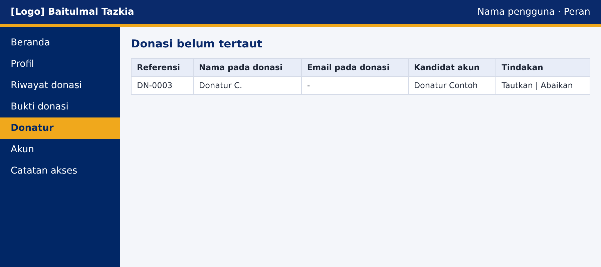

*Penautan donasi ke akun*

| **Elemen**           | **Jenis** | **Perilaku**  |
|----------------------|-----------|---------------|
| Daftar belum tertaut | Tabel     | Kandidat akun |
| Tautkan, Abaikan     | Tautan    | Alasan wajib  |

Pesan galat: “Donasi tidak ditemukan.”; “Alasan wajib diisi.”

### FR-ADBD-05 Riwayat donasi \[DUGAAN\]

| **Atribut** | **Isi**                                                                                                      |
|-------------|--------------------------------------------------------------------------------------------------------------|
| Prioritas   | Must                                                                                                         |
| Sumber      | v0.2 FR-007, US-004                                                                                          |
| Aktor       | Donatur, petugas donasi                                                                                      |
| Deskripsi   | Sistem menampilkan donasi tertaut dengan filter periode dan peruntukan serta total donasi berstatus Berhasil |
| Task proses | T-06                                                                                                         |

**Alur**

- Prakondisi: pengguna sudah login.

- Alur utama: (1) membuka riwayat; (2) menyaring; (3) sistem menampilkan daftar dan total.

- Alur alternatif: belum ada donasi, tampil “tidak ada data”.

- Alur kegagalan: membuka data donatur lain, 403.

- Pascakondisi: riwayat tampil.

**Acceptance criteria**

- **Given** donatur memiliki donasi Berhasil Rp100.000 dan Rp250.000, **When** membuka riwayat, **Then** tampil 2 donasi dan total Rp350.000.

- **Given** donatur A, **When** membuka riwayat donatur B, **Then** ditolak 403.

**Mockup**

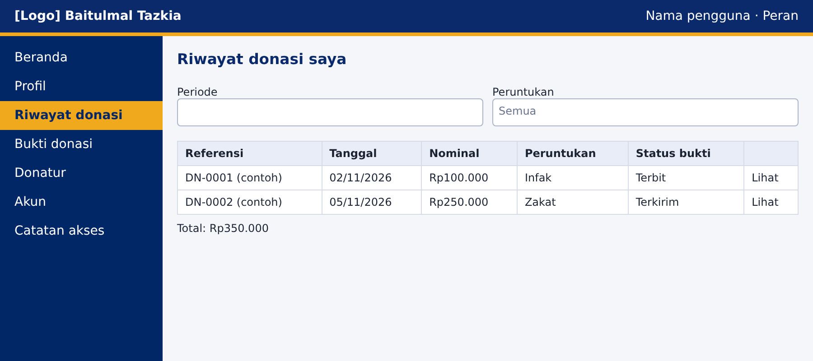

*Riwayat donasi*

| **Elemen**          | **Jenis** | **Perilaku**              |
|---------------------|-----------|---------------------------|
| Periode, Peruntukan | Filter    | Awal tidak melewati akhir |
| Tabel               | Baca saja | Donasi milik sendiri      |

Pesan galat: “Tanggal akhir tidak boleh sebelum tanggal awal.”; “Tidak ada data.”

### FR-ADBD-06 Penerbitan bukti donasi \[USULAN\]

| **Atribut** | **Isi**                                                                                                                                                                                                                       |
|-------------|-------------------------------------------------------------------------------------------------------------------------------------------------------------------------------------------------------------------------------|
| Prioritas   | Must                                                                                                                                                                                                                          |
| Sumber      | Usulan tim (judul proyek)                                                                                                                                                                                                     |
| Aktor       | Sistem, petugas donasi                                                                                                                                                                                                        |
| Deskripsi   | Sistem menerbitkan satu bukti per donasi berstatus Berhasil, berisi nomor bukti unik, referensi, nama, tanggal, nominal, peruntukan, dan kode verifikasi. Bila donasi dibatalkan atau dikembalikan, bukti ditandai Dibatalkan |
| Task proses | T-04                                                                                                                                                                                                                          |

**Alur**

- Prakondisi: donasi berstatus Berhasil.

- Alur utama: (1) sistem atau petugas memicu penerbitan; (2) sistem memberi nomor bukti; (3) menyimpan.

- Alur alternatif: donasi tanpa identitas, bukti beratas nama “Hamba Allah”.

- Alur kegagalan: status bukan Berhasil, ditolak.

- Pascakondisi: satu bukti tersimpan.

**Acceptance criteria**

- **Given** donasi Berhasil Rp100.000, **When** bukti diterbitkan, **Then** bukti memuat nomor unik dan nominal Rp100.000.

- **Given** donasi berstatus Menunggu, **When** penerbitan diminta, **Then** sistem menolak.

- **Given** bukti sudah ada, **When** penerbitan diminta lagi, **Then** bukti yang sama dikembalikan.

**Mockup**

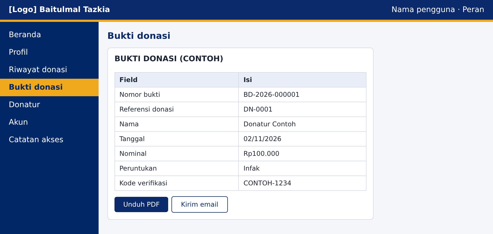

*Penerbitan bukti donasi*

| **Elemen**   | **Jenis** | **Perilaku**                                        |
|--------------|-----------|-----------------------------------------------------|
| Isi bukti    | Baca saja | Diambil dari data donasi; tidak dapat diubah manual |
| Unduh, Kirim | Tombol    | Lihat FR-ADBD-07                                    |

Pesan galat: “Bukti hanya untuk donasi berstatus Berhasil.”

### FR-ADBD-07 Unduh dan kirim bukti \[USULAN\]

| **Atribut** | **Isi**                                                                                                   |
|-------------|-----------------------------------------------------------------------------------------------------------|
| Prioritas   | Must                                                                                                      |
| Sumber      | Usulan tim                                                                                                |
| Aktor       | Donatur, petugas donasi                                                                                   |
| Deskripsi   | Bukti dapat diunduh sebagai PDF dan dikirim ke email donatur sesuai preferensi; status pengiriman dicatat |
| Task proses | T-05                                                                                                      |

**Alur**

- Prakondisi: bukti sudah terbit.

- Alur utama: (1) membuka bukti; (2) mengunduh PDF atau mengirim email.

- Alur alternatif: kirim ulang atas permintaan.

- Alur kegagalan: pengiriman gagal, status tidak menjadi Terkirim.

- Pascakondisi: donatur menerima bukti.

**Acceptance criteria**

- **Given** bukti Terbit, **When** donatur menekan Unduh PDF, **Then** berkas PDF terunduh.

- **Given** layanan email gagal, **When** bukti dikirim, **Then** status tidak menjadi Terkirim dan kegagalan dicatat.

**Mockup**

*Unduh dan kirim bukti*

| **Elemen**  | **Jenis** | **Perilaku**               |
|-------------|-----------|----------------------------|
| Unduh PDF   | Tombol    | Hanya pemilik atau petugas |
| Kirim email | Tombol    | Ke email terverifikasi     |

Pesan galat: “Pengiriman gagal, coba lagi.”

### FR-ADBD-08 Verifikasi keaslian bukti \[USULAN, kandidat CR-02\]

| **Atribut** | **Isi**                                                                                                                        |
|-------------|--------------------------------------------------------------------------------------------------------------------------------|
| Prioritas   | Could                                                                                                                          |
| Sumber      | Usulan tim                                                                                                                     |
| Aktor       | Penerima bukti                                                                                                                 |
| Deskripsi   | Siapa pun yang memiliki kode dapat memeriksa keabsahan; hasil hanya memuat status, nomor, tanggal, dan nominal tanpa identitas |
| Task proses | T-05                                                                                                                           |

**Alur**

- Prakondisi: memiliki kode verifikasi.

- Alur utama: (1) memasukkan kode; (2) sistem menampilkan ringkasan.

- Alur alternatif: bukti dibatalkan, tampil “Dibatalkan”.

- Alur kegagalan: kode tidak dikenal, “tidak ditemukan”.

- Pascakondisi: tidak ada data berubah.

**Acceptance criteria**

- **Given** kode sah, **When** dimasukkan, **Then** tampil “Sah” tanpa nama donatur.

- **Given** kode tidak dikenal, **When** dimasukkan, **Then** tampil “tidak ditemukan”.

**Mockup**

*Verifikasi keaslian bukti*

| **Elemen**      | **Jenis** | **Perilaku**          |
|-----------------|-----------|-----------------------|
| Kode verifikasi | Kolom     | 12 karakter           |
| Periksa         | Tombol    | Menampilkan ringkasan |

Pesan galat: “Kode verifikasi tidak valid.”

### FR-ADBD-09 Pembatasan akses menurut peran \[DRAF\]

| **Atribut** | **Isi**                                                                            |
|-------------|------------------------------------------------------------------------------------|
| Prioritas   | Must                                                                               |
| Sumber      | v0.2 NFR-001, BR-006                                                               |
| Aktor       | Semua peran                                                                        |
| Deskripsi   | Sistem membatasi data menurut peran dan kepemilikan, diterapkan terpusat di server |
| Task proses | T-01 sampai T-06                                                                   |

**Acceptance criteria**

- **Given** pengguna Donatur, **When** memanggil API kelola akun, **Then** server menolak 403.

- **Given** donatur A, **When** meminta bukti donatur B, **Then** ditolak.

**Mockup**

*Pembatasan akses menurut peran*

*Pembatasan akses menurut peran*

| **Elemen**            | **Jenis** | **Perilaku** |
|-----------------------|-----------|--------------|
| Menu samping          | Navigasi  | Sesuai peran |
| Halaman akses ditolak | Pesan     | Kode 403     |

Pesan galat: “Anda tidak berhak membuka halaman ini.”

### FR-ADBD-10 Pengelolaan akun dan peran \[DRAF\]

| **Atribut** | **Isi**                                                                                          |
|-------------|--------------------------------------------------------------------------------------------------|
| Prioritas   | Must                                                                                             |
| Sumber      | Usulan tim; v0.2 NFR-001                                                                         |
| Aktor       | Admin                                                                                            |
| Deskripsi   | Admin membuat akun internal, menonaktifkan akun, dan menetapkan peran. Login mengikuti FR Umum 1 |
| Task proses | T-01 sampai T-06                                                                                 |

**Alur**

- Prakondisi: berperan Admin.

- Alur utama: (1) membuat akun; (2) menetapkan peran; (3) menyimpan.

- Alur alternatif: Admin menonaktifkan akun.

- Alur kegagalan: non-Admin ditolak 403.

- Pascakondisi: akun tersimpan.

**Acceptance criteria**

- **Given** pengguna Admin, **When** membuat akun petugas unik, **Then** akun aktif tampil.

- **Given** akun dinonaktifkan, **When** pemiliknya login, **Then** ditolak.

- **Given** nama pengguna sudah dipakai, **When** Admin membuat akun, **Then** ditolak.

**Mockup**

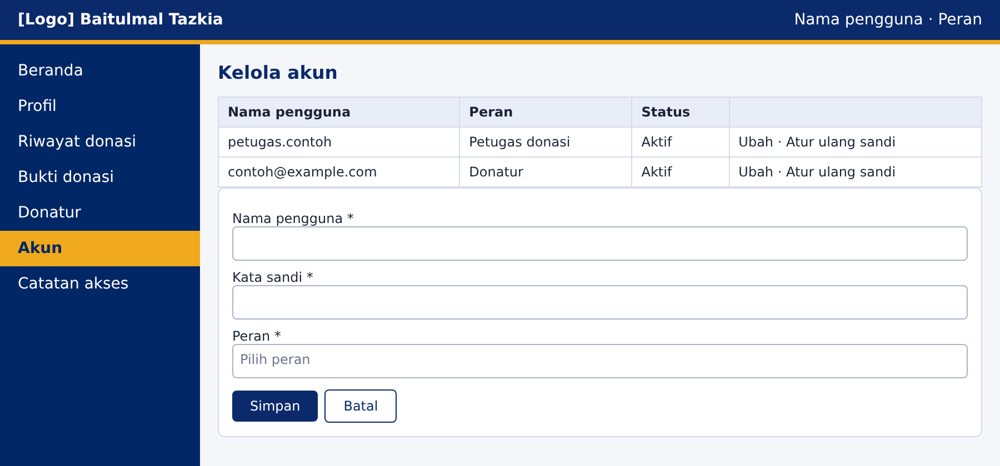

*Pengelolaan akun dan peran*

| **Elemen**             | **Jenis** | **Perilaku**        |
|------------------------|-----------|---------------------|
| Tabel akun             | Tabel     | Nama, peran, status |
| Akun baru              | Formulir  | Sesuai 3.1.1.2      |
| Ubah, Atur ulang sandi | Tautan    | Hanya Admin         |

Pesan galat: “Nama pengguna tidak valid atau sudah dipakai.”; “Kata sandi minimal 8 karakter.”; “Pilih peran.”

### FR-ADBD-11 Log akses data pribadi \[DUGAAN\]

| **Atribut** | **Isi**                                                                             |
|-------------|-------------------------------------------------------------------------------------|
| Prioritas   | Should                                                                              |
| Sumber      | v0.2 FR-011                                                                         |
| Aktor       | Admin                                                                               |
| Deskripsi   | Sistem mencatat siapa membuka atau mengubah data donatur atau bukti siapa dan kapan |
| Task proses | T-01 sampai T-06                                                                    |

**Alur**

- Prakondisi: berperan Admin.

- Alur utama: (1) membuka log; (2) menyaring; (3) sistem menampilkan siapa membuka data siapa dan kapan.

- Alur alternatif: hasil kosong.

- Alur kegagalan: non-Admin ditolak.

- Pascakondisi: log tidak dapat diubah.

**Acceptance criteria**

- **Given** petugas membuka profil donatur, **When** Admin membuka log, **Then** tercatat pengguna, donatur, dan waktu.

**Mockup**

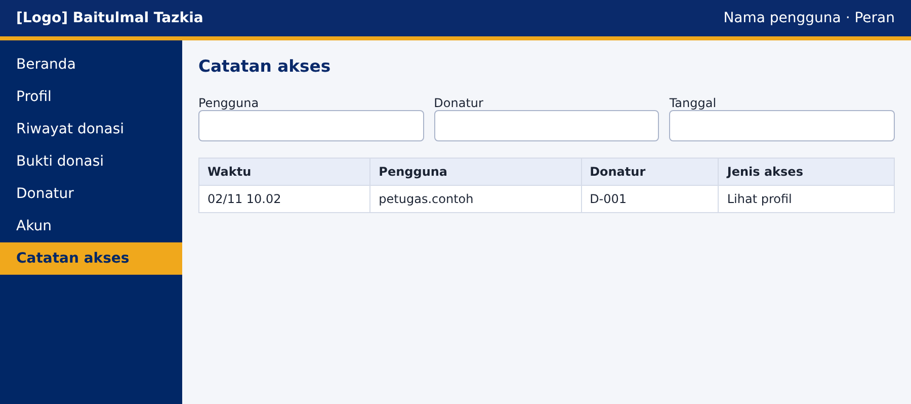

*Log akses data pribadi*

| **Elemen**    | **Jenis**        | **Perilaku**                    |
|---------------|------------------|---------------------------------|
| Filter        | Pilihan, rentang | Menyaring                       |
| Tabel catatan | Baca saja        | Tidak dapat diubah atau dihapus |

Pesan galat: “Tidak ada data.”

### FR-ADBD-12 Penyediaan data untuk proyek hilir \[DUGAAN\]

| **Atribut** | **Isi**                                                                                                        |
|-------------|----------------------------------------------------------------------------------------------------------------|
| Prioritas   | Should                                                                                                         |
| Sumber      | v0.2 FR-009                                                                                                    |
| Aktor       | Proyek 11, Proyek 10                                                                                           |
| Deskripsi   | Sistem menyediakan lewat API: data donatur dan preferensi (IF-02) serta jumlah donatur tanpa identitas (IF-03) |
| Task proses | T-01                                                                                                           |

**Alur**

- Prakondisi: kredensial sah.

- Alur utama: (1) proyek hilir memanggil API; (2) sistem mengembalikan data sesuai kontrak.

- Alur alternatif: tidak ada data, daftar kosong.

- Alur kegagalan: kredensial tidak sah, 401 atau 403.

- Pascakondisi: data diterima.

**Acceptance criteria**

- **Given** konsumen terotorisasi, **When** meminta data donatur, **Then** hanya atribut sesuai kontrak diterima.

- **Given** Proyek 10, **When** meminta rekap, **Then** tidak memuat nama atau kontak.

**Mockup.** Tidak berlaku: layanan data (API) tanpa layar.

## Persetujuan

| **Peran**                   | **Nama**      | **Tanda tangan** | **Tanggal** |
|-----------------------------|---------------|------------------|-------------|
| Narasumber Baitulmal Tazkia |               |                  |             |
| Business Analyst            | Eli Nur Aulia |                  |             |
| Project Manager             | Destri        |                  |             |
