# Software Requirements Specification (SRS)

Sistem Akun Donatur dan Bukti Donasi · Baitulmal Tazkia

**Table of Contents**

| **Item**            | **Isi**                                                                                                                                                    |
|---------------------|------------------------------------------------------------------------------------------------------------------------------------------------------------|
| Nomor dokumen       | SRS-ID-001, bagian Akun Donatur (nomor final: isi)                                                                                                         |
| Proyek              | Klaster Inti Donasi: Akun Donatur dan Bukti Donasi (pecahan dari SRS Penerimaan Donasi dan Akun Donatur)                                                   |
| Kelompok            | 2 (pasangan: Kelompok 1, Penerimaan Donasi)                                                                                                                |
| Project Manager     | Destri                                                                                                                                                     |
| Standar struktur    | ISO/IEC/IEEE 29148:2018, klausul 9.6 (isi SRS), sesuai workbook subbab 7.1; pemetaan bab di 5.5                                                            |
| Versi               | 0.3 (draf)                                                                                                                                                 |
| Tanggal dokumen     | 25 November 2026                                                                                                                                           |
| Penulis             | Eli Nur Aulia (Business Analyst)                                                                                                                           |
| Status              | DRAF. Belum ada sign-off narasumber. Butir bertanda **\[DUGAAN\]** belum dikonfirmasi klien; **\[DRAF\]** belum disetujui final; **\[USULAN\]** usulan tim |
| Sign-off narasumber | Belum (lihat 5.6)                                                                                                                                          |

**Urutan sumber yang berlaku.** Bila dua sumber bertentangan, yang menang adalah (1) notulen pertemuan dengan BMTZ, (2) workbook proyek, (3) dokumen terkait lainnya.

**Data sintetis.** Seluruh data pada contoh acceptance criteria dan mockup adalah data sintetis. Jangan memasukkan data donatur asli sebelum perjanjian pemrosesan data dan NDA ditandatangani.

## 1. Pendahuluan

### 1.1 Purpose (Tujuan)

Dokumen ini menetapkan kebutuhan perangkat lunak untuk subsistem **Akun Donatur dan Bukti Donasi** milik Baitulmal Tazkia (BMTZ). Subsistem ini membantu donatur mengelola akun, melihat riwayat donasi, dan memperoleh bukti donasi, tanpa mengubah pencatatan penerimaan donasi.

Sasaran pembaca dan bagian yang paling perlu dibaca:

| **Pembaca**                 | **Bagian utama**                             |
|-----------------------------|----------------------------------------------|
| Narasumber BMTZ             | 1.2, 1.3, 1.4, 1.5, 3.2.1, 5.6               |
| Pengembang                  | 3.1, 3.2, 3.5, 3.6, 3.8                      |
| Penguji dan Quality Control | Acceptance criteria di 3.2, Bab 4, 5.3 (RTM) |
| Penulis dokumentasi         | 1.3, 1.4, 3.2.1, 3.9                         |

### 1.2 Scope (Ruang Lingkup)

Nama produk: Sistem Akun Donatur dan Bukti Donasi.

**Konteks keseluruhan.** SRS ini adalah satu bagian dari SRS gabungan untuk BMTZ. Seluruh 12 proyek pada empat modul (1.3.2) termasuk ruang lingkup pengembangan. Setiap SRS proyek memuat **FR umum** (login, beranda setelah login, tabel, formulir input) dan **FR proyek**. SRS ini memuat FR umum dan 12 FR proyek (FR-ADBD-01 sampai FR-ADBD-12).

**Dalam lingkup proyek ini:**

- T-01 dan T-02: pendaftaran akun, pengelolaan data donatur, dan pemeriksaan data.

- T-03: penautan donasi ke akun donatur.

- T-04: penerbitan bukti donasi.

- T-05: pengunduhan dan pengiriman bukti donasi.

- T-06: riwayat donasi dan arsip bukti bagi donatur.

**Dalam lingkup proyek lain pada SRS gabungan.** Penerimaan dan pencatatan donasi dikerjakan Kelompok 1 pada SRS terpisah. Proyek ini mengambil data donasi lewat API. Proyek lain juga hanya bertukar data lewat API.

**Tetap manual:**

- Pemberian donasi oleh donatur lewat kanal.

- Keputusan petugas atas donasi yang tidak dapat dipastikan pemiliknya.

**Di luar lingkup** (tidak termasuk proyek mana pun):

- Pemrosesan pembayaran dan settlement.

- Bukti potong pajak resmi, kecuali BMTZ memintanya.

- Hal lain yang tidak termasuk dalam 12 proyek pada empat modul.

**Manfaat yang diharapkan \[DUGAAN\]:** bukti donasi cepat tersedia, arsip tertata, donatur dapat menelusuri donasinya, serta dukungan untuk pelaporan dan audit.

### 1.3 Product perspective (Perspektif Produk)

#### 1.3.1 Proses bisnis: kondisi sekarang (as-is) dan usulan (to-be) \[DUGAAN\]

Nama peran, urutan, dan jalur pengecualian belum dikonfirmasi pemilik proses; seluruh alur disusun tim tanpa wawancara. Kondisi sekarang digambar dengan notasi **BPMN 2.0** (draf), usulan dengan flowchart (garis putus-putus: kandidat change request). ID task T-01 sampai T-06 dipakai di RTM (5.3).

**Kondisi sekarang (as-is), BPMN 2.0:**

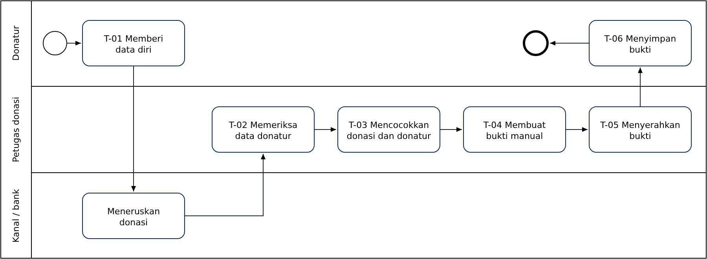

*Model BPMN 2.0 kondisi sekarang (draf)*

**Usulan (to-be), flowchart:**

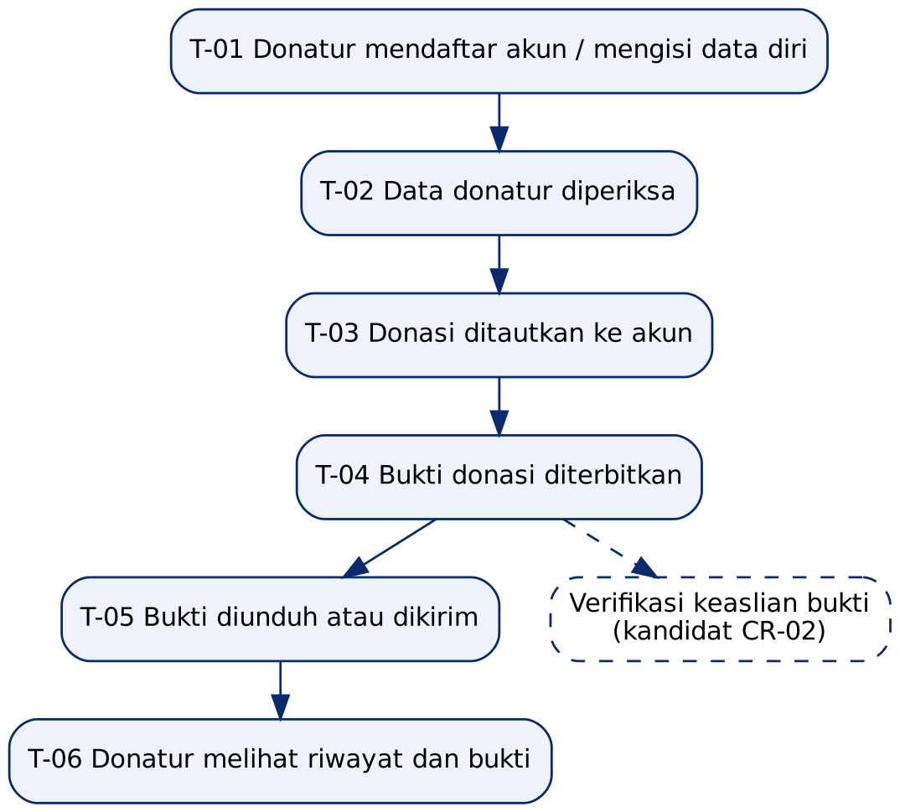

*Alur usulan (flowchart)*

| **ID** | **Task**                       | **Pelaksana (belum dikonfirmasi)** | **Kondisi sekarang**           | **Usulan**                                  | **Batas sistem**  |
|--------|--------------------------------|------------------------------------|--------------------------------|---------------------------------------------|-------------------|
| T-01   | Memberi data diri              | Donatur                            | Lewat petugas atau kanal       | Daftar akun dan isi profil sendiri          | Didukung          |
| T-02   | Memeriksa data donatur         | Petugas donasi                     | Pemeriksaan manual             | Validasi isian; petugas meninjau bila perlu | Didukung sebagian |
| T-03   | Mencocokkan donasi dan donatur | Petugas donasi                     | Pencocokan manual              | Tautan berdasarkan data terverifikasi       | Didukung (CR-01)  |
| T-04   | Membuat bukti donasi           | Petugas donasi                     | Dibuat manual                  | Diterbitkan dari data donasi                | Didukung (CR-01)  |
| T-05   | Menyerahkan bukti              | Petugas donasi                     | Diserahkan atau dikirim manual | Unduh atau kirim email                      | Didukung          |
| T-06   | Menyimpan bukti                | Donatur                            | Disimpan sendiri               | Arsip di akun                               | Didukung          |

Kondisi di lapangan belum diobservasi. Waktu siklus dan jumlah bukti per hari belum diukur.

#### 1.3.2 Posisi di antara proyek lain

Seluruh proyek dihimpun dalam satu SRS gabungan dan diarahkan menjadi satu aplikasi terpadu. Dua belas proyek dikelompokkan ke dalam empat modul:

| **Modul**                     | **Proyek**                                                                                                                                                          |
|-------------------------------|---------------------------------------------------------------------------------------------------------------------------------------------------------------------|
| 1\. Penghimpunan              | 1\. Penerimaan Donasi dan Akun (Kelompok 1: penerimaan donasi; Kelompok 2: akun donatur, SRS ini); 2. Manajemen Kampanye; 3. Kalkulator Zakat dan Kepatuhan Syariah |
| 2\. Kanal dan Operasional     | 4\. Donasi Berulang dan Kanal Pembayaran Digital; 6. Penerimaan Donasi Luring; 12. Relawan dan Operasional Acara                                                    |
| 3\. Keuangan dan Transparansi | 5\. Rekonsiliasi dan Settlement; 7. Pengelolaan Dana per Peruntukan; 10. Pelaporan Publik                                                                           |
| 4\. Penyaluran dan Donatur    | 8\. Pendataan Penerima Manfaat; 9. Penyaluran Bantuan; 11. Hubungan Donatur dan Komunikasi                                                                          |

Batas yang dipakai: pertukaran data lewat kontrak API, tanpa foreign key lintas proyek. Pemilik tampilan bersama dan pengelolaan akun lintas modul belum ditetapkan (AS-04).

| **Arah** | **Proyek**                           | **Data**                                                                       |
|----------|--------------------------------------|--------------------------------------------------------------------------------|
| Hulu     | Penerimaan Donasi (Kelompok 1)       | Referensi, nominal, waktu, kanal, status, peruntukan, data donatur pada donasi |
| Hilir    | 11\. Hubungan Donatur dan Komunikasi | Data donatur dan preferensi komunikasi                                         |
| Hilir    | 10\. Pelaporan Publik                | Jumlah donatur tanpa identitas                                                 |

### 1.4 Product functions (Fungsi Produk)

Selain empat FR umum (3.2.2), subsistem dibagi menjadi lima modul fungsional (M1 sampai M5).

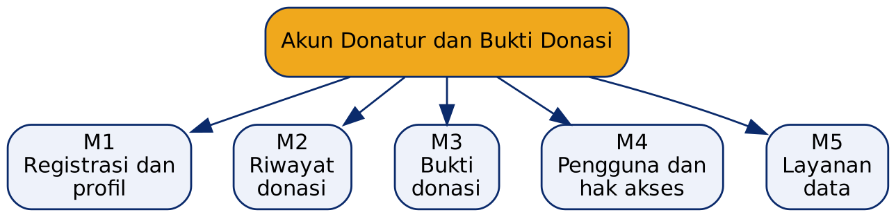

*Peta modul*

| **ID** | **Modul**                 | **Ringkasan fungsi**             | **Use case**  | **Kebutuhan**      |
|--------|---------------------------|----------------------------------|---------------|--------------------|
| M1     | Registrasi dan profil     | Akun, data diri, preferensi      | UC-01, 02, 03 | FR-ADBD-01, 02, 03 |
| M2     | Riwayat donasi            | Penautan dan riwayat             | UC-04, 05     | FR-ADBD-04, 05     |
| M3     | Bukti donasi              | Terbit, unduh, kirim, verifikasi | UC-06, 07, 08 | FR-ADBD-06, 07, 08 |
| M4     | Pengguna dan hak akses    | Peran, akun, log akses           | UC-09, 10, 11 | FR-ADBD-09, 10, 11 |
| M5     | Layanan data proyek hilir | API data donatur                 | UC-12         | FR-ADBD-12         |

### 1.5 User characteristics (Karakteristik Pengguna)

Disusun dari lane model as-is. Stakeholder register resmi belum tersedia.

| **Peran**               | **Tugas**                                          | **Data yang boleh dibuka** | **Perkiraan akun** | **Keahlian teknis** | **Status** |
|-------------------------|----------------------------------------------------|----------------------------|--------------------|---------------------|------------|
| Donatur                 | Mengelola akun, melihat riwayat dan bukti          | Datanya sendiri            | (isi)              | Beragam             | DUGAAN     |
| Petugas donasi          | Meninjau data, menautkan donasi, menerbitkan bukti | Donatur, donasi, bukti     | (isi)              | (isi)               | DUGAAN     |
| Admin                   | Mengelola akun, peran, log akses                   | Akun dan log               | (isi)              | (isi)               | DUGAAN     |
| Penerima bukti (publik) | Memeriksa keaslian bukti; tanpa akun               | Ringkasan bukti saja       | 0                  | Beragam             | USULAN     |

### 1.6 Limitations (Batasan)

- Pengembangan memakai data sintetis sampai perjanjian pemrosesan data dan kerahasiaan ditandatangani.

- Data identitas donatur dan riwayat donasi adalah data pribadi; data keuangan pribadi termasuk data pribadi spesifik menurut UU No. 27 Tahun 2022.

- Kredensial produksi tidak boleh masuk repository.

- Data subsistem lain hanya diakses lewat API.

- Ketentuan akses, bentuk bukti donasi, dan penyimpanan data belum ditetapkan BMTZ.

### 1.7 Assumptions and dependencies (Asumsi dan Ketergantungan)

| **ID** | **Asumsi atau ketergantungan**                                              | **Pemilik**        | **Tindakan bila tidak terpenuhi**                                          |
|--------|-----------------------------------------------------------------------------|--------------------|----------------------------------------------------------------------------|
| AS-01  | Subsistem Penerimaan Donasi menyediakan data donasi lewat API               | PM                 | M2 dan M3 ditunda; kontrak dirundingkan ulang                              |
| AS-02  | Donatur memiliki email aktif                                                | BA                 | Pengiriman lewat kanal lain diajukan sebagai CR                            |
| AS-03  | Akun tidak wajib untuk berdonasi                                            | BA                 | Pendaftaran menjadi bagian alur donasi; dibahas dengan kelompok penerimaan |
| AS-04  | Pemilik FR umum dan akun lintas modul belum ditetapkan                      | Tim penggabung SRS | Bagian 1.3.2, 3.1, DC-03 ditinjau ulang                                    |
| AS-05  | Bukti diterbitkan hanya untuk donasi berstatus Berhasil                     | PM, BA             | FR-ADBD-06 diubah                                                          |
| AS-06  | Perjanjian pemrosesan data dan NDA ditandatangani sebelum data asli dipakai | PM                 | Tetap data sintetis                                                        |

### 1.8 Apportioning of requirements (Prioritas Kebutuhan)

Prioritas memakai MoSCoW **\[USULAN\]**.

| **Prioritas**        | **Kebutuhan**                                                              |
|----------------------|----------------------------------------------------------------------------|
| Must                 | FR-ADBD-01, 02, 04, 05, 06, 07, 09, 10; NFR-S1, S2, S3, S4, S7, S8, U1, U2 |
| Should               | FR-ADBD-03, 11, 12; NFR-P1 sampai P4, S5, S9, U3                           |
| Could                | FR-ADBD-08 (kandidat CR-02); NFR-S6                                        |
| Won’t (semester ini) | Pembayaran; bukti potong pajak resmi                                       |

**Kebutuhan yang mengubah proses** dicatat sebagai kandidat change request di 5.4. FR-ADBD-04 dan 06 dimuat sebagai inti subsistem, tetapi berlaku setelah CR-01 disetujui.

### 1.9 Pembagian kebutuhan dari SRS gabungan

Pembagian antara Kelompok 1 dan Kelompok 2 adalah **\[USULAN\]** dan perlu disepakati kedua kelompok.

| **SRS v0.2**      | **Kebutuhan**                                 | **Pemilik** | **Di SRS ini**                            |
|-------------------|-----------------------------------------------|-------------|-------------------------------------------|
| FR-001 sampai 004 | Terima, validasi, referensi unik, cegah ganda | Kelompok 1  | Tidak dimuat; datanya dipakai lewat IF-01 |
| FR-005            | Identitas donatur                             | Kelompok 2  | FR-ADBD-01, 02                            |
| FR-006            | Donasi tanpa identitas                        | Kelompok 1  | Dampaknya pada FR-ADBD-04, 06             |
| FR-007            | Akun dan riwayat donasi                       | Kelompok 2  | FR-ADBD-04, 05                            |
| FR-008            | Preferensi anonimitas dan kanal               | Kelompok 2  | FR-ADBD-03                                |
| FR-009            | Data bagi subsistem terkait                   | Keduanya    | FR-ADBD-12                                |
| FR-010            | Kesalahan integrasi                           | Keduanya    | IF-01 sampai 04; NFR-S7                   |
| FR-011            | Aktivitas audit                               | Keduanya    | FR-ADBD-11                                |
| Baru              | Bukti donasi                                  | Kelompok 2  | FR-ADBD-06 sampai 08                      |

## 2. References (Referensi)

| **No.** | **Rujukan**                                                               | **Keterangan**                                 |
|---------|---------------------------------------------------------------------------|------------------------------------------------|
| 1       | SRS-ID-001 versi 0.2, Penerimaan Donasi dan Akun Donatur, 21 Oktober 2026 | **Acuan utama isi**                            |
| 2       | Workbook proyek, subbab 7.1                                               | Struktur SRS dan aturan (judul dan versi: isi) |
| 3       | ISO/IEC/IEEE 29148:2018                                                   | Kerangka isi                                   |
| 4       | UU No. 27 Tahun 2022 tentang Pelindungan Data Pribadi                     | Kepatuhan 3.7                                  |
| 5       | Catatan wawancara dan pertanyaan lanjutan                                 | **Belum tersedia**                             |
| 6       | BRS Akun Donatur dan Bukti Donasi                                         | Draf; kebutuhan bisnis                         |
| 7       | Model BPMN as-is                                                          | **Draf** (gambar di 1.3.1); belum divalidasi   |
| 8       | Stakeholder register                                                      | **Belum tersedia**                             |
| 9       | Peta ketergantungan antarproyek                                           | **Belum disepakati**                           |
| 10      | Contoh bukti donasi BMTZ                                                  | **Belum diterima**                             |
| 11      | Daftar 12 proyek dan empat modul                                          | 1.3.2                                          |
| 12      | Wireframe tampilan bersama                                                | Dasar FR umum                                  |

## 3. Specific requirements (Persyaratan Spesifik)

Kolom **Sumber** menunjuk ke pertemuan klien, workbook, atau elisitasi.

### 3.1 External interfaces (Antarmuka Eksternal)

#### 3.1.1 Antarmuka pengguna

Aplikasi web responsif yang terbaca pada telepon dan laptop. Layar utama per peran:

| **Peran**      | **Layar utama**                                 | **Isi**                    |
|----------------|-------------------------------------------------|----------------------------|
| Donatur        | Daftar akun, profil, preferensi, riwayat, bukti | Data milik sendiri         |
| Petugas donasi | Donasi belum tertaut, data donatur, bukti       | Donatur dan bukti          |
| Admin          | Kelola akun, catatan akses                      | Akun, peran, riwayat akses |

Kolom formulir utama (usulan awal):

| **Formulir** | **Kolom**                                     | **Wajib**                       |
|--------------|-----------------------------------------------|---------------------------------|
| Pendaftaran  | Nama, email, telepon, kata sandi, persetujuan | Nama, email, sandi, persetujuan |
| Profil       | Nama, email, telepon, alamat                  | Nama, email                     |
| Preferensi   | Anonim, cara kirim bukti, kabar program       | Anonim, cara kirim              |
| Penautan     | Referensi donasi, akun, alasan                | Semua                           |
| Bukti        | Referensi donasi                              | Referensi                       |

#### 3.1.1.1 Tema dan tampilan bersama \[USULAN\]

Seluruh mockup memakai kerangka yang sama: navy (#0A2A6B dan \#012766) dan emas (#F0A81C), logo BMTZ pada pojok kiri atas, menu samping, dan bilah atas dengan nama pengguna dan peran. Menu mockup disederhanakan ke lingkup proyek ini; menu final memuat Beranda dan empat modul sesuai peran. Gambar adalah wireframe usulan dengan data fiktif.

#### 3.1.1.2 Kamus data formulir \[USULAN\]

Seluruh panjang, rentang, dan format adalah usulan tim yang menunggu persetujuan BMTZ.

| **Formulir** | **Field**        | **Tipe data**    | **Panjang atau rentang**  | **Wajib** | **Format dan validasi**         | **Pesan galat**                                  |
|--------------|------------------|------------------|---------------------------|-----------|---------------------------------|--------------------------------------------------|
| Pendaftaran  | Nama lengkap     | Teks             | 1 sampai 100 karakter     | Ya        | Tidak kosong                    | “Nama wajib diisi”                               |
| Pendaftaran  | Email            | Teks             | Maks. 254                 | Ya        | Format email; unik              | “Email tidak valid atau sudah dipakai”           |
| Pendaftaran  | Nomor telepon    | Teks angka       | 8 sampai 15 digit         | Tidak     | Hanya angka                     | “Nomor telepon tidak valid”                      |
| Pendaftaran  | Kata sandi       | Teks tersembunyi | Minimal 8                 | Ya        | Disimpan sebagai hash           | “Kata sandi minimal 8 karakter”                  |
| Pendaftaran  | Persetujuan data | Centang          | \-                        | Ya        | Harus dicentang                 | “Persetujuan wajib diberikan”                    |
| Profil       | Alamat           | Teks             | Maks. 255                 | Tidak     | \-                              | “Alamat terlalu panjang”                         |
| Preferensi   | Anonim           | Pilihan          | Ya, tidak                 | Ya        | Default tidak                   | “Pilih preferensi anonim”                        |
| Preferensi   | Cara kirim bukti | Pilihan          | Email, unduh sendiri      | Ya        | Salah satu                      | “Pilih cara pengiriman”                          |
| Preferensi   | Kabar program    | Pilihan          | Ya, tidak                 | Tidak     | Default tidak                   | \-                                               |
| Penautan     | Referensi donasi | Teks             | Sesuai kontrak            | Ya        | Donasi ada                      | “Donasi tidak ditemukan”                         |
| Penautan     | Alasan           | Teks             | 1 sampai 500              | Ya        | Tidak kosong                    | “Alasan wajib diisi”                             |
| Verifikasi   | Kode verifikasi  | Teks             | Tepat 12 karakter         | Ya        | Huruf dan angka                 | “Kode verifikasi tidak valid”                    |
| Akun         | Nama pengguna    | Teks             | 4 sampai 30               | Ya        | Huruf kecil, angka, titik; unik | “Nama pengguna tidak valid atau sudah dipakai”   |
| Akun         | Peran            | Pilihan          | Petugas donasi, Admin     | Ya        | Salah satu                      | “Pilih peran”                                    |
| Akun         | Status           | Pilihan          | Aktif, nonaktif           | Ya        | Salah satu                      | “Pilih status akun”                              |
| Pencarian    | Periode          | Rentang tanggal  | Awal tidak melewati akhir | Tidak     | Tanggal sah                     | “Tanggal akhir tidak boleh sebelum tanggal awal” |

Donatur masuk memakai email sebagai nama pengguna pada layar login bersama.

#### 3.1.2 Antarmuka perangkat keras

Tidak ada perangkat keras khusus. Pengguna memakai ponsel atau laptop dengan peramban web modern.

#### 3.1.3 Antarmuka perangkat lunak (antarsubsistem)

Kontrak rinci ditetapkan di dokumen OpenAPI dan tidak disalin ke SRS.

| **ID** | **Pihak**                      | **Arah** | **Data yang diserahkan atau diterima**                                      | **Pemilik data**  | **Perkiraan volume** | **Batas waktu response** | **Status**    |
|--------|--------------------------------|----------|-----------------------------------------------------------------------------|-------------------|----------------------|--------------------------|---------------|
| IF-01  | Penerimaan Donasi (Kelompok 1) | Masuk    | Referensi, nominal, waktu, kanal, status, peruntukan, identitas pada donasi | Penerimaan Donasi | (isi)                | (isi)                    | MENUNGGU DATA |
| IF-02  | Hubungan Donatur (Proyek 11)   | Keluar   | ID donatur, nama, kontak, preferensi                                        | Subsistem ini     | (isi)                | (isi)                    | MENUNGGU DATA |
| IF-03  | Pelaporan Publik (Proyek 10)   | Keluar   | Jumlah donatur tanpa identitas                                              | Subsistem ini     | (isi)                | (isi)                    | MENUNGGU DATA |
| IF-04  | Layanan email                  | Keluar   | Alamat email dan berkas bukti                                               | Subsistem ini     | (isi)                | (isi)                    | USULAN        |

#### 3.1.4 Antarmuka komunikasi

Seluruh komunikasi klien-server dan antarsubsistem memakai HTTPS. Format pertukaran data API adalah JSON.

### 3.2 Functions (Persyaratan Fungsional)

#### 3.2.1 Model use case

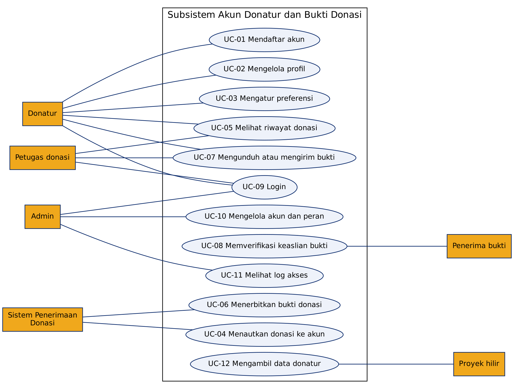

*Use case diagram*

| **ID** | **Use case**                  | **Aktor**        | **FR**         | **Task**   |
|--------|-------------------------------|------------------|----------------|------------|
| UC-01  | Mendaftar akun                | Donatur          | FR-ADBD-01     | T-01       |
| UC-02  | Mengelola profil              | Donatur          | FR-ADBD-02     | T-01, T-02 |
| UC-03  | Mengatur preferensi           | Donatur          | FR-ADBD-03     | T-01       |
| UC-04  | Menautkan donasi ke akun      | Sistem, petugas  | FR-ADBD-04     | T-03       |
| UC-05  | Melihat riwayat donasi        | Donatur, petugas | FR-ADBD-05     | T-06       |
| UC-06  | Menerbitkan bukti donasi      | Sistem, petugas  | FR-ADBD-06     | T-04       |
| UC-07  | Mengunduh atau mengirim bukti | Donatur, petugas | FR-ADBD-07     | T-05       |
| UC-08  | Memverifikasi keaslian bukti  | Penerima bukti   | FR-ADBD-08     | T-05       |
| UC-09  | Login                         | Semua peran      | FR Umum 1      | semua      |
| UC-10  | Mengelola akun dan peran      | Admin            | FR-ADBD-09, 10 | semua      |
| UC-11  | Melihat log akses             | Admin            | FR-ADBD-11     | semua      |
| UC-12  | Mengambil data donatur        | Proyek hilir     | FR-ADBD-12     | T-01       |

**Use case rinci** (alur utama, alternatif, kegagalan; seluruh alur **\[DUGAAN\]**).

**UC-01 Mendaftar akun**

- Prakondisi: belum punya akun.

- Alur utama: (1) donatur memilih “Daftar”; (2) mengisi data dan persetujuan; (3) sistem memvalidasi; (4) akun dibuat.

- Alur alternatif: donatur mendaftar tanpa nomor telepon.

- Alur kegagalan: email sudah dipakai atau kolom wajib kosong, sistem menolak.

- Pascakondisi: akun donatur aktif.

**UC-02 Mengelola profil**

- Prakondisi: donatur sudah login.

- Alur utama: (1) membuka profil; (2) mengubah data; (3) menyimpan.

- Alur alternatif: ganti email memerlukan verifikasi.

- Alur kegagalan: data tidak valid, sistem menolak.

- Pascakondisi: profil tersimpan.

**UC-03 Mengatur preferensi**

- Prakondisi: donatur sudah login.

- Alur utama: (1) membuka preferensi; (2) memilih; (3) menyimpan.

- Alur alternatif: tidak mengubah, default dipakai.

- Alur kegagalan: nilai tidak sah ditolak.

- Pascakondisi: preferensi tersimpan.

**UC-04 Menautkan donasi ke akun**

- Prakondisi: akun terverifikasi; data donasi tersedia.

- Alur utama: (1) sistem menerima data donasi; (2) mencocokkan email terverifikasi; (3) menautkan.

- Alur alternatif: tidak pasti, petugas meninjau dan memberi alasan.

- Alur kegagalan: donasi sudah tertaut ke akun lain, sistem menolak.

- Pascakondisi: donasi tertaut.

**UC-05 Melihat riwayat donasi**

- Prakondisi: pengguna sudah login.

- Alur utama: (1) membuka riwayat; (2) menyaring; (3) sistem menampilkan daftar dan total.

- Alur alternatif: belum ada donasi, tampil “tidak ada data”.

- Alur kegagalan: membuka data donatur lain, 403.

- Pascakondisi: riwayat tampil.

**UC-06 Menerbitkan bukti donasi**

- Prakondisi: donasi berstatus Berhasil.

- Alur utama: (1) sistem atau petugas memicu penerbitan; (2) sistem memberi nomor bukti; (3) menyimpan.

- Alur alternatif: donasi tanpa identitas, bukti beratas nama “Hamba Allah”.

- Alur kegagalan: status bukan Berhasil, ditolak.

- Pascakondisi: satu bukti tersimpan.

**UC-07 Mengunduh atau mengirim bukti**

- Prakondisi: bukti sudah terbit.

- Alur utama: (1) membuka bukti; (2) mengunduh PDF atau mengirim email.

- Alur alternatif: kirim ulang atas permintaan.

- Alur kegagalan: pengiriman gagal, status tidak menjadi Terkirim.

- Pascakondisi: donatur menerima bukti.

**UC-08 Memverifikasi keaslian bukti**

- Prakondisi: memiliki kode verifikasi.

- Alur utama: (1) memasukkan kode; (2) sistem menampilkan ringkasan.

- Alur alternatif: bukti dibatalkan, tampil “Dibatalkan”.

- Alur kegagalan: kode tidak dikenal, “tidak ditemukan”.

- Pascakondisi: tidak ada data berubah.

**UC-09 Login**

- Prakondisi: akun aktif.

- Alur utama: (1) memasukkan nama pengguna dan sandi; (2) verifikasi; (3) token diterbitkan; (4) layar sesuai peran.

- Alur alternatif: pengguna keluar.

- Alur kegagalan: sandi salah atau akun nonaktif, ditolak tanpa menyebut mana yang salah.

- Pascakondisi: sesi aktif.

**UC-10 Mengelola akun dan peran**

- Prakondisi: berperan Admin.

- Alur utama: (1) membuat akun; (2) menetapkan peran; (3) menyimpan.

- Alur alternatif: Admin menonaktifkan akun.

- Alur kegagalan: non-Admin ditolak 403.

- Pascakondisi: akun tersimpan.

**UC-11 Melihat log akses**

- Prakondisi: berperan Admin.

- Alur utama: (1) membuka log; (2) menyaring; (3) sistem menampilkan siapa membuka data siapa dan kapan.

- Alur alternatif: hasil kosong.

- Alur kegagalan: non-Admin ditolak.

- Pascakondisi: log tidak dapat diubah.

**UC-12 Mengambil data donatur**

- Prakondisi: kredensial sah.

- Alur utama: (1) proyek hilir memanggil API; (2) sistem mengembalikan data sesuai kontrak.

- Alur alternatif: tidak ada data, daftar kosong.

- Alur kegagalan: kredensial tidak sah, 401 atau 403.

- Pascakondisi: data diterima.

#### 3.2.2 Kebutuhan fungsional per modul

Setiap FR proyek dilengkapi mockup dan Test Scenario ringkas. Dokumen FR dan Test Scenario tersedia terpisah.

#### FR umum (dipakai bersama seluruh proyek)

Empat FR umum disepakati bersama para Business Analyst dan berlaku untuk seluruh proyek. FR umum **tidak memakai kode proyek**. Isi dan tampilan di bawah adalah usulan yang diselaraskan dengan wireframe tampilan bersama.

##### FR Umum 1: Layar login \[DRAF\]

| **Atribut** | **Isi**                                                                                                |
|-------------|--------------------------------------------------------------------------------------------------------|
| Prioritas   | Must                                                                                                   |
| Aktor       | Semua pengguna                                                                                         |
| Deskripsi   | Pengguna memasukkan nama pengguna dan kata sandi pada satu layar login yang sama untuk semua pengguna. |

**Mockup**

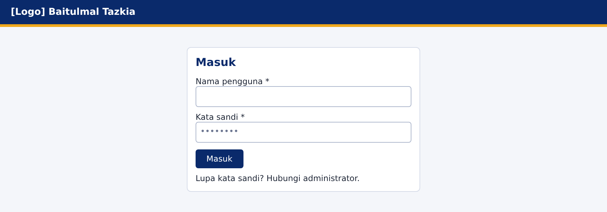

*Layar login*

| **Elemen**      | **Jenis**         | **Perilaku**                                 |
|-----------------|-------------------|----------------------------------------------|
| Nama pengguna   | Kolom teks        | Wajib                                        |
| Kata sandi      | Kolom tersembunyi | Wajib; tidak pernah ditampilkan              |
| Masuk           | Tombol            | Memeriksa akun; bila gagal tampil pesan umum |
| Lupa kata sandi | Teks              | Mengarahkan ke administrator                 |

Pesan galat: “Nama pengguna atau kata sandi salah.”

**Acceptance criteria**

- **Given** akun aktif dengan kata sandi benar, **When** pengguna menekan Masuk, **Then** sistem menerbitkan token berumur terbatas dan membuka beranda sesuai peran.

- **Given** akun yang dinonaktifkan, **When** pemilik akun menekan Masuk, **Then** sistem menolak login.

- **Given** kata sandi salah, **When** pengguna menekan Masuk, **Then** sistem menampilkan pesan umum tanpa menyebut bagian yang salah.

##### FR Umum 2: Beranda setelah login \[DRAF\]

| **Atribut** | **Isi**                                              |
|-------------|------------------------------------------------------|
| Prioritas   | Must                                                 |
| Aktor       | Semua pengguna                                       |
| Deskripsi   | Beranda memuat ringkasan dan menu sesuai peran akun. |

**Mockup**

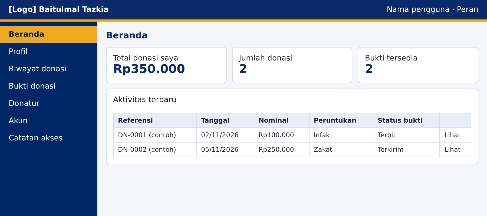

*Beranda*

| **Elemen**        | **Jenis** | **Perilaku**                        |
|-------------------|-----------|-------------------------------------|
| Menu samping      | Navigasi  | Hanya menu yang boleh dipakai peran |
| Kartu ringkasan   | Angka     | Menyesuaikan peran dan modul        |
| Aktivitas terbaru | Daftar    | Data sesuai hak akses               |
| Bilah atas        | Profil    | Nama dan peran; Keluar              |

**Acceptance criteria**

- **Given** pengguna berperan Donatur, **When** pengguna login, **Then** menu hanya memuat data miliknya.

- **Given** pengguna berperan Admin, **When** pengguna login, **Then** menu memuat kelola akun dan catatan akses.

##### FR Umum 3: Tampilan tabel \[DRAF\]

| **Atribut** | **Isi**                                                                                    |
|-------------|--------------------------------------------------------------------------------------------|
| Prioritas   | Must                                                                                       |
| Aktor       | Semua pengguna                                                                             |
| Deskripsi   | Tampilan standar daftar data: pencarian, saring, tambah data, tabel, status, dan paginasi. |

**Mockup**

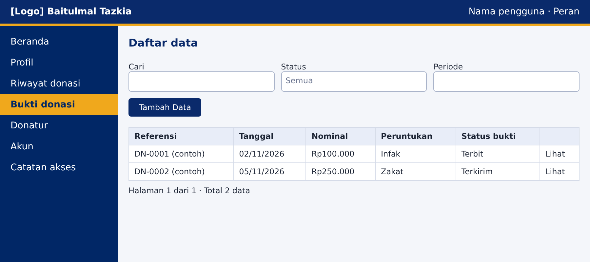

*Tampilan tabel*

| **Elemen**            | **Jenis**         | **Perilaku**                        |
|-----------------------|-------------------|-------------------------------------|
| Cari, Status, Periode | Kolom dan pilihan | Menyaring tabel                     |
| Tambah Data           | Tombol            | Membuka formulir                    |
| Tabel                 | Tabel             | Tampil “tidak ada data” bila kosong |
| Lihat, Ubah           | Tautan            | Hanya peran berhak                  |
| Paginasi              | Navigasi          | Berpindah halaman                   |

Pesan galat: “Tidak ada data.”

**Acceptance criteria**

- **Given** terdapat 48 data, **When** pengguna membuka tabel, **Then** sistem menampilkan enam data per halaman beserta jumlah total.

- **Given** filter tidak cocok, **When** pengguna menyaring, **Then** sistem menampilkan “tidak ada data”.

##### FR Umum 4: Tampilan formulir input \[DRAF\]

| **Atribut** | **Isi**                                                                                                           |
|-------------|-------------------------------------------------------------------------------------------------------------------|
| Prioritas   | Must                                                                                                              |
| Aktor       | Semua pengguna                                                                                                    |
| Deskripsi   | Tampilan standar mengisi data: kolom wajib bertanda bintang, pesan galat di bawah kolom, tombol Simpan dan Batal. |

**Mockup**

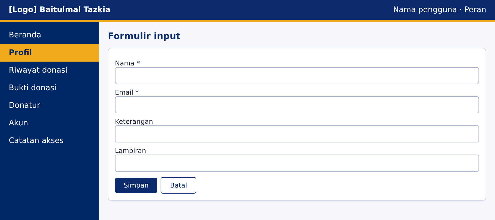

*Tampilan formulir input*

| **Elemen**           | **Jenis**              | **Perilaku**                    |
|----------------------|------------------------|---------------------------------|
| Kolom isian          | Teks, pilihan, tanggal | Wajib bertanda \*               |
| Keterangan, Lampiran | Teks, berkas           | Opsional                        |
| Simpan, Batal        | Tombol                 | Simpan memeriksa; Batal kembali |

Pesan galat: “Kolom wajib diisi.”

**Acceptance criteria**

- **Given** kolom wajib kosong, **When** pengguna menekan Simpan, **Then** sistem menolak dan menyebut kolom yang kurang.

- **Given** seluruh kolom valid, **When** pengguna menekan Simpan, **Then** sistem menyimpan dan kembali ke tabel.

#### Modul M1: Registrasi dan profil

##### FR-ADBD-01 Pendaftaran akun donatur \[DUGAAN\]

| **Atribut** | **Isi**                                                                                                                    |
|-------------|----------------------------------------------------------------------------------------------------------------------------|
| Prioritas   | Must                                                                                                                       |
| Sumber      | v0.2; usulan tim                                                                                                           |
| Aktor       | Donatur                                                                                                                    |
| Deskripsi   | Sistem membuat akun donatur dari nama, email, kata sandi, dan persetujuan penggunaan data; email diverifikasi lewat tautan |
| Task proses | T-01                                                                                                                       |

**Acceptance criteria**

- **Given** email belum terdaftar, **When** donatur mendaftar sebagai “Donatur Contoh”, **Then** akun dibuat dan tautan verifikasi dikirim.

- **Given** email sudah dipakai, **When** donatur mendaftar, **Then** sistem menolak.

- **Given** persetujuan tidak dicentang, **When** donatur menekan Daftar, **Then** sistem menolak.

**Mockup**

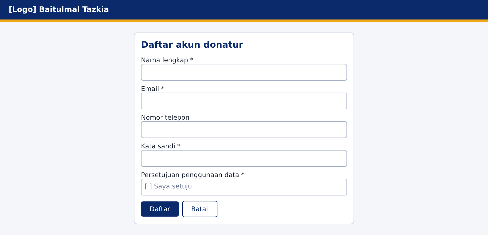

*Daftar akun*

| **Elemen**           | **Jenis**   | **Perilaku**               |
|----------------------|-------------|----------------------------|
| Nama, Email, Telepon | Kolom       | Nama dan email wajib       |
| Kata sandi           | Tersembunyi | Minimal 8                  |
| Persetujuan          | Centang     | Wajib                      |
| Daftar, Batal        | Tombol      | Memvalidasi lalu menyimpan |

Pesan galat: “Email tidak valid atau sudah dipakai.”; “Kata sandi minimal 8 karakter.”; “Persetujuan wajib diberikan.”

**Test Scenario ringkas** (TS-ADBD-01)

| **Teknik**           | **Skenario**                                         | **Hasil diharapkan**        |
|----------------------|------------------------------------------------------|-----------------------------|
| Benar (Right)        | Daftar dengan data lengkap                           | Akun dibuat                 |
| Benar (Right)        | Daftar tanpa nama                                    | Ditolak: “Nama wajib diisi” |
| Kebalikan (Inverse)  | Daftar lalu login                                    | Data profil sama            |
| Batas (Boundary)     | Kata sandi 7 karakter                                | Ditolak                     |
| Batas (Boundary)     | Kata sandi 8 karakter                                | Diterima                    |
| Batas (Boundary)     | Nama 101 karakter                                    | Ditolak                     |
| Silang (Cross-check) | Jumlah akun dibandingkan jumlah pendaftaran berhasil | Sama                        |

##### FR-ADBD-02 Pengelolaan profil donatur \[DUGAAN\]

| **Atribut** | **Isi**                                                             |
|-------------|---------------------------------------------------------------------|
| Prioritas   | Must                                                                |
| Sumber      | v0.2 FR-005                                                         |
| Aktor       | Donatur                                                             |
| Deskripsi   | Donatur melihat dan mengubah data yang disetujui; perubahan dicatat |
| Task proses | T-01, T-02                                                          |

**Acceptance criteria**

- **Given** donatur sudah login, **When** mengubah alamat dan menyimpan, **Then** perubahan tersimpan.

- **Given** email baru belum diverifikasi, **When** donatur menyimpan, **Then** email lama tetap berlaku.

**Mockup**

*Profil donatur*

| **Elemen**    | **Jenis** | **Perilaku**      |
|---------------|-----------|-------------------|
| Data diri     | Kolom     | Sesuai 3.1.1.2    |
| Simpan, Batal | Tombol    | Perubahan dicatat |

Pesan galat: “Nama wajib diisi.”; “Nomor telepon tidak valid.”

**Test Scenario ringkas** (TS-ADBD-02)

| **Teknik**           | **Skenario**                                  | **Hasil diharapkan**       |
|----------------------|-----------------------------------------------|----------------------------|
| Benar (Right)        | Ubah nomor telepon                            | Tersimpan                  |
| Benar (Right)        | Kosongkan nama                                | Ditolak                    |
| Kebalikan (Inverse)  | Simpan lalu buka kembali                      | Isi sama                   |
| Batas (Boundary)     | Telepon 7 digit                               | Ditolak                    |
| Batas (Boundary)     | Telepon 8 digit                               | Diterima                   |
| Batas (Boundary)     | Telepon 16 digit                              | Ditolak                    |
| Silang (Cross-check) | Data tersimpan dibandingkan atribut disetujui | Tidak ada atribut tambahan |

##### FR-ADBD-03 Preferensi anonimitas dan pengiriman \[DUGAAN\]

| **Atribut** | **Isi**                                                                                                                         |
|-------------|---------------------------------------------------------------------------------------------------------------------------------|
| Prioritas   | Should                                                                                                                          |
| Sumber      | v0.2 FR-008, BR-005                                                                                                             |
| Aktor       | Donatur                                                                                                                         |
| Deskripsi   | Sistem menyimpan preferensi anonim, cara kirim bukti, dan kabar program; anonim mengatur tampilan tanpa menghapus data internal |
| Task proses | T-01                                                                                                                            |

**Acceptance criteria**

- **Given** donatur memilih anonim, **When** namanya akan tampil pada daftar umum, **Then** tampil “Hamba Allah”.

- **Given** preferensi belum diisi, **When** sistem memakainya, **Then** default tidak anonim.

**Mockup**

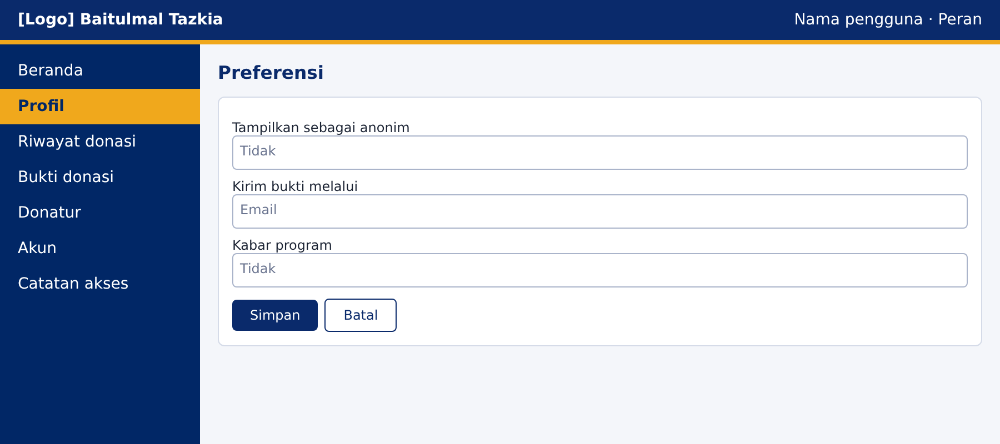

*Preferensi*

| **Elemen**                | **Jenis** | **Perilaku**         |
|---------------------------|-----------|----------------------|
| Anonim, Cara kirim, Kabar | Pilihan   | Default tidak anonim |
| Simpan, Batal             | Tombol    | Menyimpan preferensi |

Pesan galat: “Pilih preferensi anonim.”; “Pilih cara pengiriman.”

**Test Scenario ringkas** (TS-ADBD-03)

| **Teknik**           | **Skenario**                                           | **Hasil diharapkan**   |
|----------------------|--------------------------------------------------------|------------------------|
| Benar (Right)        | Aktifkan anonim                                        | Tersimpan              |
| Benar (Right)        | Kirim nilai di luar pilihan                            | Ditolak                |
| Kebalikan (Inverse)  | Nonaktifkan anonim                                     | Nama tampil kembali    |
| Batas (Boundary)     | Tanpa preferensi                                       | Default dipakai        |
| Batas (Boundary)     | Ubah dua kali berturut-turut                           | Nilai terakhir berlaku |
| Batas (Boundary)     | Kabar program kosong                                   | Dianggap tidak         |
| Silang (Cross-check) | Preferensi dibandingkan data yang dikirim ke Proyek 11 | Sama                   |

#### Modul M2: Riwayat donasi

##### FR-ADBD-04 Penautan donasi ke akun \[DUGAAN\]

| **Atribut** | **Isi**                                                                                                                                  |
|-------------|------------------------------------------------------------------------------------------------------------------------------------------|
| Prioritas   | Must                                                                                                                                     |
| Sumber      | v0.2 FR-007                                                                                                                              |
| Aktor       | Sistem, petugas donasi                                                                                                                   |
| Deskripsi   | Sistem menautkan donasi ke akun bila email terverifikasi sama; kasus tidak pasti ditinjau petugas; tidak menautkan berdasarkan nama saja |
| Task proses | T-03                                                                                                                                     |

**Acceptance criteria**

- **Given** donasi beremail sama dengan akun terverifikasi, **When** data diterima, **Then** donasi tertaut.

- **Given** hanya nama yang mirip, **When** data diterima, **Then** tidak ditautkan otomatis.

- **Given** petugas menautkan tanpa alasan, **When** menyimpan, **Then** sistem menolak.

**Mockup**

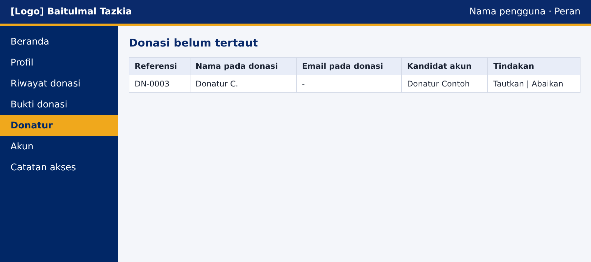

*Penautan donasi*

| **Elemen**           | **Jenis** | **Perilaku**  |
|----------------------|-----------|---------------|
| Daftar belum tertaut | Tabel     | Kandidat akun |
| Tautkan, Abaikan     | Tautan    | Alasan wajib  |

Pesan galat: “Donasi tidak ditemukan.”; “Alasan wajib diisi.”

**Test Scenario ringkas** (TS-ADBD-04)

| **Teknik**           | **Skenario**                            | **Hasil diharapkan**                 |
|----------------------|-----------------------------------------|--------------------------------------|
| Benar (Right)        | Email sama dan terverifikasi            | Tertaut                              |
| Benar (Right)        | Email belum terverifikasi               | Tidak tertaut                        |
| Kebalikan (Inverse)  | Tautan dibatalkan petugas               | Donasi hilang dari riwayat; tercatat |
| Batas (Boundary)     | Alasan kosong                           | Ditolak                              |
| Batas (Boundary)     | Alasan 1 karakter                       | Diterima                             |
| Batas (Boundary)     | Alasan 501 karakter                     | Ditolak                              |
| Silang (Cross-check) | Donasi tertaut dibandingkan data sumber | Pemilik sama                         |

##### FR-ADBD-05 Riwayat donasi \[DUGAAN\]

| **Atribut** | **Isi**                                                                                                      |
|-------------|--------------------------------------------------------------------------------------------------------------|
| Prioritas   | Must                                                                                                         |
| Sumber      | v0.2 FR-007, US-004                                                                                          |
| Aktor       | Donatur, petugas donasi                                                                                      |
| Deskripsi   | Sistem menampilkan donasi tertaut dengan filter periode dan peruntukan serta total donasi berstatus Berhasil |
| Task proses | T-06                                                                                                         |

**Acceptance criteria**

- **Given** donatur memiliki donasi Berhasil Rp100.000 dan Rp250.000, **When** membuka riwayat, **Then** tampil 2 donasi dan total Rp350.000.

- **Given** donatur A, **When** membuka riwayat donatur B, **Then** ditolak 403.

**Mockup**

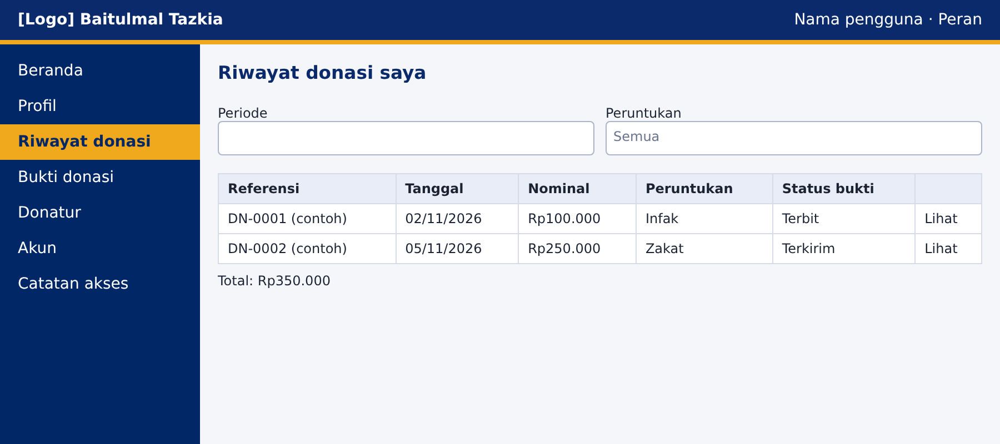

*Riwayat donasi*

| **Elemen**          | **Jenis** | **Perilaku**              |
|---------------------|-----------|---------------------------|
| Periode, Peruntukan | Filter    | Awal tidak melewati akhir |
| Tabel               | Baca saja | Donasi milik sendiri      |

Pesan galat: “Tanggal akhir tidak boleh sebelum tanggal awal.”; “Tidak ada data.”

**Test Scenario ringkas** (TS-ADBD-05)

| **Teknik**           | **Skenario**                              | **Hasil diharapkan**  |
|----------------------|-------------------------------------------|-----------------------|
| Benar (Right)        | Buka riwayat                              | Tampil donasi tertaut |
| Benar (Right)        | Buka riwayat orang lain                   | Ditolak               |
| Kebalikan (Inverse)  | Filter lalu kosongkan                     | Seluruh data kembali  |
| Batas (Boundary)     | Awal sama dengan akhir                    | Diterima              |
| Batas (Boundary)     | Akhir sebelum awal                        | Ditolak               |
| Batas (Boundary)     | Nol donasi                                | “Tidak ada data”      |
| Silang (Cross-check) | Total dibandingkan data Penerimaan Donasi | Sama                  |

#### Modul M3: Bukti donasi

##### FR-ADBD-06 Penerbitan bukti donasi \[USULAN\]

| **Atribut** | **Isi**                                                                                                                                                                                                                       |
|-------------|-------------------------------------------------------------------------------------------------------------------------------------------------------------------------------------------------------------------------------|
| Prioritas   | Must                                                                                                                                                                                                                          |
| Sumber      | Usulan tim (judul proyek)                                                                                                                                                                                                     |
| Aktor       | Sistem, petugas donasi                                                                                                                                                                                                        |
| Deskripsi   | Sistem menerbitkan satu bukti per donasi berstatus Berhasil, berisi nomor bukti unik, referensi, nama, tanggal, nominal, peruntukan, dan kode verifikasi. Bila donasi dibatalkan atau dikembalikan, bukti ditandai Dibatalkan |
| Task proses | T-04                                                                                                                                                                                                                          |

**Acceptance criteria**

- **Given** donasi Berhasil Rp100.000, **When** bukti diterbitkan, **Then** bukti memuat nomor unik dan nominal Rp100.000.

- **Given** donasi berstatus Menunggu, **When** penerbitan diminta, **Then** sistem menolak.

- **Given** bukti sudah ada, **When** penerbitan diminta lagi, **Then** bukti yang sama dikembalikan.

**Mockup**

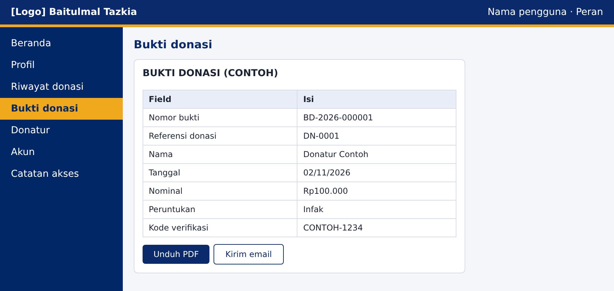

*Bukti donasi*

| **Elemen**   | **Jenis** | **Perilaku**                                        |
|--------------|-----------|-----------------------------------------------------|
| Isi bukti    | Baca saja | Diambil dari data donasi; tidak dapat diubah manual |
| Unduh, Kirim | Tombol    | Lihat FR-ADBD-07                                    |

Pesan galat: “Bukti hanya untuk donasi berstatus Berhasil.”

**Test Scenario ringkas** (TS-ADBD-06)

| **Teknik**           | **Skenario**                       | **Hasil diharapkan**     |
|----------------------|------------------------------------|--------------------------|
| Benar (Right)        | Terbitkan untuk donasi Berhasil    | Bukti dibuat             |
| Benar (Right)        | Terbitkan untuk donasi Gagal       | Ditolak                  |
| Kebalikan (Inverse)  | Donasi dikembalikan                | Bukti menjadi Dibatalkan |
| Batas (Boundary)     | Dua permintaan bersamaan           | Satu bukti               |
| Batas (Boundary)     | Nominal 1                          | Tampil benar             |
| Batas (Boundary)     | Nama 100 karakter                  | Tidak terpotong          |
| Silang (Cross-check) | Isi bukti dibandingkan data donasi | Sama persis              |

##### FR-ADBD-07 Unduh dan kirim bukti \[USULAN\]

| **Atribut** | **Isi**                                                                                                   |
|-------------|-----------------------------------------------------------------------------------------------------------|
| Prioritas   | Must                                                                                                      |
| Sumber      | Usulan tim                                                                                                |
| Aktor       | Donatur, petugas donasi                                                                                   |
| Deskripsi   | Bukti dapat diunduh sebagai PDF dan dikirim ke email donatur sesuai preferensi; status pengiriman dicatat |
| Task proses | T-05                                                                                                      |

**Acceptance criteria**

- **Given** bukti Terbit, **When** donatur menekan Unduh PDF, **Then** berkas PDF terunduh.

- **Given** layanan email gagal, **When** bukti dikirim, **Then** status tidak menjadi Terkirim dan kegagalan dicatat.

**Mockup**

*Bukti donasi*

| **Elemen**  | **Jenis** | **Perilaku**               |
|-------------|-----------|----------------------------|
| Unduh PDF   | Tombol    | Hanya pemilik atau petugas |
| Kirim email | Tombol    | Ke email terverifikasi     |

Pesan galat: “Pengiriman gagal, coba lagi.”

**Test Scenario ringkas** (TS-ADBD-07)

| **Teknik**           | **Skenario**                         | **Hasil diharapkan**        |
|----------------------|--------------------------------------|-----------------------------|
| Benar (Right)        | Kirim ke email terverifikasi         | Terkirim                    |
| Benar (Right)        | Donatur lain mengunduh               | Ditolak 403                 |
| Kebalikan (Inverse)  | Unduh lalu bandingkan                | Sama dengan tampilan        |
| Batas (Boundary)     | Tanpa email terverifikasi            | Hanya unduh                 |
| Batas (Boundary)     | Kirim ulang                          | Tercatat, nomor bukti sama  |
| Batas (Boundary)     | Percobaan ke-3 gagal \[USULAN\]      | Berhenti dan ditandai gagal |
| Silang (Cross-check) | Log kirim dibandingkan layanan email | Sama                        |

##### FR-ADBD-08 Verifikasi keaslian bukti \[USULAN, kandidat CR-02\]

| **Atribut** | **Isi**                                                                                                                        |
|-------------|--------------------------------------------------------------------------------------------------------------------------------|
| Prioritas   | Could                                                                                                                          |
| Sumber      | Usulan tim                                                                                                                     |
| Aktor       | Penerima bukti                                                                                                                 |
| Deskripsi   | Siapa pun yang memiliki kode dapat memeriksa keabsahan; hasil hanya memuat status, nomor, tanggal, dan nominal tanpa identitas |
| Task proses | T-05                                                                                                                           |

**Acceptance criteria**

- **Given** kode sah, **When** dimasukkan, **Then** tampil “Sah” tanpa nama donatur.

- **Given** kode tidak dikenal, **When** dimasukkan, **Then** tampil “tidak ditemukan”.

**Mockup**

*Verifikasi bukti*

| **Elemen**      | **Jenis** | **Perilaku**          |
|-----------------|-----------|-----------------------|
| Kode verifikasi | Kolom     | 12 karakter           |
| Periksa         | Tombol    | Menampilkan ringkasan |

Pesan galat: “Kode verifikasi tidak valid.”

**Test Scenario ringkas** (TS-ADBD-08)

| **Teknik**           | **Skenario**                    | **Hasil diharapkan** |
|----------------------|---------------------------------|----------------------|
| Benar (Right)        | Kode sah                        | “Sah”                |
| Benar (Right)        | Kode acak                       | “Tidak ditemukan”    |
| Kebalikan (Inverse)  | Bukti dibatalkan lalu diperiksa | “Dibatalkan”         |
| Batas (Boundary)     | 11 karakter                     | Ditolak              |
| Batas (Boundary)     | 12 karakter                     | Diproses             |
| Batas (Boundary)     | 13 karakter                     | Ditolak              |
| Silang (Cross-check) | Hasil dibandingkan data bukti   | Sama                 |

#### Modul M4: Pengguna, peran, dan hak akses

##### FR-ADBD-09 Pembatasan akses menurut peran \[DRAF\]

| **Atribut** | **Isi**                                                                            |
|-------------|------------------------------------------------------------------------------------|
| Prioritas   | Must                                                                               |
| Sumber      | v0.2 NFR-001, BR-006                                                               |
| Aktor       | Semua peran                                                                        |
| Deskripsi   | Sistem membatasi data menurut peran dan kepemilikan, diterapkan terpusat di server |
| Task proses | T-01 sampai T-06                                                                   |

**Acceptance criteria**

- **Given** pengguna Donatur, **When** memanggil API kelola akun, **Then** server menolak 403.

- **Given** donatur A, **When** meminta bukti donatur B, **Then** ditolak.

**Mockup**

*Beranda*

*Akses ditolak*

| **Elemen**            | **Jenis** | **Perilaku** |
|-----------------------|-----------|--------------|
| Menu samping          | Navigasi  | Sesuai peran |
| Halaman akses ditolak | Pesan     | Kode 403     |

Pesan galat: “Anda tidak berhak membuka halaman ini.”

**Test Scenario ringkas** (TS-ADBD-09)

| **Teknik**           | **Skenario**                              | **Hasil diharapkan** |
|----------------------|-------------------------------------------|----------------------|
| Benar (Right)        | Pemilik membuka datanya                   | Diizinkan            |
| Benar (Right)        | Non-Admin membuka kelola akun             | Ditolak              |
| Kebalikan (Inverse)  | Peran dicabut                             | Akses ditolak        |
| Batas (Boundary)     | Tanpa peran                               | Ditolak semua        |
| Batas (Boundary)     | Peran terendah mencoba tindakan tertinggi | Ditolak              |
| Batas (Boundary)     | Token kedaluwarsa                         | Diminta login        |
| Silang (Cross-check) | Matriks akses dibandingkan perilaku       | Sama                 |

##### FR-ADBD-10 Pengelolaan akun dan peran \[DRAF\]

| **Atribut** | **Isi**                                                                                          |
|-------------|--------------------------------------------------------------------------------------------------|
| Prioritas   | Must                                                                                             |
| Sumber      | Usulan tim; v0.2 NFR-001                                                                         |
| Aktor       | Admin                                                                                            |
| Deskripsi   | Admin membuat akun internal, menonaktifkan akun, dan menetapkan peran. Login mengikuti FR Umum 1 |
| Task proses | T-01 sampai T-06                                                                                 |

**Acceptance criteria**

- **Given** pengguna Admin, **When** membuat akun petugas unik, **Then** akun aktif tampil.

- **Given** akun dinonaktifkan, **When** pemiliknya login, **Then** ditolak.

- **Given** nama pengguna sudah dipakai, **When** Admin membuat akun, **Then** ditolak.

**Mockup**

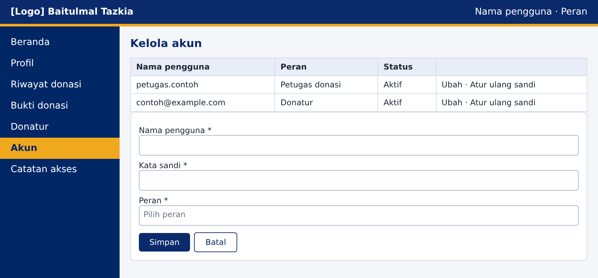

*Kelola akun*

| **Elemen**             | **Jenis** | **Perilaku**        |
|------------------------|-----------|---------------------|
| Tabel akun             | Tabel     | Nama, peran, status |
| Akun baru              | Formulir  | Sesuai 3.1.1.2      |
| Ubah, Atur ulang sandi | Tautan    | Hanya Admin         |

Pesan galat: “Nama pengguna tidak valid atau sudah dipakai.”; “Kata sandi minimal 8 karakter.”; “Pilih peran.”

**Test Scenario ringkas** (TS-ADBD-10)

| **Teknik**           | **Skenario**                                  | **Hasil diharapkan** |
|----------------------|-----------------------------------------------|----------------------|
| Benar (Right)        | Buat “petugas.contoh”                         | Akun aktif           |
| Benar (Right)        | Nama sama dibuat lagi                         | Ditolak              |
| Kebalikan (Inverse)  | Nonaktifkan lalu aktifkan                     | Dapat login          |
| Batas (Boundary)     | Nama pengguna 3 karakter                      | Ditolak              |
| Batas (Boundary)     | 4 karakter                                    | Diterima             |
| Batas (Boundary)     | 31 karakter                                   | Ditolak              |
| Silang (Cross-check) | Daftar akun dibandingkan daftar petugas resmi | Sama                 |

##### FR-ADBD-11 Log akses data pribadi \[DUGAAN\]

| **Atribut** | **Isi**                                                                             |
|-------------|-------------------------------------------------------------------------------------|
| Prioritas   | Should                                                                              |
| Sumber      | v0.2 FR-011                                                                         |
| Aktor       | Admin                                                                               |
| Deskripsi   | Sistem mencatat siapa membuka atau mengubah data donatur atau bukti siapa dan kapan |
| Task proses | T-01 sampai T-06                                                                    |

**Acceptance criteria**

- **Given** petugas membuka profil donatur, **When** Admin membuka log, **Then** tercatat pengguna, donatur, dan waktu.

**Mockup**

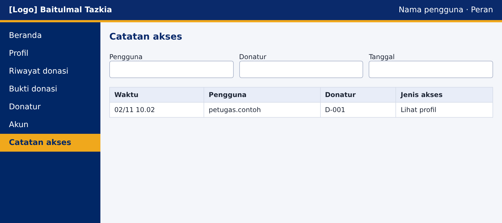

*Catatan akses*

| **Elemen**    | **Jenis**        | **Perilaku**                    |
|---------------|------------------|---------------------------------|
| Filter        | Pilihan, rentang | Menyaring                       |
| Tabel catatan | Baca saja        | Tidak dapat diubah atau dihapus |

Pesan galat: “Tidak ada data.”

**Test Scenario ringkas** (TS-ADBD-11)

| **Teknik**           | **Skenario**                             | **Hasil diharapkan** |
|----------------------|------------------------------------------|----------------------|
| Benar (Right)        | Buka profil lalu lihat log               | Tercatat             |
| Benar (Right)        | Non-Admin membuka log                    | Ditolak              |
| Kebalikan (Inverse)  | Cari satu akses                          | Ditemukan            |
| Batas (Boundary)     | Filter satu hari                         | Hanya hari itu       |
| Batas (Boundary)     | Nol catatan                              | “Tidak ada data”     |
| Batas (Boundary)     | Akhir sebelum awal                       | Ditolak              |
| Silang (Cross-check) | Jumlah log dibandingkan jumlah akses uji | Sama                 |

#### Modul M5: Layanan data untuk proyek hilir

##### FR-ADBD-12 Penyediaan data untuk proyek hilir \[DUGAAN\]

| **Atribut** | **Isi**                                                                                                        |
|-------------|----------------------------------------------------------------------------------------------------------------|
| Prioritas   | Should                                                                                                         |
| Sumber      | v0.2 FR-009                                                                                                    |
| Aktor       | Proyek 11, Proyek 10                                                                                           |
| Deskripsi   | Sistem menyediakan lewat API: data donatur dan preferensi (IF-02) serta jumlah donatur tanpa identitas (IF-03) |
| Task proses | T-01                                                                                                           |

**Acceptance criteria**

- **Given** konsumen terotorisasi, **When** meminta data donatur, **Then** hanya atribut sesuai kontrak diterima.

- **Given** Proyek 10, **When** meminta rekap, **Then** tidak memuat nama atau kontak.

**Mockup.** Tidak berlaku: FR ini berupa layanan data antarproyek (API) tanpa layar.

**Test Scenario ringkas** (TS-ADBD-12)

| **Teknik**           | **Skenario**                         | **Hasil diharapkan**           |
|----------------------|--------------------------------------|--------------------------------|
| Benar (Right)        | Ambil data donatur                   | Sesuai kontrak                 |
| Benar (Right)        | Kredensial salah                     | 401 atau 403                   |
| Kebalikan (Inverse)  | Data API dibandingkan sumber         | Sama                           |
| Batas (Boundary)     | Nol donatur                          | Daftar kosong                  |
| Batas (Boundary)     | Donatur menolak kabar program        | Ditandai tidak boleh dihubungi |
| Batas (Boundary)     | Periode awal sama dengan akhir       | Diterima                       |
| Silang (Cross-check) | Jumlah donatur dibandingkan aplikasi | Sama                           |

### 3.3 Usability requirements (Persyaratan Kegunaan)

| **ID** | **Kebutuhan**                          | **Ukuran**                                        | **Status** |
|--------|----------------------------------------|---------------------------------------------------|------------|
| NFR-U1 | Terbaca dan dapat dipakai pada telepon | Lebar minimal 360 px tanpa gulir horizontal       | USULAN     |
| NFR-U2 | Pesan galat menjelaskan perbaikan      | Setiap penolakan menyebut kolom dan alasan        | DUGAAN     |
| NFR-U3 | Donatur memperoleh bukti dengan mudah  | Dari login sampai unduh maksimal 2 menit saat UAT | USULAN     |

### 3.4 Performance requirements (Persyaratan Kinerja)

Angka diisi bersama klien.

| **ID** | **Kebutuhan**       | **Ukuran**                                                                    | **Status** |
|--------|---------------------|-------------------------------------------------------------------------------|------------|
| NFR-P1 | Kapasitas data      | 20.000 donatur dan 100.000 bukti                                              | USULAN     |
| NFR-P2 | Pengguna bersamaan  | 50 pengguna saat puncak                                                       | USULAN     |
| NFR-P3 | Waktu respons       | Halaman maksimal 3 detik; penerbitan bukti maksimal 5 detik pada beban NFR-P2 | USULAN     |
| NFR-P4 | Ukuran berkas bukti | PDF maksimal 500 KB                                                           | USULAN     |

### 3.5 Logical database requirements (Persyaratan Basis Data Logis)

Entitas utama. Rancangan skema dan ERD ditetapkan di dokumen perancangan dan tidak disalin ke SRS.

| **Entitas**      | **Isi utama**                               | **Memuat data pribadi** | **Masa simpan**   |
|------------------|---------------------------------------------|-------------------------|-------------------|
| Donatur          | Nama, email, telepon, alamat                | Ya                      | Menunggu BMTZ     |
| Akun, peran      | Nama pengguna, sandi (hash), peran, status  | Ya                      | Selama akun aktif |
| Preferensi       | Anonim, cara kirim, kabar program           | Ya                      | Mengikuti donatur |
| Persetujuan data | Waktu dan versi persetujuan                 | Ya                      | Menunggu BMTZ     |
| Tautan donasi    | ID donatur, referensi donasi, cara, alasan  | Tidak langsung          | Menunggu BMTZ     |
| Bukti donasi     | Nomor, referensi, salinan isi, kode, status | Ya                      | Menunggu BMTZ     |
| Log pengiriman   | Bukti, waktu, hasil                         | Tidak langsung          | Menunggu BMTZ     |
| Log akses        | Pengguna, donatur, waktu                    | Tidak langsung          | Menunggu BMTZ     |

Aturan: tidak ada foreign key lintas subsistem; referensi donasi disimpan sebagai nilai. Nomor kartu, PIN, dan OTP tidak disimpan.

**Kamus data entitas \[USULAN\]**

| **Entitas** | **Field**                    | **Tipe**      | **Wajib**     | **Aturan**                     |
|-------------|------------------------------|---------------|---------------|--------------------------------|
| Donatur     | donor_id                     | UUID          | Ya            | PK; dipakai bersama Kelompok 1 |
| Donatur     | name                         | VARCHAR(100)  | Ya            | Tidak kosong                   |
| Donatur     | email                        | VARCHAR(254)  | Ya untuk akun | Unik, format email             |
| Donatur     | phone                        | VARCHAR(15)   | Tidak         | 8 sampai 15 digit              |
| Akun        | account_id, donor_id         | UUID          | Ya            | Satu akun per donatur          |
| Akun        | password_hash, status        | VARCHAR, ENUM | Ya            | Aktif atau nonaktif            |
| Preferensi  | is_anonymous                 | BOOLEAN       | Ya            | Default false                  |
| Preferensi  | receipt_channel              | ENUM          | Ya            | Email atau unduh               |
| Tautan      | donor_id, donation_reference | UUID          | Ya            | Satu donasi satu pemilik       |
| Bukti       | receipt_number               | VARCHAR(30)   | Ya            | Unik                           |
| Bukti       | donation_reference           | UUID          | Ya            | Satu bukti per donasi          |
| Bukti       | verification_code            | CHAR(12)      | Ya            | Unik, acak                     |
| Bukti       | status                       | ENUM          | Ya            | Lihat 3.9.2                    |

#### 3.5.1 Aturan bisnis

| **ID** | **Aturan**                                                                                       | **Status**                  |
|--------|--------------------------------------------------------------------------------------------------|-----------------------------|
| BR-001 | Setiap catatan donasi sah memiliki referensi unik; subsistem ini merujuknya                      | Prinsip kebutuhan           |
| BR-004 | Identitas donatur diproses hanya bila tersedia, relevan, dan diizinkan                           | Perlu validasi kebijakan    |
| BR-005 | Preferensi anonim mengatur tampilan identitas dan tidak menghapus catatan internal               | Perlu validasi              |
| BR-006 | Akses data donatur dan donasi dibatasi menurut kewenangan                                        | Perlu matriks akses         |
| BR-007 | Status, pembatalan, pengembalian dana, dan peruntukan mengikuti sumber kebenaran yang disepakati | Belum disepakati lintas tim |
| BR-008 | Data sintetis dipakai sampai persetujuan pemrosesan data tersedia                                | Ketentuan proyek            |

### 3.6 Design constraints (Batasan Desain)

| **ID** | **Batasan**                                                                                 |
|--------|---------------------------------------------------------------------------------------------|
| DC-01  | Arsitektur berlapis (controller, service, repository) dengan aturan bisnis di service       |
| DC-02  | Kontrak API ditulis dalam OpenAPI dan diterbitkan sebelum struktur database dirancang bebas |
| DC-03  | Data subsistem lain hanya diakses lewat API                                                 |
| DC-04  | Pembatasan akses diterapkan di satu tempat terpusat                                         |
| DC-05  | Data sintetis sampai perjanjian pemrosesan data dan NDA ditandatangani                      |
| DC-06  | Bahasa pemrograman dan basis data belum ditentukan                                          |

### 3.7 Standards compliance (Kepatuhan pada Standar)

| **ID** | **Standar atau ketentuan**                                                            | **Dampak**                                     | **Status**             |
|--------|---------------------------------------------------------------------------------------|------------------------------------------------|------------------------|
| STD-01 | UU No. 27 Tahun 2022 tentang Pelindungan Data Pribadi                                 | Dasar NFR-S3: akses, log, persetujuan, retensi | Berlaku                |
| STD-02 | Ketentuan pengelolaan zakat, mis. UU No. 23 Tahun 2011 (termasuk bukti setoran zakat) | Isi bukti donasi zakat                         | **Perlu diverifikasi** |

### 3.8 Software system attributes (Atribut Sistem Perangkat Lunak)

| **ID** | **Atribut**  | **Kebutuhan**                                  | **Ukuran**                                      | **Status**    |
|--------|--------------|------------------------------------------------|-------------------------------------------------|---------------|
| NFR-S1 | Keamanan     | Sandi di-hash; token berumur terbatas          | Sandi minimal 8; sesi 8 jam                     | USULAN        |
| NFR-S2 | Keamanan     | Pembatasan akses diperiksa di server           | Permintaan tidak sah ditolak                    | DUGAAN        |
| NFR-S3 | Privasi      | Data donatur diperlakukan sebagai data pribadi | Hanya pemilik dan peran berwenang               | USULAN        |
| NFR-S4 | Keamanan     | Tidak ada kredensial di kode atau repository   | Pemindai rahasia lulus                          | DUGAAN        |
| NFR-S5 | Retensi      | Data dan bukti disimpan sesuai ketentuan BMTZ  | Menunggu angka                                  | MENUNGGU DATA |
| NFR-S6 | Ketersediaan | Layanan dapat diakses donatur                  | 99% per bulan                                   | USULAN        |
| NFR-S7 | Keandalan    | Operasi multi-tabel atomik                     | Uji integrasi lulus                             | DUGAAN        |
| NFR-S8 | Pemeliharaan | Dapat dijalankan dari dokumentasi              | Instalasi oleh orang luar tim berhasil          | DUGAAN        |
| NFR-S9 | Portabilitas | Peramban modern di ponsel dan laptop           | Dua versi terbaru Chrome, Edge, Firefox, Safari | USULAN        |

### 3.9 Supporting information (Informasi Pendukung)

#### 3.9.1 Contoh formulir dan dokumen klien

**Belum diterima.** Contoh bukti donasi dan formulir data donatur BMTZ. Hanya versi tanpa data pribadi yang dilampirkan.

#### 3.9.2 Status bukti donasi \[USULAN\]

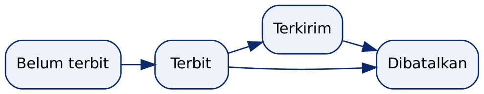

*Status bukti donasi*

#### 3.9.3 Dokumentasi untuk pengguna \[DRAF\]

| **Dokumen**                         | **Pembaca**             | **Isi**                            | **Format**      |
|-------------------------------------|-------------------------|------------------------------------|-----------------|
| Panduan pengguna per peran          | Donatur, petugas, Admin | Langkah kerja dan arti pesan galat | DOCX/PDF        |
| Panduan pemasangan dan pemeliharaan | Administrator BMTZ      | Pemasangan, pencadangan, pemulihan | DOCX/PDF        |
| Materi pelatihan                    | Pengguna internal       | Alur kerja dengan data sintetis    | Slide atau DOCX |

## 4. Verification (Verifikasi)

Metode: **T** = uji, **I** = inspeksi, **D** = demonstrasi bersama klien. Kasus uji per FR (TS-ADBD-01 sampai 12) memakai teknik RIGHT-BICEP, nilai batas, dan pemeriksaan silang.

| **ID**               | **Metode** | **Cara verifikasi**                          |
|----------------------|------------|----------------------------------------------|
| FR Umum 1 sampai 4   | T, D       | Uji empat tampilan bersama; demonstrasi UAT  |
| FR-ADBD-01 sampai 05 | T, D       | Uji integrasi per acceptance criteria        |
| FR-ADBD-06, 07       | T, D       | Uji dan demonstrasi bukti sintetis           |
| FR-ADBD-08           | T          | Diuji bila CR-02 disetujui                   |
| FR-ADBD-09, 10       | T          | Peran rendah memanggil endpoint peran tinggi |
| FR-ADBD-11           | T, I       | Uji dan inspeksi log                         |
| FR-ADBD-12           | T          | Uji kontrak OpenAPI                          |
| NFR-P1 sampai P4     | T          | Uji beban setelah angka disepakati           |
| NFR-S1, S4           | I          | Inspeksi kode dan pemindai rahasia           |
| NFR-S2, S7           | T          | Uji integrasi                                |
| NFR-S3               | I, D       | Inspeksi akses; demonstrasi                  |
| NFR-U1, U2           | T, D       | Uji layar telepon; UAT                       |

## 5. Appendices (Lampiran)

### 5.1 Glosarium istilah domain

| **Istilah**      | **Arti**                                           |
|------------------|----------------------------------------------------|
| BMTZ             | Baitulmal Tazkia                                   |
| Donatur / muzaki | Pihak yang menyalurkan dana                        |
| Bukti donasi     | Dokumen digital tanda donasi diterima              |
| Penautan         | Menghubungkan donasi dengan akun donatur           |
| Peruntukan       | Tujuan penggunaan dana                             |
| FR umum          | Kebutuhan bersama: login, beranda, tabel, formulir |
| Modul            | Pengelompokan proyek pada aplikasi terpadu         |
| Proyek           | Satu dari 12 proyek pada SRS gabungan              |

### 5.2 Akronim dan singkatan

BRS, SRS, FR, NFR, RTM, BPMN, API, UAT, ADR, MoSCoW (Must, Should, Could, Won’t), PIC, CR (change request), UU PDP.

### 5.3 Requirements Traceability Matrix (RTM)

Penelusuran dua arah: kebutuhan, task proses, rancangan, uji.

| **ID**             | **Modul** | **MoSCoW** | **Sumber**       | **Task proses**  | **Elemen rancangan** | **Kasus uji**     | **Status**      |
|--------------------|-----------|------------|------------------|------------------|----------------------|-------------------|-----------------|
| FR Umum 1 sampai 4 | Umum      | Must       | Kesepakatan BA   | Semua            | Tampilan bersama     | AC FR Umum        | Draf            |
| FR-ADBD-01         | M1        | Must       | Usulan tim       | T-01             | M1; UC-01            | AC FR-ADBD-01 (3) | Draf            |
| FR-ADBD-02         | M1        | Must       | v0.2 FR-005      | T-01, T-02       | M1; UC-02            | AC FR-ADBD-02 (2) | Draf            |
| FR-ADBD-03         | M1        | Should     | v0.2 FR-008      | T-01             | M1; UC-03            | AC FR-ADBD-03 (2) | Draf            |
| FR-ADBD-04         | M2        | Must       | v0.2 FR-007      | T-03             | M2; UC-04            | AC FR-ADBD-04 (3) | Draf            |
| FR-ADBD-05         | M2        | Must       | v0.2 FR-007      | T-06             | M2; UC-05            | AC FR-ADBD-05 (2) | Draf            |
| FR-ADBD-06         | M3        | Must       | Usulan tim       | T-04             | M3; UC-06            | AC FR-ADBD-06 (3) | Draf            |
| FR-ADBD-07         | M3        | Must       | Usulan tim       | T-05             | M3; UC-07            | AC FR-ADBD-07 (2) | Draf            |
| FR-ADBD-08         | M3        | Could      | Usulan tim       | T-05             | M3; UC-08            | AC FR-ADBD-08 (2) | Ditahan (CR-02) |
| FR-ADBD-09         | M4        | Must       | v0.2 NFR-001     | T-01 sampai T-06 | M4; UC-10            | AC FR-ADBD-09 (2) | Draf            |
| FR-ADBD-10         | M4        | Must       | v0.2 NFR-001     | T-01 sampai T-06 | M4; UC-10            | AC FR-ADBD-10 (3) | Draf            |
| FR-ADBD-11         | M4        | Should     | v0.2 FR-011      | T-01 sampai T-06 | M4; UC-11            | AC FR-ADBD-11 (1) | Draf            |
| FR-ADBD-12         | M5        | Should     | v0.2 FR-009      | T-01             | M5; UC-12            | AC FR-ADBD-12 (2) | Draf            |
| NFR-U1             | Lintas    | Must       | Usulan tim; v0.2 | T-01 sampai T-06 | Dokumen perancangan  | Test plan         | Usulan          |
| NFR-U2             | Lintas    | Must       | Usulan tim; v0.2 | T-01 sampai T-06 | Dokumen perancangan  | Test plan         | Usulan          |
| NFR-U3             | Lintas    | Should     | Usulan tim; v0.2 | T-01 sampai T-06 | Dokumen perancangan  | Test plan         | Usulan          |
| NFR-P1             | Lintas    | Should     | Usulan tim; v0.2 | T-01 sampai T-06 | Dokumen perancangan  | Test plan         | Usulan          |
| NFR-P2             | Lintas    | Should     | Usulan tim; v0.2 | T-01 sampai T-06 | Dokumen perancangan  | Test plan         | Usulan          |
| NFR-P3             | Lintas    | Should     | Usulan tim; v0.2 | T-01 sampai T-06 | Dokumen perancangan  | Test plan         | Usulan          |
| NFR-P4             | Lintas    | Should     | Usulan tim; v0.2 | T-01 sampai T-06 | Dokumen perancangan  | Test plan         | Usulan          |
| NFR-S1             | Lintas    | Must       | Usulan tim; v0.2 | T-01 sampai T-06 | Dokumen perancangan  | Test plan         | Usulan          |
| NFR-S2             | Lintas    | Must       | Usulan tim; v0.2 | T-01 sampai T-06 | Dokumen perancangan  | Test plan         | Usulan          |
| NFR-S3             | Lintas    | Must       | Usulan tim; v0.2 | T-01 sampai T-06 | Dokumen perancangan  | Test plan         | Usulan          |
| NFR-S4             | Lintas    | Must       | Usulan tim; v0.2 | T-01 sampai T-06 | Dokumen perancangan  | Test plan         | Usulan          |
| NFR-S5             | Lintas    | Should     | Usulan tim; v0.2 | T-01 sampai T-06 | Dokumen perancangan  | Test plan         | Usulan          |
| NFR-S6             | Lintas    | Could      | Usulan tim; v0.2 | T-01 sampai T-06 | Dokumen perancangan  | Test plan         | Usulan          |
| NFR-S7             | Lintas    | Must       | Usulan tim; v0.2 | T-01 sampai T-06 | Dokumen perancangan  | Test plan         | Usulan          |
| NFR-S8             | Lintas    | Must       | Usulan tim; v0.2 | T-01 sampai T-06 | Dokumen perancangan  | Test plan         | Usulan          |
| NFR-S9             | Lintas    | Should     | Usulan tim; v0.2 | T-01 sampai T-06 | Dokumen perancangan  | Test plan         | Usulan          |

#### 5.3.1 Pemetaan FR ke Fitur (dokumen klien)

Dokumen untuk BMTZ memakai nama “Fitur 01” dan seterusnya. Rincian ada di dokumen FR dan Test Scenario.

| **Fitur (dokumen klien)** | **FR (SRS)** | **Nama**                             | **Dokumen FR** | **Test Scenario** |
|---------------------------|--------------|--------------------------------------|----------------|-------------------|
| Fitur 01                  | FR-ADBD-01   | Pendaftaran akun donatur             | FR-ADBD-01     | TS-ADBD-01        |
| Fitur 02                  | FR-ADBD-02   | Pengelolaan profil donatur           | FR-ADBD-02     | TS-ADBD-02        |
| Fitur 03                  | FR-ADBD-04   | Penautan donasi ke akun              | FR-ADBD-04     | TS-ADBD-04        |
| Fitur 04                  | FR-ADBD-05   | Riwayat donasi                       | FR-ADBD-05     | TS-ADBD-05        |
| Fitur 05                  | FR-ADBD-06   | Penerbitan bukti donasi              | FR-ADBD-06     | TS-ADBD-06        |
| Fitur 06                  | FR-ADBD-07   | Unduh dan kirim bukti                | FR-ADBD-07     | TS-ADBD-07        |
| Fitur 07                  | FR-ADBD-09   | Pembatasan akses menurut peran       | FR-ADBD-09     | TS-ADBD-09        |
| Fitur 08                  | FR-ADBD-10   | Pengelolaan akun dan peran           | FR-ADBD-10     | TS-ADBD-10        |
| Fitur 09                  | FR-ADBD-03   | Preferensi anonimitas dan pengiriman | FR-ADBD-03     | TS-ADBD-03        |
| Fitur 10                  | FR-ADBD-11   | Log akses data pribadi               | FR-ADBD-11     | TS-ADBD-11        |
| Fitur 11                  | FR-ADBD-12   | Penyediaan data untuk proyek hilir   | FR-ADBD-12     | TS-ADBD-12        |
| Fitur 12                  | FR-ADBD-08   | Verifikasi keaslian bukti            | FR-ADBD-08     | TS-ADBD-08        |

### 5.4 Kandidat change request

| **ID** | **Usulan**                             | **Task terdampak** | **Perubahan**                              | **Bottleneck atau waste yang dihilangkan** | **Status** |
|--------|----------------------------------------|--------------------|--------------------------------------------|--------------------------------------------|------------|
| CR-01  | Penautan dan penerbitan bukti otomatis | T-03, T-04         | Pelaksana berpindah dari petugas ke sistem | Belum terukur (dugaan: pekerjaan manual)   | Diusulkan  |
| CR-02  | Verifikasi keaslian bukti (FR-ADBD-08) | T-05               | Menambah task verifikasi                   | Belum terukur                              | Diusulkan  |

### 5.5 Pemetaan ke ISO/IEC/IEEE 29148

| **Klausul 29148 (isi SRS, klausul 9.6)** | **Bab pada SRS ini** |
|------------------------------------------|----------------------|
| 9.6.1 Pendahuluan                        | Bab 1                |
| 9.6.2 Rujukan                            | Bab 2                |
| 9.6.3 Persyaratan spesifik               | Bab 3                |
| 9.6.4 Verifikasi                         | Bab 4                |
| 9.6.5 Lampiran                           | Bab 5                |

Tambahan di luar kerangka standar: FR umum, mockup dan Test Scenario ringkas per FR, dan pemetaan FR ke fitur (5.3.1).

### 5.6 Persetujuan

Setelah ditandatangani, perubahan SRS melewati prosedur change control.

| **Peran**                   | **Nama**      | **Tanda tangan** | **Tanggal** |
|-----------------------------|---------------|------------------|-------------|
| Narasumber Baitulmal Tazkia |               |                  |             |
| Business Analyst            | Eli Nur Aulia |                  |             |
| Project Manager             | Destri        |                  |             |

### 5.7 User story

| **ID** | **User story**                                                                                        | **FR**     |
|--------|-------------------------------------------------------------------------------------------------------|------------|
| US-004 | Sebagai pengguna berwenang, saya ingin melihat riwayat donasi yang terkait akun agar dapat ditelusuri | FR-ADBD-05 |
| US-005 | Sebagai pemilik proses, saya ingin aktivitas penting tercatat agar dapat diaudit                      | FR-ADBD-11 |

### 5.8 Keputusan terbuka

| **ID** | **Pertanyaan**                               | **Dampak bila belum diputuskan** |
|--------|----------------------------------------------|----------------------------------|
| OD-001 | Apakah akun wajib untuk semua donasi?        | FR-ADBD-01, 04, antarmuka        |
| OD-002 | Apa atribut minimum identitas donatur?       | Validasi, privasi, pencocokan    |
| OD-007 | Target kinerja, ketersediaan, retensi log?   | Pengujian kualitas               |
| OD-008 | Kebijakan anonimitas dan akses data pribadi? | Risiko privasi dan tampilan      |
| OD-010 | Apakah portal donatur masuk rilis pertama?   | Seluruh layar donatur            |
| OD-011 | Retensi, penghapusan, koreksi, backup?       | Data tidak terkelola             |
| OD-012 | Siapa pemilik proses yang memvalidasi?       | Kebutuhan belum dapat disahkan   |

### 5.9 Risiko utama

| **ID** | **Risiko**                                     | **Mitigasi**                                       |
|--------|------------------------------------------------|----------------------------------------------------|
| R-001  | As-is belum tervalidasi                        | Wawancara, observasi, validasi pemilik proses      |
| R-002  | Kontrak API dengan Kelompok 1 belum disepakati | Tetapkan pemilik data, skema, status, galat, versi |
| R-003  | Kebijakan data pribadi belum lengkap           | Validasi atribut, tujuan, akses, retensi           |
| R-004  | Target kualitas belum terukur                  | Sepakati angka sebelum acceptance test             |
| R-005  | Batas rilis belum final                        | Tetapkan lingkup dan MoSCoW                        |
