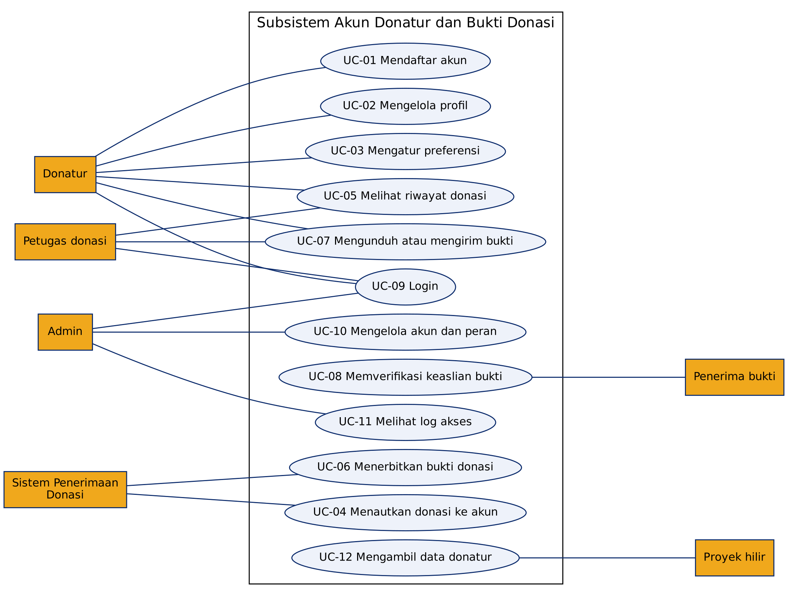

# Use Case Lengkap · Akun Donatur dan Bukti Donasi

Kelompok 2 · Business Analyst: Eli Nur Aulia · Project Manager: Destri · Status: draf

## Model use case

*Use case diagram*

| **ID** | **Use case**                  | **Aktor**        | **FR**         | **Task**   |
|--------|-------------------------------|------------------|----------------|------------|
| UC-01  | Mendaftar akun                | Donatur          | FR-ADBD-01     | T-01       |
| UC-02  | Mengelola profil              | Donatur          | FR-ADBD-02     | T-01, T-02 |
| UC-03  | Mengatur preferensi           | Donatur          | FR-ADBD-03     | T-01       |
| UC-04  | Menautkan donasi ke akun      | Sistem, petugas  | FR-ADBD-04     | T-03       |
| UC-05  | Melihat riwayat donasi        | Donatur, petugas | FR-ADBD-05     | T-06       |
| UC-06  | Menerbitkan bukti donasi      | Sistem, petugas  | FR-ADBD-06     | T-04       |
| UC-07  | Mengunduh atau mengirim bukti | Donatur, petugas | FR-ADBD-07     | T-05       |
| UC-08  | Memverifikasi keaslian bukti  | Penerima bukti   | FR-ADBD-08     | T-05       |
| UC-09  | Login                         | Semua peran      | FR Umum 1      | semua      |
| UC-10  | Mengelola akun dan peran      | Admin            | FR-ADBD-09, 10 | semua      |
| UC-11  | Melihat log akses             | Admin            | FR-ADBD-11     | semua      |
| UC-12  | Mengambil data donatur        | Proyek hilir     | FR-ADBD-12     | T-01       |

**Use case rinci** (alur utama, alternatif, kegagalan; seluruh alur **\[DUGAAN\]**).

**UC-01 Mendaftar akun**

- Prakondisi: belum punya akun.

- Alur utama: (1) donatur memilih “Daftar”; (2) mengisi data dan persetujuan; (3) sistem memvalidasi; (4) akun dibuat.

- Alur alternatif: donatur mendaftar tanpa nomor telepon.

- Alur kegagalan: email sudah dipakai atau kolom wajib kosong, sistem menolak.

- Pascakondisi: akun donatur aktif.

**UC-02 Mengelola profil**

- Prakondisi: donatur sudah login.

- Alur utama: (1) membuka profil; (2) mengubah data; (3) menyimpan.

- Alur alternatif: ganti email memerlukan verifikasi.

- Alur kegagalan: data tidak valid, sistem menolak.

- Pascakondisi: profil tersimpan.

**UC-03 Mengatur preferensi**

- Prakondisi: donatur sudah login.

- Alur utama: (1) membuka preferensi; (2) memilih; (3) menyimpan.

- Alur alternatif: tidak mengubah, default dipakai.

- Alur kegagalan: nilai tidak sah ditolak.

- Pascakondisi: preferensi tersimpan.

**UC-04 Menautkan donasi ke akun**

- Prakondisi: akun terverifikasi; data donasi tersedia.

- Alur utama: (1) sistem menerima data donasi; (2) mencocokkan email terverifikasi; (3) menautkan.

- Alur alternatif: tidak pasti, petugas meninjau dan memberi alasan.

- Alur kegagalan: donasi sudah tertaut ke akun lain, sistem menolak.

- Pascakondisi: donasi tertaut.

**UC-05 Melihat riwayat donasi**

- Prakondisi: pengguna sudah login.

- Alur utama: (1) membuka riwayat; (2) menyaring; (3) sistem menampilkan daftar dan total.

- Alur alternatif: belum ada donasi, tampil “tidak ada data”.

- Alur kegagalan: membuka data donatur lain, 403.

- Pascakondisi: riwayat tampil.

**UC-06 Menerbitkan bukti donasi**

- Prakondisi: donasi berstatus Berhasil.

- Alur utama: (1) sistem atau petugas memicu penerbitan; (2) sistem memberi nomor bukti; (3) menyimpan.

- Alur alternatif: donasi tanpa identitas, bukti beratas nama “Hamba Allah”.

- Alur kegagalan: status bukan Berhasil, ditolak.

- Pascakondisi: satu bukti tersimpan.

**UC-07 Mengunduh atau mengirim bukti**

- Prakondisi: bukti sudah terbit.

- Alur utama: (1) membuka bukti; (2) mengunduh PDF atau mengirim email.

- Alur alternatif: kirim ulang atas permintaan.

- Alur kegagalan: pengiriman gagal, status tidak menjadi Terkirim.

- Pascakondisi: donatur menerima bukti.

**UC-08 Memverifikasi keaslian bukti**

- Prakondisi: memiliki kode verifikasi.

- Alur utama: (1) memasukkan kode; (2) sistem menampilkan ringkasan.

- Alur alternatif: bukti dibatalkan, tampil “Dibatalkan”.

- Alur kegagalan: kode tidak dikenal, “tidak ditemukan”.

- Pascakondisi: tidak ada data berubah.

**UC-09 Login**

- Prakondisi: akun aktif.

- Alur utama: (1) memasukkan nama pengguna dan sandi; (2) verifikasi; (3) token diterbitkan; (4) layar sesuai peran.

- Alur alternatif: pengguna keluar.

- Alur kegagalan: sandi salah atau akun nonaktif, ditolak tanpa menyebut mana yang salah.

- Pascakondisi: sesi aktif.

**UC-10 Mengelola akun dan peran**

- Prakondisi: berperan Admin.

- Alur utama: (1) membuat akun; (2) menetapkan peran; (3) menyimpan.

- Alur alternatif: Admin menonaktifkan akun.

- Alur kegagalan: non-Admin ditolak 403.

- Pascakondisi: akun tersimpan.

**UC-11 Melihat log akses**

- Prakondisi: berperan Admin.

- Alur utama: (1) membuka log; (2) menyaring; (3) sistem menampilkan siapa membuka data siapa dan kapan.

- Alur alternatif: hasil kosong.

- Alur kegagalan: non-Admin ditolak.

- Pascakondisi: log tidak dapat diubah.

**UC-12 Mengambil data donatur**

- Prakondisi: kredensial sah.

- Alur utama: (1) proyek hilir memanggil API; (2) sistem mengembalikan data sesuai kontrak.

- Alur alternatif: tidak ada data, daftar kosong.

- Alur kegagalan: kredensial tidak sah, 401 atau 403.

- Pascakondisi: data diterima.
