# UI Mockup · Akun Donatur dan Bukti Donasi

Kelompok 2 · Business Analyst: Eli Nur Aulia · Project Manager: Destri · Status: draf

Gambar adalah wireframe usulan dengan data fiktif.

## FR Umum 1 Layar login

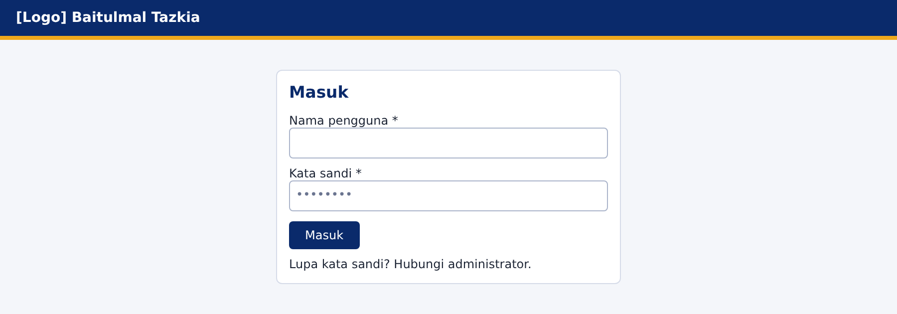

*Layar login*

## FR Umum 2 Beranda setelah login

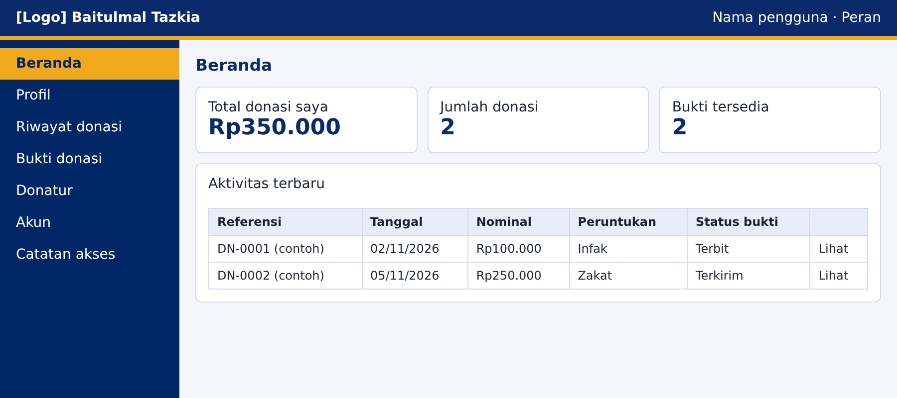

*Beranda setelah login*

## FR Umum 3 Tampilan tabel

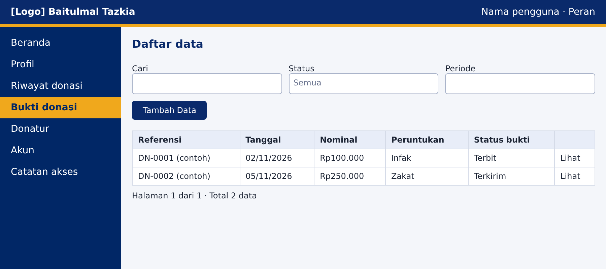

*Tampilan tabel*

## FR Umum 4 Tampilan formulir input

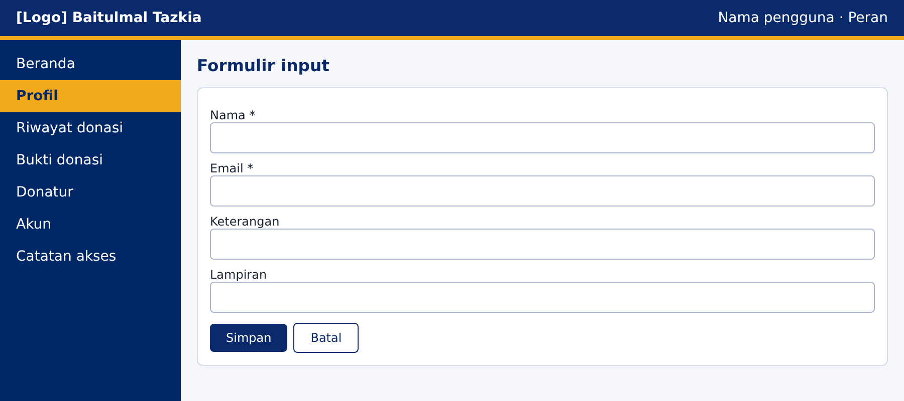

*Tampilan formulir input*

## FR-ADBD-01 Pendaftaran akun donatur

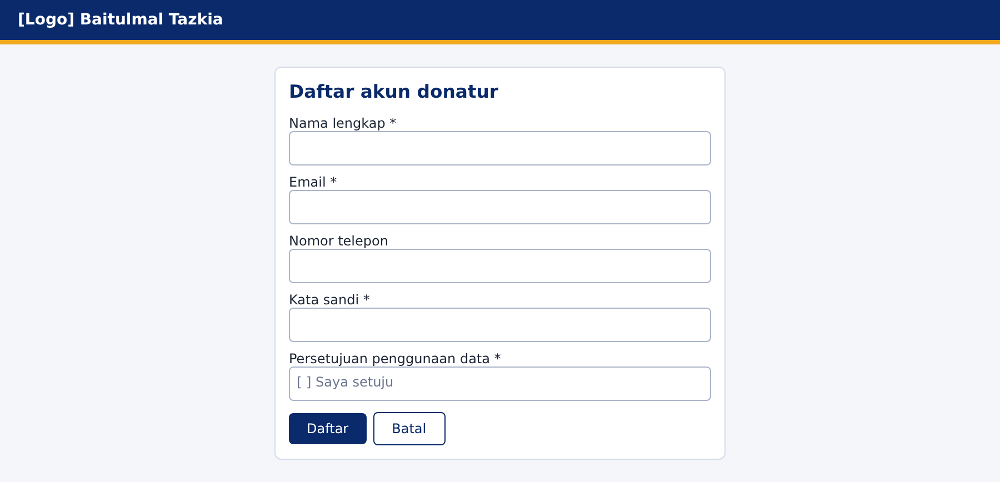

*Pendaftaran akun donatur*

| **Elemen**           | **Jenis**   | **Perilaku**               |
|----------------------|-------------|----------------------------|
| Nama, Email, Telepon | Kolom       | Nama dan email wajib       |
| Kata sandi           | Tersembunyi | Minimal 8                  |
| Persetujuan          | Centang     | Wajib                      |
| Daftar, Batal        | Tombol      | Memvalidasi lalu menyimpan |

Pesan galat: “Email tidak valid atau sudah dipakai.”; “Kata sandi minimal 8 karakter.”; “Persetujuan wajib diberikan.”

## FR-ADBD-02 Pengelolaan profil donatur

*Pengelolaan profil donatur*

| **Elemen**    | **Jenis** | **Perilaku**      |
|---------------|-----------|-------------------|
| Data diri     | Kolom     | Sesuai 3.1.1.2    |
| Simpan, Batal | Tombol    | Perubahan dicatat |

Pesan galat: “Nama wajib diisi.”; “Nomor telepon tidak valid.”

## FR-ADBD-03 Preferensi anonimitas dan pengiriman

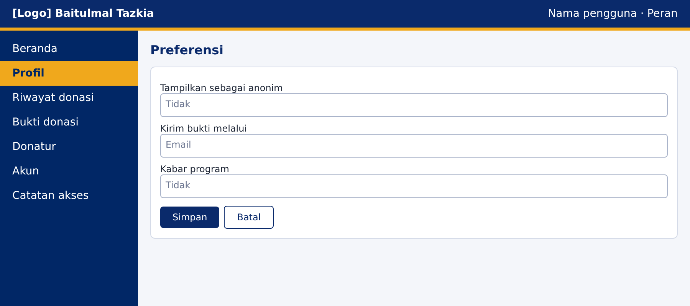

*Preferensi anonimitas dan pengiriman*

| **Elemen**                | **Jenis** | **Perilaku**         |
|---------------------------|-----------|----------------------|
| Anonim, Cara kirim, Kabar | Pilihan   | Default tidak anonim |
| Simpan, Batal             | Tombol    | Menyimpan preferensi |

Pesan galat: “Pilih preferensi anonim.”; “Pilih cara pengiriman.”

## FR-ADBD-04 Penautan donasi ke akun

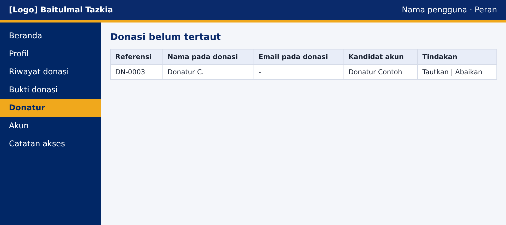

*Penautan donasi ke akun*

| **Elemen**           | **Jenis** | **Perilaku**  |
|----------------------|-----------|---------------|
| Daftar belum tertaut | Tabel     | Kandidat akun |
| Tautkan, Abaikan     | Tautan    | Alasan wajib  |

Pesan galat: “Donasi tidak ditemukan.”; “Alasan wajib diisi.”

## FR-ADBD-05 Riwayat donasi

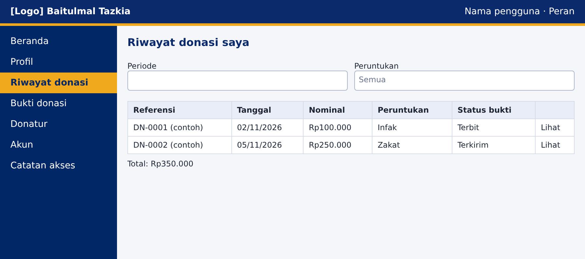

*Riwayat donasi*

| **Elemen**          | **Jenis** | **Perilaku**              |
|---------------------|-----------|---------------------------|
| Periode, Peruntukan | Filter    | Awal tidak melewati akhir |
| Tabel               | Baca saja | Donasi milik sendiri      |

Pesan galat: “Tanggal akhir tidak boleh sebelum tanggal awal.”; “Tidak ada data.”

## FR-ADBD-06 Penerbitan bukti donasi

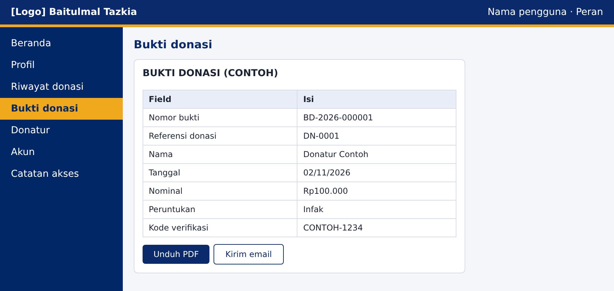

*Penerbitan bukti donasi*

| **Elemen**   | **Jenis** | **Perilaku**                                        |
|--------------|-----------|-----------------------------------------------------|
| Isi bukti    | Baca saja | Diambil dari data donasi; tidak dapat diubah manual |
| Unduh, Kirim | Tombol    | Lihat FR-ADBD-07                                    |

Pesan galat: “Bukti hanya untuk donasi berstatus Berhasil.”

## FR-ADBD-07 Unduh dan kirim bukti

*Unduh dan kirim bukti*

| **Elemen**  | **Jenis** | **Perilaku**               |
|-------------|-----------|----------------------------|
| Unduh PDF   | Tombol    | Hanya pemilik atau petugas |
| Kirim email | Tombol    | Ke email terverifikasi     |

Pesan galat: “Pengiriman gagal, coba lagi.”

## FR-ADBD-08 Verifikasi keaslian bukti

*Verifikasi keaslian bukti*

| **Elemen**      | **Jenis** | **Perilaku**          |
|-----------------|-----------|-----------------------|
| Kode verifikasi | Kolom     | 12 karakter           |
| Periksa         | Tombol    | Menampilkan ringkasan |

Pesan galat: “Kode verifikasi tidak valid.”

## FR-ADBD-09 Pembatasan akses menurut peran

*Pembatasan akses menurut peran*

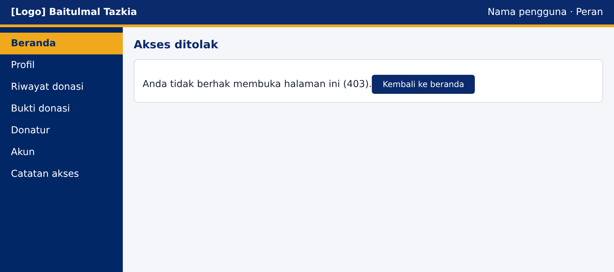

*Pembatasan akses menurut peran*

| **Elemen**            | **Jenis** | **Perilaku** |
|-----------------------|-----------|--------------|
| Menu samping          | Navigasi  | Sesuai peran |
| Halaman akses ditolak | Pesan     | Kode 403     |

Pesan galat: “Anda tidak berhak membuka halaman ini.”

## FR-ADBD-10 Pengelolaan akun dan peran

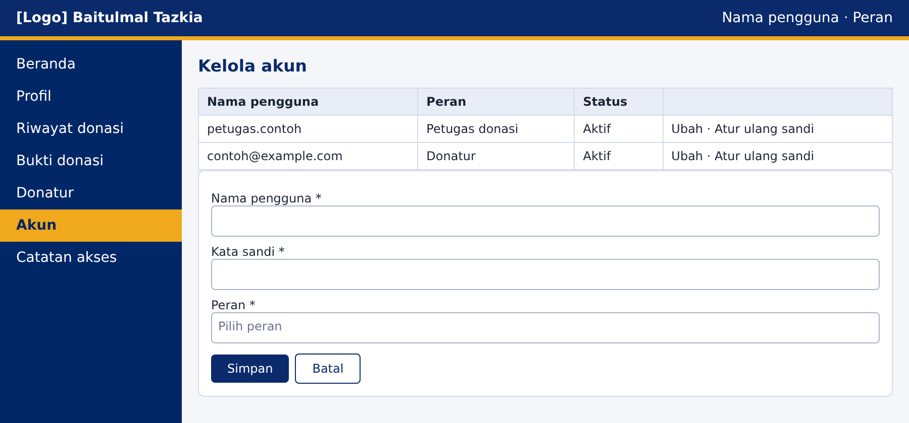

*Pengelolaan akun dan peran*

| **Elemen**             | **Jenis** | **Perilaku**        |
|------------------------|-----------|---------------------|
| Tabel akun             | Tabel     | Nama, peran, status |
| Akun baru              | Formulir  | Sesuai 3.1.1.2      |
| Ubah, Atur ulang sandi | Tautan    | Hanya Admin         |

Pesan galat: “Nama pengguna tidak valid atau sudah dipakai.”; “Kata sandi minimal 8 karakter.”; “Pilih peran.”

## FR-ADBD-11 Log akses data pribadi

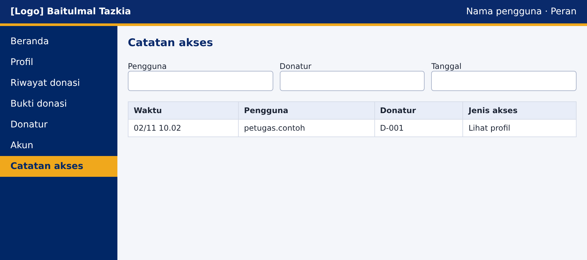

*Log akses data pribadi*

| **Elemen**    | **Jenis**        | **Perilaku**                    |
|---------------|------------------|---------------------------------|
| Filter        | Pilihan, rentang | Menyaring                       |
| Tabel catatan | Baca saja        | Tidak dapat diubah atau dihapus |

Pesan galat: “Tidak ada data.”
