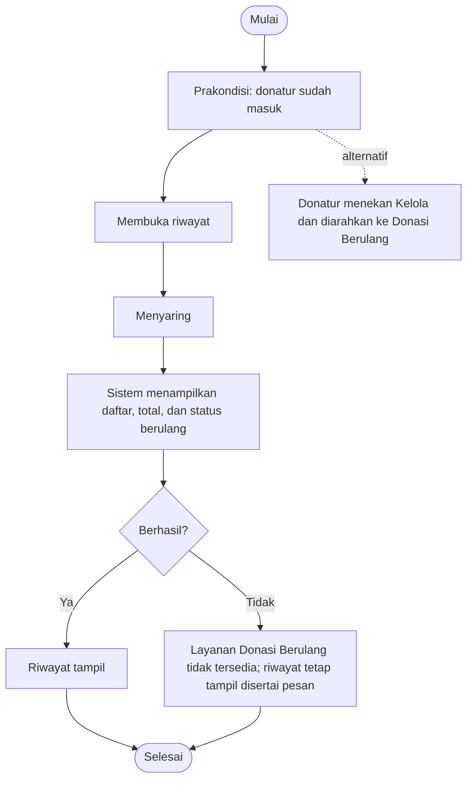
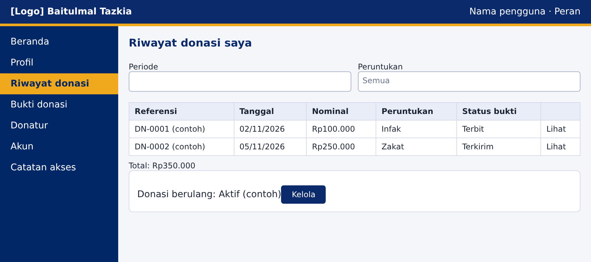

# FR-ADBD-05 Riwayat donasi dan status donasi berulang · Akun Donatur dan Bukti Donasi

Kelompok 2 · Dosen: Endy Muhardin · Business Analyst: Eli Nur Aulia · Project Manager: Destri Komalasari · Status: draf

| **Atribut** | **Isi** |
|-------------|------------------------------------------------------------|
| Prioritas | Must |
| Sumber | Workbook 3.2, 3.5, 3.7 |
| Aktor | Donatur, petugas donasi |
| Deskripsi | Sistem menampilkan donasi milik akun dengan filter periode dan peruntukan, total donasi Berhasil, serta status donasi berulang. Tombol Kelola meminta signed URL berumur singkat ke subsistem Donasi Berulang lalu mengarahkan donatur tanpa login ulang. Donasi yang dibatalkan atau dibalik oleh koreksi tidak dihitung dalam total; yang dihitung catatan penggantinya [USULAN] |
| Task proses | T-06 |

**Alur**

- Prakondisi: donatur sudah masuk.
- Alur utama: (1) membuka riwayat; (2) menyaring; (3) sistem menampilkan daftar, total, dan status berulang.
- Alur alternatif: donatur menekan Kelola dan diarahkan ke Donasi Berulang.
- Alur kegagalan: layanan Donasi Berulang tidak tersedia; riwayat tetap tampil disertai pesan.
- Pascakondisi: riwayat tampil.

**Diagram alur**

{height=5in}

**Acceptance criteria**

- **Given** donasi Berhasil Rp100.000 dan Rp250.000, **When** donatur membuka riwayat, **Then** tampil 2 donasi dan total Rp350.000.
- **Given** donatur A sudah masuk, **When** membuka riwayat donatur B, **Then** ditolak 403.
- **Given** ada donasi berulang aktif, **When** donatur menekan Kelola, **Then** halaman pengelolaan terbuka lewat signed URL tanpa login ulang.

**Mockup**

*Riwayat donasi*

| **Elemen** | **Jenis** | **Perilaku** |
|-------------------------|------------------|-----------------------------|
| Periode, Peruntukan | Filter | Awal tidak melewati akhir |
| Tabel | Baca saja | Donasi milik sendiri |
| Donasi berulang, Kelola | Kartu dan tombol | Status dari Donasi Berulang |

Pesan galat: “Tanggal akhir tidak boleh sebelum tanggal awal.”; “Pengelolaan donasi berulang sedang tidak tersedia.”

Test scenario lengkap: `04-pengujian-dan-penerimaan/Test-Scenario/TS-ADBD-05 - Riwayat donasi dan status donasi berulang`.
