# Functional Requirements (FR)

Sistem Akun Donatur dan Bukti Donasi · Baitulmal Tazkia

| **Item**         | **Isi**                                                                                                                    |
|------------------|----------------------------------------------------------------------------------------------------------------------------|
| Dokumen          | Dokumen FR                                                                                                                 |
| Kelompok         | 2                                                                                                                          |
| Business Analyst | Eli Nur Aulia                                                                                                              |
| Project Manager  | Destri Komalasari                                                                                                                     |
| Versi            | 0.2 (draf)                                                                                                                 |
| Tanggal          | 26 November 2026                                                                                                           |
| Acuan            | SRS Akun Donatur dan Bukti Donasi v0.4                                                                                     |
| Status           | DRAF, belum ada sign-off. \[USULAN\] = usulan tim; \[DUGAAN\] = belum dikonfirmasi klien; \[DRAF\] = belum disetujui final |

## 1. Daftar kebutuhan fungsional

| **ID** | **Nama** | **Prioritas** | **Aktor** |
|------------|----------------------------------------------------|---------------|--------------------------|
| FR Umum 1 | Layar login | Must | Semua pengguna |
| FR Umum 2 | Beranda setelah login | Must | Semua pengguna |
| FR Umum 3 | Tampilan tabel | Must | Semua pengguna |
| FR Umum 4 | Tampilan formulir input | Must | Semua pengguna |
| FR-ADBD-01 | Pendaftaran dan login donatur | Must | Donatur |
| FR-ADBD-02 | Pengelolaan profil donatur | Must | Donatur |
| FR-ADBD-03 | Preferensi anonimitas dan pengiriman | Should | Donatur |
| FR-ADBD-04 | Penyatuan donasi ke akun | Must | Sistem, petugas, donatur |
| FR-ADBD-05 | Riwayat donasi dan status donasi berulang | Must | Donatur, petugas |
| FR-ADBD-06 | Penerbitan bukti donasi | Must | Sistem, petugas |
| FR-ADBD-07 | Unduh dan kirim bukti | Must | Donatur, petugas |
| FR-ADBD-08 | Verifikasi keaslian bukti | Could | Penerima bukti |
| FR-ADBD-09 | Pembatasan akses dan login staf | Must | Semua peran |
| FR-ADBD-10 | Pengelolaan akun staf dan peran | Must | Admin |
| FR-ADBD-11 | Log akses data pribadi | Should | Admin |
| FR-ADBD-12 | Penyediaan data untuk proyek hilir (tidak berlaku) | Won’t | - |
| FR-ADBD-13 | Rekapitulasi donasi tahunan | Must | Donatur, petugas |
| FR-ADBD-14 | Penghapusan akun donatur | Must | Donatur, Admin |
| FR-ADBD-15 | Kanal WhatsApp pada Aplikasi Notifikasi | Should | Aplikasi Notifikasi |

## 2. FR umum \[DRAF\]

### FR Umum 1: Layar login

| **Atribut** | **Isi**                                                                    |
|-------------|----------------------------------------------------------------------------|
| Prioritas   | Must                                                                       |
| Aktor       | Semua pengguna                                                             |
| Deskripsi | Donatur masuk dengan akun Google atau OTP nomor telepon. Staf masuk dengan akun Google lalu TOTP. Tidak ada kata sandi. |

**Mockup**

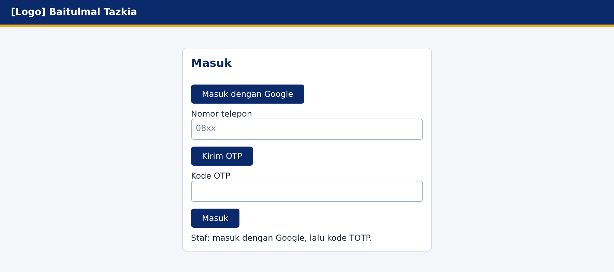

*Layar login*

**Acceptance criteria**

- Akun donatur aktif dan OTP benar, menekan Masuk: beranda donatur terbuka.
- Akun dinonaktifkan, pemilik mencoba masuk: sistem menolak.
- OTP atau ID token tidak sah, dikirim ke server: sistem menampilkan pesan umum tanpa membuat sesi.

### FR Umum 2: Beranda setelah login

| **Atribut** | **Isi**                               |
|-------------|---------------------------------------|
| Prioritas   | Must                                  |
| Aktor       | Semua pengguna                        |
| Deskripsi   | Ringkasan dan menu sesuai peran akun. |

**Mockup**

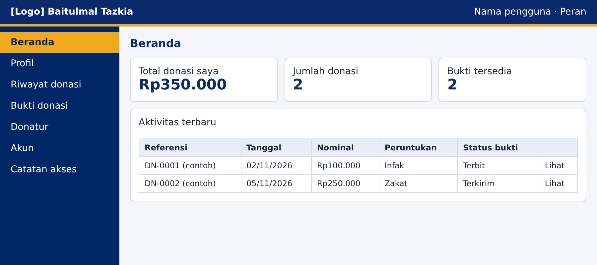

*Beranda setelah login*

**Acceptance criteria**

- Login sebagai Donatur: menu hanya memuat data miliknya.

- Login sebagai Admin: menu kelola akun dan catatan akses tampil.

### FR Umum 3: Tampilan tabel

| **Atribut** | **Isi**                                                      |
|-------------|--------------------------------------------------------------|
| Prioritas   | Must                                                         |
| Aktor       | Semua pengguna                                               |
| Deskripsi   | Daftar data standar: cari, saring, tambah, status, paginasi. |

**Mockup**

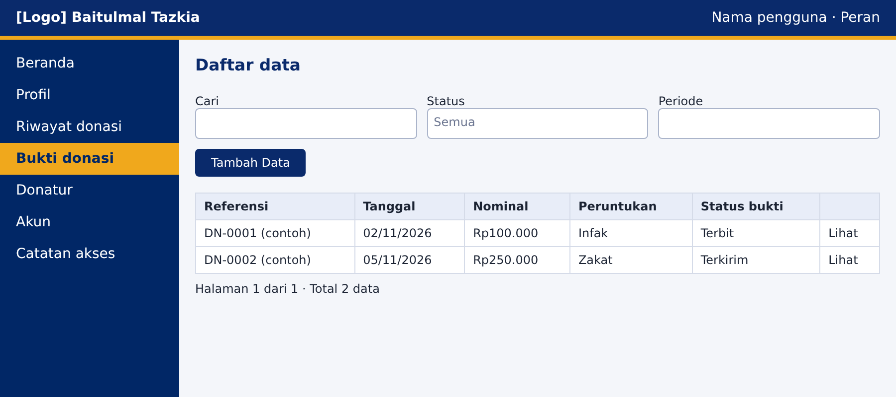

*Tampilan tabel*

**Acceptance criteria**

- Buka tabel berisi 48 data: enam data per halaman dan jumlah total.

- Filter tidak cocok: tampil “tidak ada data”.

### FR Umum 4: Tampilan formulir input

| **Atribut** | **Isi**                                                                   |
|-------------|---------------------------------------------------------------------------|
| Prioritas   | Must                                                                      |
| Aktor       | Semua pengguna                                                            |
| Deskripsi   | Formulir standar: kolom wajib bertanda \*, pesan galat, Simpan dan Batal. |

**Mockup**

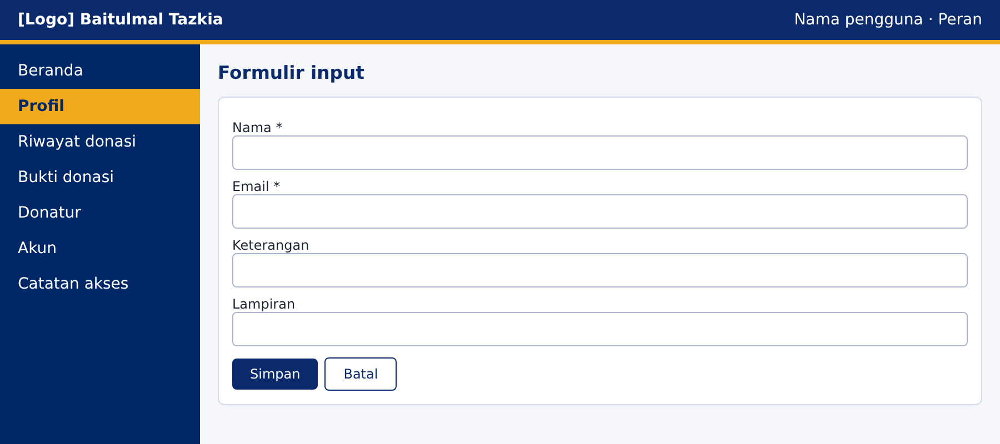

*Tampilan formulir input*

**Acceptance criteria**

- Simpan dengan kolom wajib kosong: ditolak dan kolom yang kurang disebut.

- Simpan dengan data valid: tersimpan dan kembali ke tabel.

## 3. FR proyek

### FR-ADBD-01 Pendaftaran dan login donatur \[DUGAAN\]

| **Atribut** | **Isi** |
|-------------|------------------------------------------------------------|
| Prioritas | Must |
| Sumber | Workbook 3.2, 3.7 |
| Aktor | Donatur |
| Deskripsi | Donatur masuk dengan akun Google atau OTP ke nomor telepon, tanpa kata sandi. Donatur yang masuk dengan Google memverifikasi nomor teleponnya satu kali lewat OTP sebelum donasi bernomor itu disatukan. Akun Google dikenali dari pengenal tetapnya, bukan dari alamat email. Satu akun memuat satu identitas Google serta beberapa nomor telepon dan email terverifikasi |
| Task proses | T-01 |

**Alur**

- Prakondisi: donatur punya akun Google atau nomor telepon aktif.
- Alur utama: (1) donatur memilih Google atau nomor telepon; (2) membuktikan identitas; (3) menyetujui penggunaan data; (4) akun dibuat dan sesi aktif.
- Alur alternatif: pengguna Google memverifikasi nomor telepon lewat OTP.
- Alur kegagalan: OTP salah, kedaluwarsa, atau melewati batas kirim; sistem menolak.
- Pascakondisi: donatur masuk dan identitas terverifikasi tercatat.

**Acceptance criteria**

- **Given** nomor belum terdaftar dan OTP benar, **When** donatur menyetujui penggunaan data, **Then** akun dibuat dengan nomor terverifikasi.
- **Given** donatur masuk dengan Google dan nomornya belum diverifikasi, **When** data donasi bernomor itu tersedia, **Then** donasi belum disatukan.
- **Given** sudah 3 permintaan OTP dalam 15 menit [USULAN], **When** donatur meminta lagi, **Then** sistem menolak.

**Mockup**

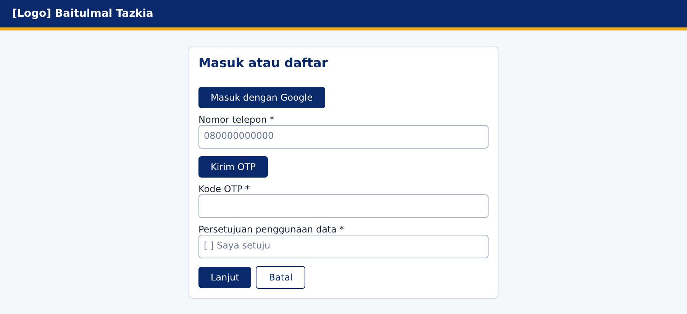

*Masuk atau daftar*

| **Elemen** | **Jenis** | **Perilaku** |
|--------------------------|------------------|-----------------------------------|
| Masuk dengan Google | Tombol | Memakai OpenID Connect |
| Nomor telepon, Kirim OTP | Kolom dan tombol | Jumlah kirim dibatasi |
| Kode OTP | Kolom | 6 digit, berlaku 5 menit [USULAN] |
| Persetujuan data | Centang | Wajib saat akun baru |

Pesan galat: “Kode OTP salah atau kedaluwarsa.”; “Terlalu banyak permintaan. Coba lagi nanti.”

### FR-ADBD-02 Pengelolaan profil donatur \[DUGAAN\]

| **Atribut** | **Isi**                                                             |
|-------------|---------------------------------------------------------------------|
| Prioritas   | Must                                                                |
| Sumber      | v0.2 FR-005                                                         |
| Aktor       | Donatur                                                             |
| Deskripsi | Donatur melihat dan mengubah data yang disetujui, serta menambah nomor telepon atau email yang diverifikasi dengan OTP; perubahan dicatat |
| Task proses | T-01, T-02                                                          |

**Alur**

- Prakondisi: donatur sudah login.

- Alur utama: (1) membuka profil; (2) mengubah data; (3) menyimpan.

- Alur alternatif: ganti email memerlukan verifikasi.

- Alur kegagalan: data tidak valid, sistem menolak.

- Pascakondisi: profil tersimpan.

**Acceptance criteria**

- **Given** donatur sudah login, **When** mengubah alamat dan menyimpan, **Then** perubahan tersimpan.

- **Given** email atau nomor baru belum diverifikasi, **When** donatur menyimpan, **Then** data lama tetap berlaku.

**Mockup**

*Pengelolaan profil donatur*

| **Elemen**    | **Jenis** | **Perilaku**      |
|---------------|-----------|-------------------|
| Data diri     | Kolom     | Sesuai 3.1.1.2    |
| Simpan, Batal | Tombol    | Perubahan dicatat |

Pesan galat: “Nama wajib diisi.”; “Nomor telepon tidak valid.”

### FR-ADBD-03 Preferensi anonimitas dan pengiriman \[DUGAAN\]

| **Atribut** | **Isi** |
|-------------|------------------------------------------------------------|
| Prioritas | Should |
| Sumber | Workbook 3.2; v0.2 FR-008 |
| Aktor | Donatur |
| Deskripsi | Donatur memilih tampil dengan nama atau anonim, serta cara menerima bukti. Anonim mengatur tampilan tanpa menghapus data internal. Arti anonim bagi staf belum dikonfirmasi |
| Task proses | T-01 |

**Alur**

- Prakondisi: donatur sudah masuk.
- Alur utama: (1) membuka preferensi; (2) memilih; (3) menyimpan.
- Alur alternatif: tidak mengubah, default dipakai.
- Alur kegagalan: kanal dipilih tetapi kontaknya belum terverifikasi; sistem menolak.
- Pascakondisi: preferensi tersimpan.

**Acceptance criteria**

- **Given** donatur memilih anonim, **When** namanya akan tampil pada daftar umum, **Then** tampil “Hamba Allah”.
- **Given** preferensi belum diisi, **When** sistem memakainya, **Then** default tampil dengan nama [USULAN].
- **Given** belum ada nomor terverifikasi, **When** donatur memilih WhatsApp, **Then** sistem menolak.

**Mockup**

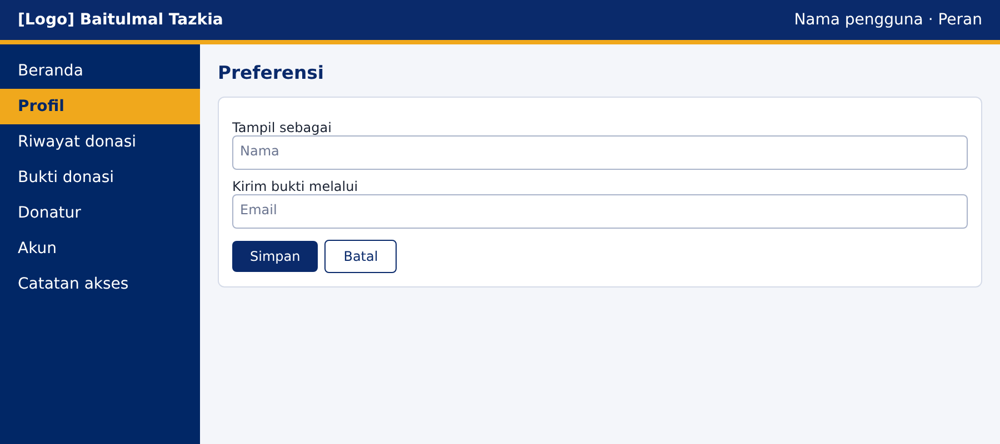

*Preferensi*

| **Elemen** | **Jenis** | **Perilaku** |
|---------------------|-----------|--------------------------------|
| Tampil sebagai | Pilihan | Nama atau anonim |
| Kirim bukti melalui | Pilihan | Email, WhatsApp, unduh sendiri |
| Simpan, Batal | Tombol | Menyimpan preferensi |

Pesan galat: “Verifikasi kontak untuk kanal ini terlebih dahulu.”

### FR-ADBD-04 Penyatuan donasi ke akun \[DUGAAN\]

| **Atribut** | **Isi** |
|-------------|------------------------------------------------------------|
| Prioritas | Must |
| Sumber | Workbook 3.2, 3.7; v0.2 FR-007 |
| Aktor | Sistem, petugas donasi, donatur |
| Deskripsi | Sistem menyatukan donasi dari semua kanal secara bertingkat. Email terverifikasi (Google atau OTP) atau nomor telepon terverifikasi OTP yang sama disatukan otomatis. Kecocokan yang hanya mirip masuk antrean konfirmasi staf atau donatur. Setiap penyatuan menyimpan dasar kecocokannya dan dapat dibatalkan |
| Task proses | T-03 |

**Alur**

- Prakondisi: data donasi tersedia lewat API.
- Alur utama: (1) sistem menerima donasi; (2) membandingkan dengan identitas terverifikasi; (3) menyatukan dan mencatat dasarnya.
- Alur alternatif: kecocokan mirip masuk antrean; staf atau donatur mengonfirmasi atau menolak.
- Alur kegagalan: donasi sudah milik akun lain; sistem menolak.
- Pascakondisi: donasi tersatukan atau menunggu konfirmasi.

**Acceptance criteria**

- **Given** donasi bernomor sama dengan nomor terverifikasi akun, **When** data diterima, **Then** donasi disatukan dengan dasar “nomor terverifikasi”.
- **Given** hanya nama yang mirip, **When** data diterima, **Then** donasi tidak disatukan otomatis.
- **Given** penyatuan keliru, **When** petugas membatalkannya dengan alasan, **Then** donasi hilang dari riwayat dan pembatalan tercatat.

**Mockup**

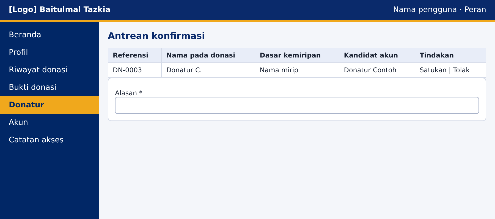

*Antrean konfirmasi*

| **Elemen** | **Jenis** | **Perilaku** |
|----------------|-----------|----------------------------------------|
| Antrean | Tabel | Donasi, kandidat akun, dasar kecocokan |
| Satukan, Tolak | Tautan | Alasan wajib bagi petugas |
| Batalkan | Tautan | Melepas penyatuan |

Pesan galat: “Donasi sudah disatukan ke akun lain.”; “Alasan wajib diisi.”

### FR-ADBD-05 Riwayat donasi dan status donasi berulang \[DUGAAN\]

| **Atribut** | **Isi** |
|-------------|------------------------------------------------------------|
| Prioritas | Must |
| Sumber | Workbook 3.2, 3.5, 3.7 |
| Aktor | Donatur, petugas donasi |
| Deskripsi | Sistem menampilkan donasi milik akun dengan filter periode dan peruntukan, total donasi Berhasil, serta status donasi berulang. Tombol Kelola meminta signed URL berumur singkat ke subsistem Donasi Berulang lalu mengarahkan donatur tanpa login ulang. Donasi yang dibatalkan atau dibalik oleh koreksi tidak dihitung dalam total; yang dihitung catatan penggantinya [USULAN] |
| Task proses | T-06 |

**Alur**

- Prakondisi: donatur sudah masuk.
- Alur utama: (1) membuka riwayat; (2) menyaring; (3) sistem menampilkan daftar, total, dan status berulang.
- Alur alternatif: donatur menekan Kelola dan diarahkan ke Donasi Berulang.
- Alur kegagalan: layanan Donasi Berulang tidak tersedia; riwayat tetap tampil disertai pesan.
- Pascakondisi: riwayat tampil.

**Acceptance criteria**

- **Given** donasi Berhasil Rp100.000 dan Rp250.000, **When** donatur membuka riwayat, **Then** tampil 2 donasi dan total Rp350.000.
- **Given** donatur A sudah masuk, **When** membuka riwayat donatur B, **Then** ditolak 403.
- **Given** ada donasi berulang aktif, **When** donatur menekan Kelola, **Then** halaman pengelolaan terbuka lewat signed URL tanpa login ulang.

**Mockup**

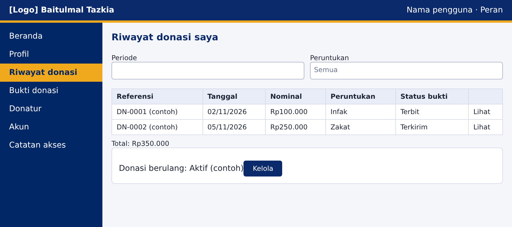

*Riwayat donasi*

| **Elemen** | **Jenis** | **Perilaku** |
|-------------------------|------------------|-----------------------------|
| Periode, Peruntukan | Filter | Awal tidak melewati akhir |
| Tabel | Baca saja | Donasi milik sendiri |
| Donasi berulang, Kelola | Kartu dan tombol | Status dari Donasi Berulang |

Pesan galat: “Tanggal akhir tidak boleh sebelum tanggal awal.”; “Pengelolaan donasi berulang sedang tidak tersedia.”

### FR-ADBD-06 Penerbitan bukti donasi \[DUGAAN\]

| **Atribut** | **Isi** |
|-------------|------------------------------------------------------------|
| Prioritas | Must |
| Sumber | Workbook 3.2, 3.7 |
| Aktor | Sistem, petugas donasi |
| Deskripsi | Sistem menerbitkan satu bukti resmi per transaksi Berhasil dari semua kanal, termasuk donasi di booth. Bukti diberi nomor urut dan disimpan apa adanya; isinya tidak pernah dibuat ulang dari data terkini. Bila donasi dibatalkan, dikembalikan, atau dikoreksi lewat catatan pembalik dari Penerimaan Donasi, bukti lama menjadi Dibatalkan dan tetap disimpan; bila ada catatan pengganti berstatus Berhasil, terbit bukti baru dengan nomor baru [USULAN] |
| Task proses | T-04 |

**Alur**

- Prakondisi: donasi berstatus Berhasil.
- Alur utama: (1) sistem atau petugas memicu penerbitan; (2) sistem memberi nomor urut; (3) menyimpan salinan isi.
- Alur alternatif: donasi tanpa identitas, bukti atas nama “Hamba Allah” [USULAN].
- Alur kegagalan: status bukan Berhasil; ditolak.
- Pascakondisi: satu bukti tersimpan.

**Acceptance criteria**

- **Given** donasi Berhasil Rp100.000 dari booth, **When** bukti diterbitkan, **Then** bukti memuat nomor urut dan Rp100.000.
- **Given** bukti sudah terbit lalu nama donatur diubah, **When** bukti dibuka, **Then** isinya tetap seperti saat terbit.
- **Given** donasi berstatus Menunggu, **When** penerbitan diminta, **Then** sistem menolak.
- **Given** bukti Rp100.000 sudah terbit, **When** diterima catatan pembalik beserta catatan pengganti Rp150.000, **Then** bukti lama berstatus Dibatalkan dan terbit bukti baru Rp150.000 dengan nomor baru [USULAN].

**Mockup**

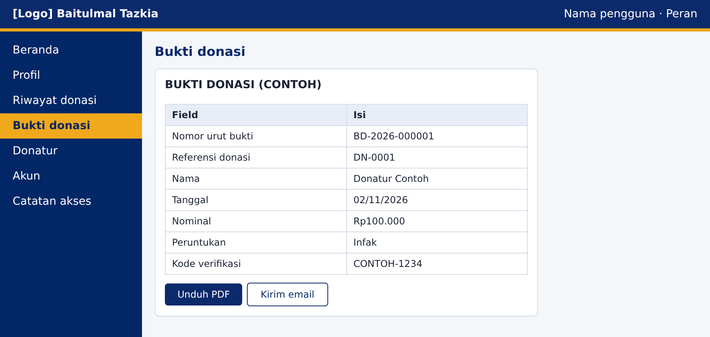

*Bukti donasi*

| **Elemen** | **Jenis** | **Perilaku** |
|--------------|-----------|---------------------|
| Isi bukti | Baca saja | Salinan saat terbit |
| Unduh, Kirim | Tombol | Lihat FR-ADBD-07 |

Pesan galat: “Bukti hanya untuk donasi berstatus Berhasil.”

### FR-ADBD-07 Unduh dan kirim bukti \[DUGAAN\]

| **Atribut** | **Isi** |
|-------------|------------------------------------------------------------|
| Prioritas | Must |
| Sumber | Workbook 3.2, 3.5 |
| Aktor | Donatur, petugas donasi |
| Deskripsi | Bukti dapat diunduh sebagai PDF dan dikirim lewat Aplikasi Notifikasi Tazkia dengan email, serta WhatsApp setelah kanalnya berjalan. Status pengiriman dibaca dari topic status |
| Task proses | T-05 |

**Alur**

- Prakondisi: bukti sudah terbit.
- Alur utama: (1) membuka bukti; (2) mengunduh atau meminta kirim; (3) sistem menerbitkan message ke Kafka; (4) membaca status.
- Alur alternatif: kanal WhatsApp belum berjalan; dikirim lewat email.
- Alur kegagalan: pengiriman gagal; status tidak menjadi Terkirim.
- Pascakondisi: donatur menerima bukti.

**Acceptance criteria**

- **Given** bukti Terbit, **When** donatur menekan Unduh PDF, **Then** berkas PDF terunduh.
- **Given** topic status melaporkan gagal, **When** sistem membacanya, **Then** status tidak menjadi Terkirim dan kegagalan dicatat.
- **Given** donatur lain sudah masuk, **When** mengunduh bukti, **Then** ditolak 403.

**Mockup**

*Unduh dan kirim*

| **Elemen** | **Jenis** | **Perilaku** |
|------------|-----------|-------------------------|
| Unduh PDF | Tombol | Pemilik atau petugas |
| Kirim | Tombol | Ke kontak terverifikasi |

Pesan galat: “Pengiriman gagal, coba lagi.”

### FR-ADBD-08 Verifikasi keaslian bukti \[USULAN, kandidat CR-02\]

| **Atribut** | **Isi**                                                                                                                        |
|-------------|--------------------------------------------------------------------------------------------------------------------------------|
| Prioritas   | Could                                                                                                                          |
| Sumber      | Usulan tim                                                                                                                     |
| Aktor       | Penerima bukti                                                                                                                 |
| Deskripsi   | Siapa pun yang memiliki kode dapat memeriksa keabsahan; hasil hanya memuat status, nomor, tanggal, dan nominal tanpa identitas |
| Task proses | T-05                                                                                                                           |

**Alur**

- Prakondisi: memiliki kode verifikasi.

- Alur utama: (1) memasukkan kode; (2) sistem menampilkan ringkasan.

- Alur alternatif: bukti dibatalkan, tampil “Dibatalkan”.

- Alur kegagalan: kode tidak dikenal, “tidak ditemukan”.

- Pascakondisi: tidak ada data berubah.

**Acceptance criteria**

- **Given** kode sah, **When** dimasukkan, **Then** tampil “Sah” tanpa nama donatur.

- **Given** kode tidak dikenal, **When** dimasukkan, **Then** tampil “tidak ditemukan”.

**Mockup**

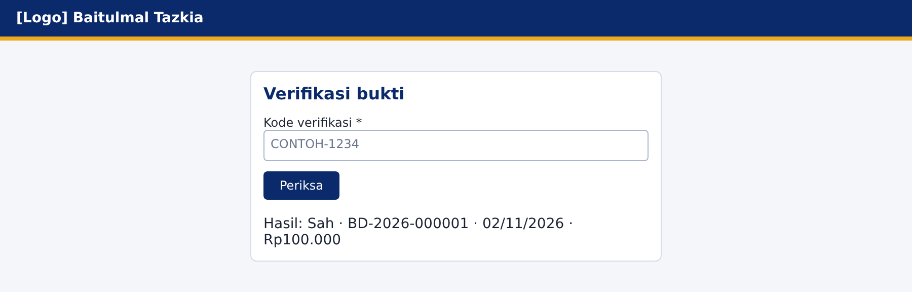

*Verifikasi keaslian bukti*

| **Elemen**      | **Jenis** | **Perilaku**          |
|-----------------|-----------|-----------------------|
| Kode verifikasi | Kolom     | 12 karakter           |
| Periksa         | Tombol    | Menampilkan ringkasan |

Pesan galat: “Kode verifikasi tidak valid.”

### FR-ADBD-09 Pembatasan akses dan login staf \[DRAF\]

| **Atribut** | **Isi** |
|-------------|------------------------------------------------------------|
| Prioritas | Must |
| Sumber | Workbook Lampiran A; v0.2 NFR-001 |
| Aktor | Semua peran |
| Deskripsi | Staf masuk dengan akun Google (OpenID Connect) lalu verifikasi TOTP. ID token divalidasi di server. Akun yang belum terdaftar hanya melihat halaman awal kosong. Data dibatasi menurut peran dan kepemilikan, diperiksa terpusat di server |
| Task proses | T-01 sampai T-06 |

**Alur**

- Prakondisi: staf punya akun Google.
- Alur utama: (1) masuk dengan Google; (2) memasukkan kode TOTP; (3) menu tampil sesuai peran.
- Alur alternatif: akun belum terdaftar; hanya halaman kosong.
- Alur kegagalan: token atau kode tidak sah; ditolak.
- Pascakondisi: akses sesuai peran.

**Acceptance criteria**

- **Given** akun Google belum terdaftar pada aplikasi, **When** pengguna masuk, **Then** hanya tampil halaman awal kosong.
- **Given** pengguna berperan Donatur, **When** memanggil API kelola akun, **Then** ditolak 403.
- **Given** kode TOTP salah, **When** staf mengirimnya, **Then** akses tidak diberikan.

**Mockup**

*Akses ditolak*

| **Elemen** | **Jenis** | **Perilaku** |
|------------|-----------|----------------------|
| Pesan 403 | Teks | Tanpa rincian teknis |
| Kembali | Tombol | Ke beranda |

Pesan galat: “Anda tidak berhak membuka halaman ini.”

### FR-ADBD-10 Pengelolaan akun staf dan peran \[DRAF\]

| **Atribut** | **Isi** |
|-------------|------------------------------------------------------------|
| Prioritas | Must |
| Sumber | Workbook Lampiran A; v0.2 NFR-001 |
| Aktor | Admin |
| Deskripsi | Admin mendaftarkan akun Google staf pada tabel pengguna aplikasi, menetapkan peran, dan menonaktifkan akun. Aplikasi tidak menyimpan kata sandi |
| Task proses | T-01 sampai T-06 |

**Alur**

- Prakondisi: berperan Admin.
- Alur utama: (1) menambah email staf; (2) menetapkan peran; (3) menyimpan; (4) pengenal Google dicatat saat staf pertama masuk.
- Alur alternatif: Admin menonaktifkan akun.
- Alur kegagalan: non-Admin; ditolak 403.
- Pascakondisi: akun tersimpan.

**Acceptance criteria**

- **Given** Admin mengisi email staf dan peran, **When** menyimpan, **Then** staf dapat masuk sesuai peran.
- **Given** akun dinonaktifkan, **When** staf mencoba masuk, **Then** ditolak.
- **Given** non-Admin, **When** membuat akun, **Then** ditolak 403.

**Mockup**

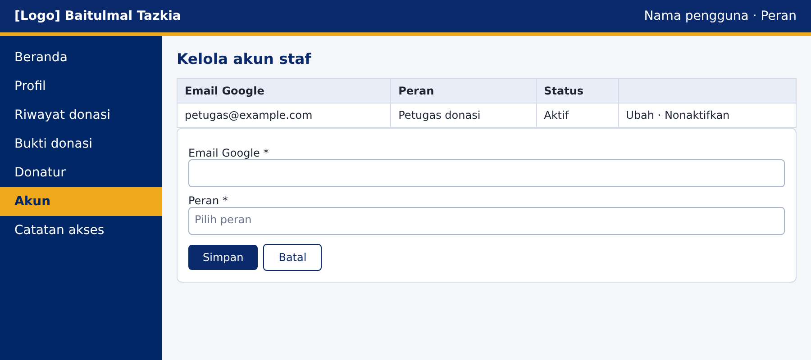

*Kelola akun staf*

| **Elemen** | **Jenis** | **Perilaku** |
|---------------------|-----------|----------------------|
| Tabel akun | Tabel | Email, peran, status |
| Email Google, Peran | Kolom | Wajib |
| Simpan, Batal | Tombol | Hanya Admin |

Pesan galat: “Email tidak valid atau sudah terdaftar.”; “Pilih peran.”

### FR-ADBD-11 Log akses data pribadi \[DUGAAN\]

| **Atribut** | **Isi**                                                                             |
|-------------|-------------------------------------------------------------------------------------|
| Prioritas   | Should                                                                              |
| Sumber      | v0.2 FR-011                                                                         |
| Aktor       | Admin                                                                               |
| Deskripsi   | Sistem mencatat siapa membuka atau mengubah data donatur atau bukti siapa dan kapan |
| Task proses | T-01 sampai T-06                                                                    |

**Alur**

- Prakondisi: berperan Admin.

- Alur utama: (1) membuka log; (2) menyaring; (3) sistem menampilkan siapa membuka data siapa dan kapan.

- Alur alternatif: hasil kosong.

- Alur kegagalan: non-Admin ditolak.

- Pascakondisi: log tidak dapat diubah.

**Acceptance criteria**

- **Given** petugas membuka profil donatur, **When** Admin membuka log, **Then** tercatat pengguna, donatur, dan waktu.

**Mockup**

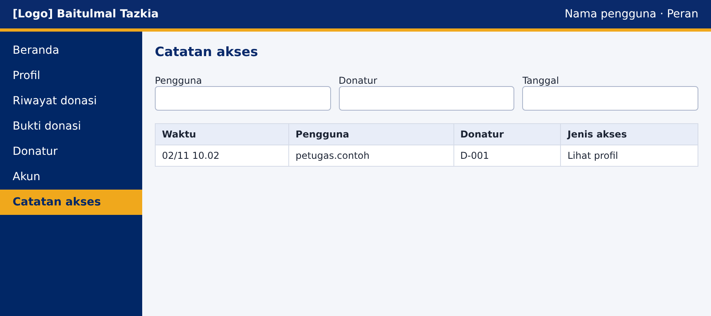

*Log akses data pribadi*

| **Elemen**    | **Jenis**        | **Perilaku**                    |
|---------------|------------------|---------------------------------|
| Filter        | Pilihan, rentang | Menyaring                       |
| Tabel catatan | Baca saja        | Tidak dapat diubah atau dihapus |

Pesan galat: “Tidak ada data.”

### FR-ADBD-12 Penyediaan data untuk proyek hilir (tidak berlaku)

**Tidak berlaku.** Workbook subbab 3.7 menyatakan subsistem ini tidak memiliki kelompok hilir. Nomor FR-ADBD-12 dipertahankan agar penelusuran versi sebelumnya tidak berubah arti. Bila PIC meminta layanan data, ajukan sebagai change request.

### FR-ADBD-13 Rekapitulasi donasi tahunan \[DUGAAN\]

| **Atribut** | **Isi** |
|-------------|------------------------------------------------------------|
| Prioritas | Must |
| Sumber | Workbook 3.2 |
| Aktor | Donatur, petugas donasi |
| Deskripsi | Sistem menerbitkan rekapitulasi per tahun sebagai bukti setor zakat, memuat daftar donasi zakat Berhasil dan totalnya. Rekap yang sudah terbit disimpan apa adanya dengan nomor urut. Format yang diterima kantor pajak belum dikonfirmasi. Bila ada koreksi atas donasi yang sudah masuk rekap, rekap lama ditandai Dibatalkan dan rekap baru diterbitkan [USULAN] |
| Task proses | T-04 |

**Alur**

- Prakondisi: donatur punya donasi zakat pada tahun itu.
- Alur utama: (1) memilih tahun; (2) sistem menyusun rekap; (3) memberi nomor; (4) menyimpan dan menampilkan.
- Alur alternatif: petugas menerbitkan atas permintaan donatur.
- Alur kegagalan: tidak ada donasi zakat; tidak diterbitkan.
- Pascakondisi: rekap tersimpan.

**Acceptance criteria**

- **Given** donasi zakat Rp250.000 dan Rp750.000 pada 2026 serta infak Rp100.000, **When** rekap zakat 2026 diterbitkan, **Then** total Rp1.000.000.
- **Given** tidak ada donasi zakat, **When** rekap diminta, **Then** sistem menolak.
- **Given** rekap sudah terbit, **When** dibuka lagi, **Then** isinya sama dengan saat terbit.

**Mockup**

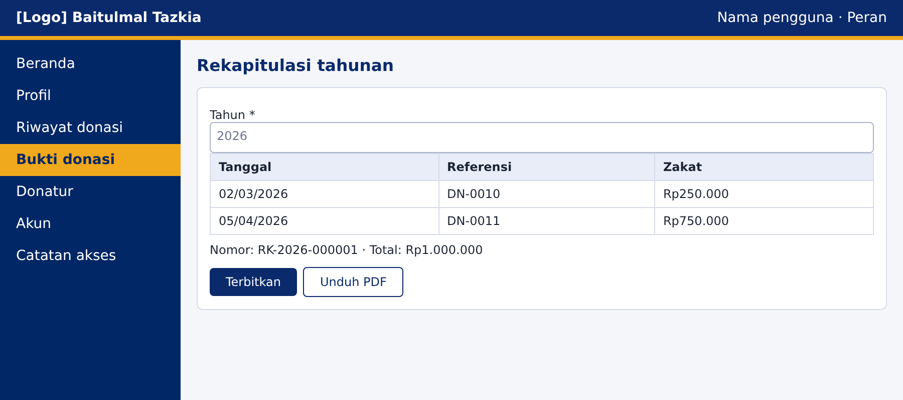

*Rekapitulasi tahunan*

| **Elemen** | **Jenis** | **Perilaku** |
|----------------------|-----------|----------------------------------|
| Tahun | Pilihan | Tahun yang memiliki donasi zakat |
| Terbitkan, Unduh PDF | Tombol | Menyimpan salinan isi |

Pesan galat: “Belum ada donasi zakat pada tahun ini.”

### FR-ADBD-14 Penghapusan akun donatur \[DUGAAN\]

| **Atribut** | **Isi** |
|-------------|------------------------------------------------------------|
| Prioritas | Must |
| Sumber | Workbook 3.2, 3.6, 3.7 |
| Aktor | Donatur, Admin |
| Deskripsi | Donatur dapat meminta akunnya dihapus. Sistem memutus hubungan akun dengan catatan donasi dan menghapus identitas login. Catatan donasi di Penerimaan Donasi tetap ada. Masa simpan bukti yang sudah terbit mengikuti ketentuan audit (belum dikonfirmasi) |
| Task proses | Belum ada pada model as-is |

**Alur**

- Prakondisi: donatur sudah masuk.
- Alur utama: (1) meminta hapus; (2) mengonfirmasi ulang dengan OTP atau Google; (3) sistem memutus hubungan dan menutup sesi.
- Alur alternatif: Admin memproses permintaan yang disampaikan langsung [USULAN].
- Alur kegagalan: konfirmasi gagal; akun tidak dihapus.
- Pascakondisi: akun tidak dapat dipakai; catatan donasi tetap.

**Acceptance criteria**

- **Given** donatur mengonfirmasi penghapusan, **When** sistem memproses, **Then** akun tidak dapat dipakai masuk.
- **Given** akun sudah dihapus, **When** data donasi sumber diperiksa, **Then** catatan donasi tetap ada.
- **Given** konfirmasi ulang gagal, **When** permintaan dikirim, **Then** akun tidak berubah.

**Mockup**

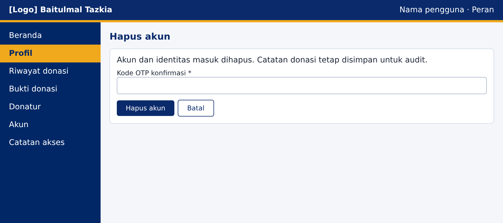

*Hapus akun*

| **Elemen** | **Jenis** | **Perilaku** |
|-------------------|-----------------|-------------------------------|
| Penjelasan dampak | Teks | Apa yang dihapus dan disimpan |
| Konfirmasi ulang | OTP atau Google | Wajib |
| Hapus akun, Batal | Tombol | Mencatat permintaan |

Pesan galat: “Konfirmasi gagal. Akun tidak dihapus.”

### FR-ADBD-15 Kanal WhatsApp pada Aplikasi Notifikasi Tazkia \[DUGAAN\]

| **Atribut** | **Isi** |
|-------------|------------------------------------------------------------|
| Prioritas | Should |
| Sumber | Workbook 3.2, 3.7 |
| Aktor | Aplikasi Notifikasi, subsistem pengirim |
| Deskripsi | Aplikasi pengirim WhatsApp membaca topic Kafka kanalnya lalu mengirim lewat API Meta memakai template yang disetujui Meta. Aplikasi template memetakan variabel bernama ke variabel bernomor. Status pengiriman diterbitkan ke topic yang dapat dibaca subsistem pengirim. Hanya pesan keluar |
| Task proses | T-05 |

**Alur**

- Prakondisi: akun bisnis, nomor, dan template disetujui Meta.
- Alur utama: (1) message masuk topic; (2) template diisi; (3) dikirim lewat API Meta; (4) status diterbitkan.
- Alur alternatif: kanal belum siap; konfigurasi template tetap memakai email.
- Alur kegagalan: Meta menolak atau gagal; status gagal diterbitkan.
- Pascakondisi: status pengiriman tersedia.

**Acceptance criteria**

- **Given** template disetujui dan message valid, **When** message dibaca, **Then** dikirim dengan variabel pada urutan yang benar.
- **Given** API Meta mengembalikan galat, **When** pengiriman dicoba, **Then** topic status memuat gagal.
- **Given** template belum disetujui, **When** message dibaca, **Then** tidak dikirim dan status gagal diterbitkan.

**Mockup**

Tidak berlaku: kebutuhan ini antarsistem, tanpa layar pengguna.

## Persetujuan

| **Peran**                   | **Nama**      | **Tanda tangan** | **Tanggal** |
|-----------------------------|---------------|------------------|-------------|
| Narasumber Baitulmal Tazkia |               |                  |             |
| Business Analyst            | Eli Nur Aulia |                  |             |
| Project Manager             | Destri Komalasari        |                  |             |
