# FR Rinci per Fitur · Akun Donatur dan Bukti Donasi

Kelompok 2 · Business Analyst: Eli Nur Aulia · Project Manager: Destri Komalasari · Status: draf

Dokumen untuk BMTZ. Setiap fitur dijelaskan dengan bahasa kerja. Data pada gambar adalah data fiktif.

## FR-ADBD-01 Pendaftaran dan login donatur

**Prioritas:** Must. **Yang memakai:** Donatur.

**Apa yang dilakukan fitur ini.** Donatur masuk dengan akun Google atau OTP ke nomor telepon, tanpa kata sandi. Donatur yang masuk dengan Google memverifikasi nomor teleponnya satu kali lewat OTP sebelum donasi bernomor itu disatukan. Akun Google dikenali dari pengenal tetapnya, bukan dari alamat email. Satu akun memuat satu identitas Google serta beberapa nomor telepon dan email terverifikasi.

**Contoh kejadian.**

- Bila nomor belum terdaftar dan OTP benar, dan ketika donatur menyetujui penggunaan data, maka akun dibuat dengan nomor terverifikasi.
- Bila donatur masuk dengan Google dan nomornya belum diverifikasi, dan ketika data donasi bernomor itu tersedia, maka donasi belum disatukan.
- Bila sudah 3 permintaan OTP dalam 15 menit [USULAN], dan ketika donatur meminta lagi, maka sistem menolak.

**Tampilan usulan.**

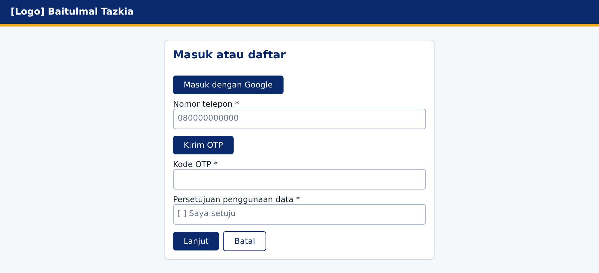{width=6in}

**Alur.**

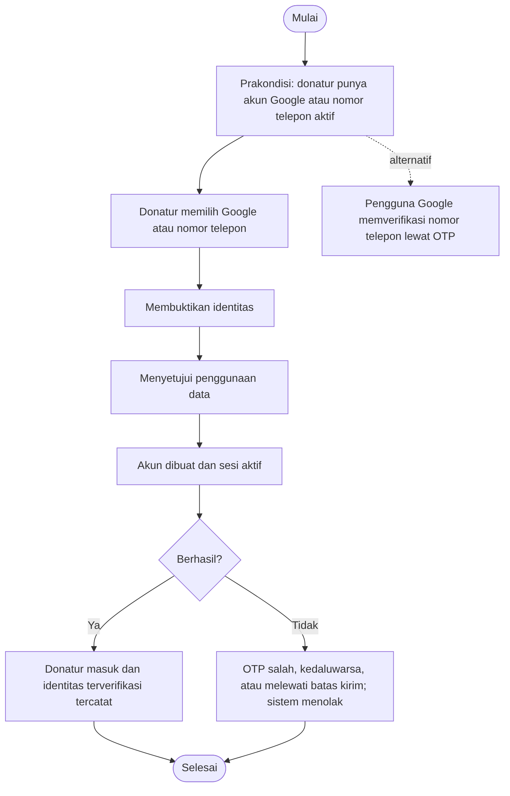{height=5in}

**Yang masih perlu dari BMTZ.** Cara masuk yang diterima donatur; apakah donatur wajib TOTP.

## FR-ADBD-02 Pengelolaan profil donatur

**Prioritas:** Must. **Yang memakai:** Donatur.

**Apa yang dilakukan fitur ini.** Donatur melihat dan mengubah data yang disetujui, serta menambah nomor telepon atau email yang diverifikasi dengan OTP; perubahan dicatat.

**Contoh kejadian.**

- Bila donatur sudah login, dan ketika mengubah alamat dan menyimpan, maka perubahan tersimpan.
- Bila email atau nomor baru belum diverifikasi, dan ketika donatur menyimpan, maka data lama tetap berlaku.

**Tampilan usulan.**

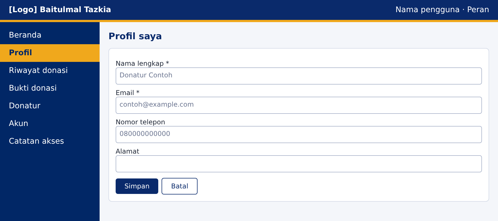{width=6in}

**Alur.**

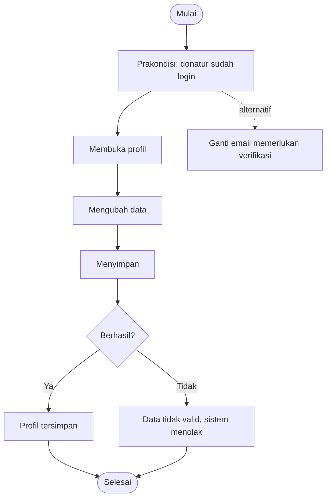{height=5in}

**Yang masih perlu dari BMTZ.** Data minimal donatur.

## FR-ADBD-03 Preferensi anonimitas dan pengiriman

**Prioritas:** Should. **Yang memakai:** Donatur.

**Apa yang dilakukan fitur ini.** Donatur memilih tampil dengan nama atau anonim, serta cara menerima bukti. Anonim mengatur tampilan tanpa menghapus data internal. Arti anonim bagi staf belum dikonfirmasi.

**Contoh kejadian.**

- Bila donatur memilih anonim, dan ketika namanya akan tampil pada daftar umum, maka tampil “Hamba Allah”.
- Bila preferensi belum diisi, dan ketika sistem memakainya, maka default tampil dengan nama [USULAN].
- Bila belum ada nomor terverifikasi, dan ketika donatur memilih WhatsApp, maka sistem menolak.

**Tampilan usulan.**

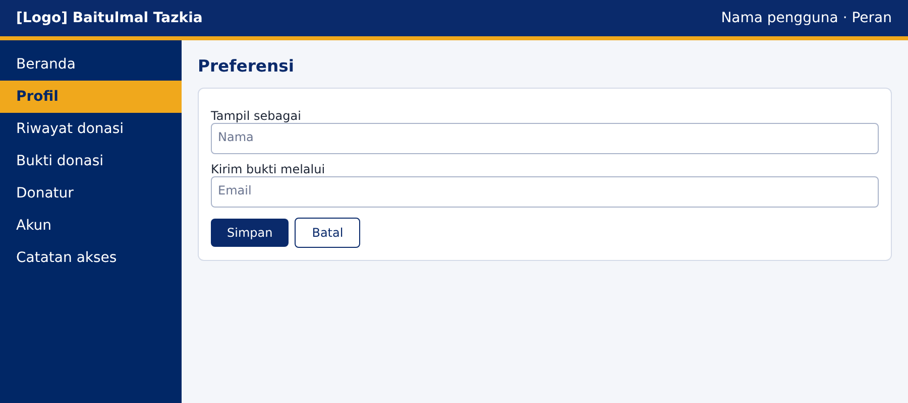{width=6in}

**Alur.**

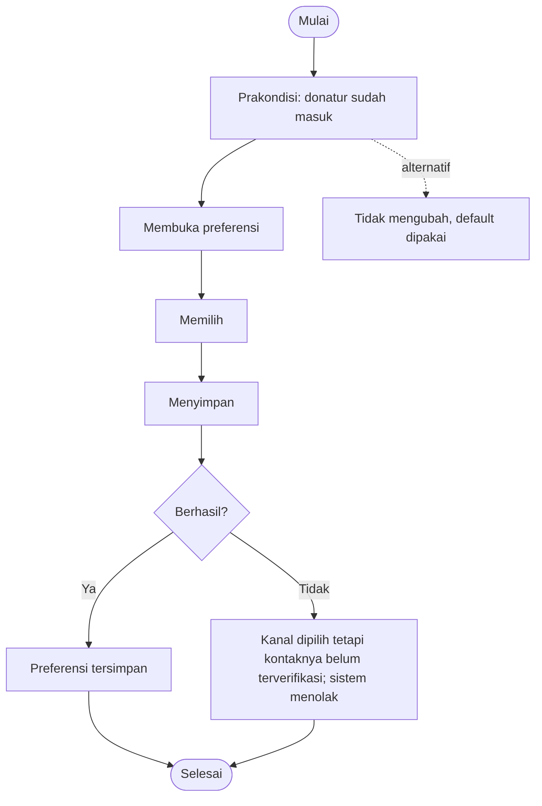{height=5in}

**Yang masih perlu dari BMTZ.** Arti anonim: dari publik saja atau juga dari staf.

## FR-ADBD-04 Penyatuan donasi ke akun

**Prioritas:** Must. **Yang memakai:** Sistem, petugas donasi, donatur.

**Apa yang dilakukan fitur ini.** Sistem menyatukan donasi dari semua kanal secara bertingkat. Email terverifikasi (Google atau OTP) atau nomor telepon terverifikasi OTP yang sama disatukan otomatis. Kecocokan yang hanya mirip masuk antrean konfirmasi staf atau donatur. Setiap penyatuan menyimpan dasar kecocokannya dan dapat dibatalkan.

**Contoh kejadian.**

- Bila donasi bernomor sama dengan nomor terverifikasi akun, dan ketika data diterima, maka donasi disatukan dengan dasar “nomor terverifikasi”.
- Bila hanya nama yang mirip, dan ketika data diterima, maka donasi tidak disatukan otomatis.
- Bila penyatuan keliru, dan ketika petugas membatalkannya dengan alasan, maka donasi hilang dari riwayat dan pembatalan tercatat.

**Tampilan usulan.**

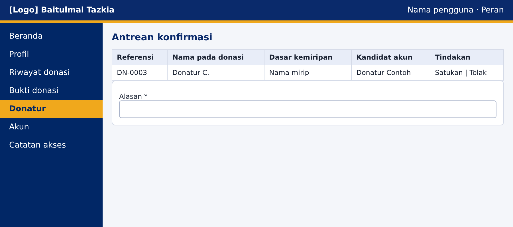{width=6in}

**Alur.**

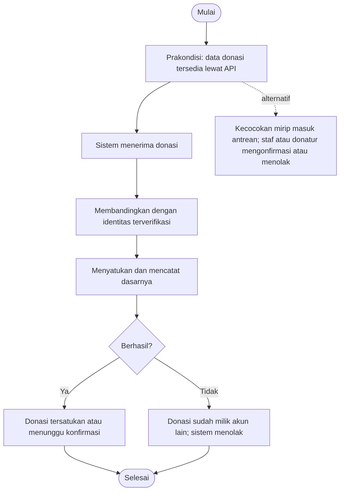{height=5in}

**Yang masih perlu dari BMTZ.** Cara BMTZ saat ini mengenali dua donasi dari orang yang sama.

## FR-ADBD-05 Riwayat donasi dan status donasi berulang

**Prioritas:** Must. **Yang memakai:** Donatur, petugas donasi.

**Apa yang dilakukan fitur ini.** Sistem menampilkan donasi milik akun dengan filter periode dan peruntukan, total donasi Berhasil, serta status donasi berulang. Tombol Kelola meminta signed URL berumur singkat ke subsistem Donasi Berulang lalu mengarahkan donatur tanpa login ulang. Donasi yang dibatalkan atau dibalik oleh koreksi tidak dihitung dalam total; yang dihitung catatan penggantinya [USULAN].

**Contoh kejadian.**

- Bila donasi Berhasil Rp100.000 dan Rp250.000, dan ketika donatur membuka riwayat, maka tampil 2 donasi dan total Rp350.000.
- Bila donatur A sudah masuk, dan ketika membuka riwayat donatur B, maka ditolak 403.
- Bila ada donasi berulang aktif, dan ketika donatur menekan Kelola, maka halaman pengelolaan terbuka lewat signed URL tanpa login ulang.

**Tampilan usulan.**

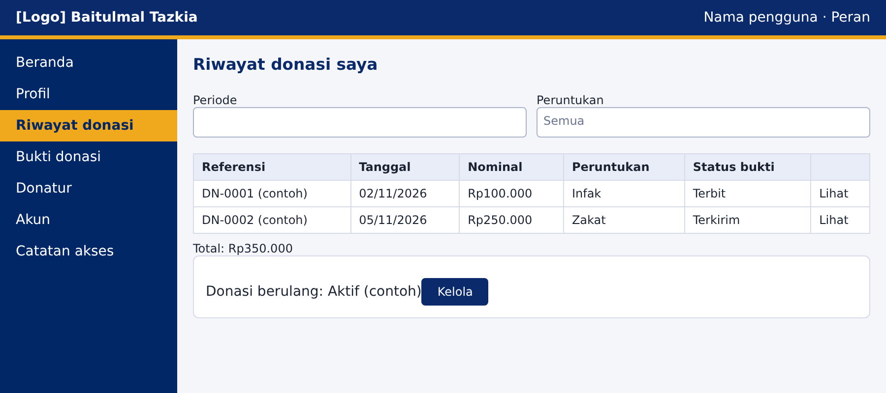{width=6in}

**Alur.**

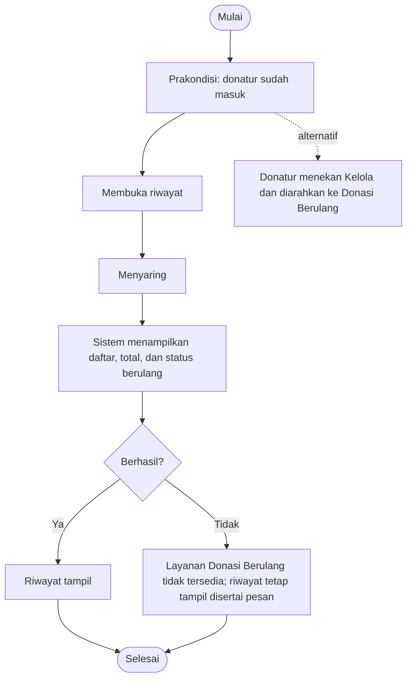{height=5in}

**Yang masih perlu dari BMTZ.** Kontrak data dengan kelompok Donasi Berulang.

## FR-ADBD-06 Penerbitan bukti donasi

**Prioritas:** Must. **Yang memakai:** Sistem, petugas donasi.

**Apa yang dilakukan fitur ini.** Sistem menerbitkan satu bukti resmi per transaksi Berhasil dari semua kanal, termasuk donasi di booth. Bukti diberi nomor urut dan disimpan apa adanya; isinya tidak pernah dibuat ulang dari data terkini. Bila donasi dibatalkan, dikembalikan, atau dikoreksi lewat catatan pembalik dari Penerimaan Donasi, bukti lama menjadi Dibatalkan dan tetap disimpan; bila ada catatan pengganti berstatus Berhasil, terbit bukti baru dengan nomor baru [USULAN].

**Contoh kejadian.**

- Bila donasi Berhasil Rp100.000 dari booth, dan ketika bukti diterbitkan, maka bukti memuat nomor urut dan Rp100.000.
- Bila bukti sudah terbit lalu nama donatur diubah, dan ketika bukti dibuka, maka isinya tetap seperti saat terbit.
- Bila donasi berstatus Menunggu, dan ketika penerbitan diminta, maka sistem menolak.
- Bila bukti Rp100.000 sudah terbit, dan ketika diterima catatan pembalik beserta catatan pengganti Rp150.000, maka bukti lama berstatus Dibatalkan dan terbit bukti baru Rp150.000 dengan nomor baru [USULAN].

**Tampilan usulan.**

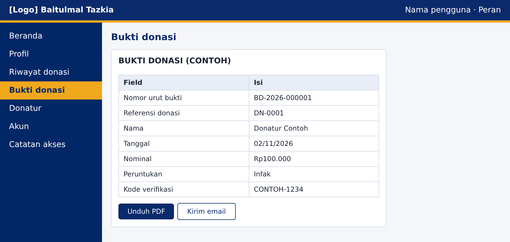{width=6in}

**Alur.**

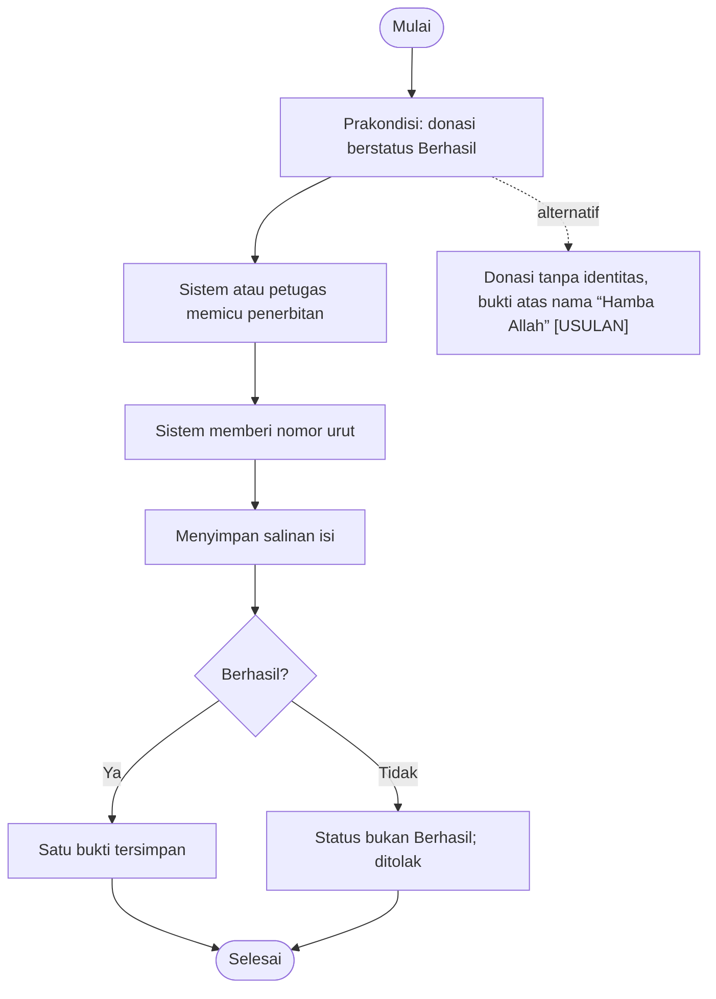{height=5in}

**Yang masih perlu dari BMTZ.** Contoh bukti donasi yang dipakai sekarang dan aturan penomorannya.

## FR-ADBD-07 Unduh dan kirim bukti

**Prioritas:** Must. **Yang memakai:** Donatur, petugas donasi.

**Apa yang dilakukan fitur ini.** Bukti dapat diunduh sebagai PDF dan dikirim lewat Aplikasi Notifikasi Tazkia dengan email, serta WhatsApp setelah kanalnya berjalan. Status pengiriman dibaca dari topic status.

**Contoh kejadian.**

- Bila bukti Terbit, dan ketika donatur menekan Unduh PDF, maka berkas PDF terunduh.
- Bila topic status melaporkan gagal, dan ketika sistem membacanya, maka status tidak menjadi Terkirim dan kegagalan dicatat.
- Bila donatur lain sudah masuk, dan ketika mengunduh bukti, maka ditolak 403.

**Tampilan usulan.**

{width=6in}

**Alur.**

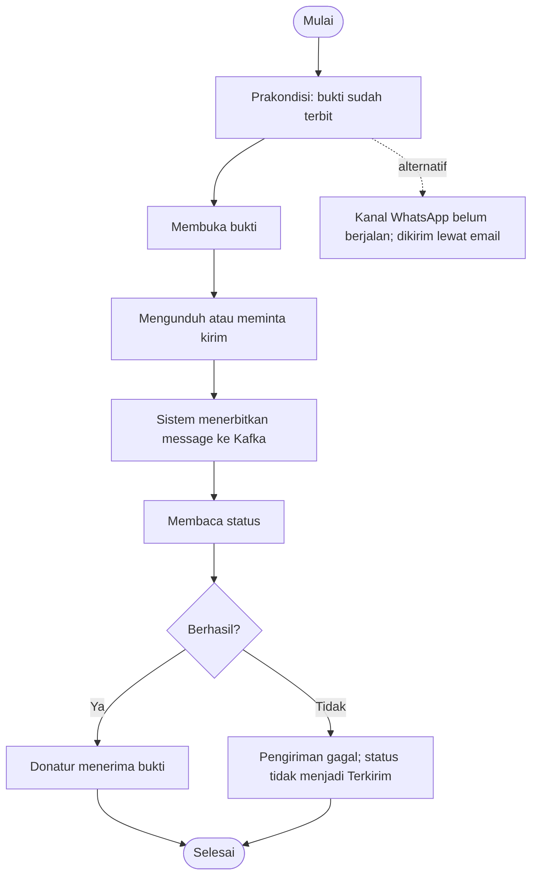{height=5in}

**Yang masih perlu dari BMTZ.** Bentuk dan kanal pengiriman bukti saat ini.

## FR-ADBD-08 Verifikasi keaslian bukti

**Prioritas:** Could. **Yang memakai:** Penerima bukti.

**Apa yang dilakukan fitur ini.** Siapa pun yang memiliki kode dapat memeriksa keabsahan; hasil hanya memuat status, nomor, tanggal, dan nominal tanpa identitas.

**Contoh kejadian.**

- Bila kode sah, dan ketika dimasukkan, maka tampil “Sah” tanpa nama donatur.
- Bila kode tidak dikenal, dan ketika dimasukkan, maka tampil “tidak ditemukan”.

**Tampilan usulan.**

{width=6in}

**Alur.**

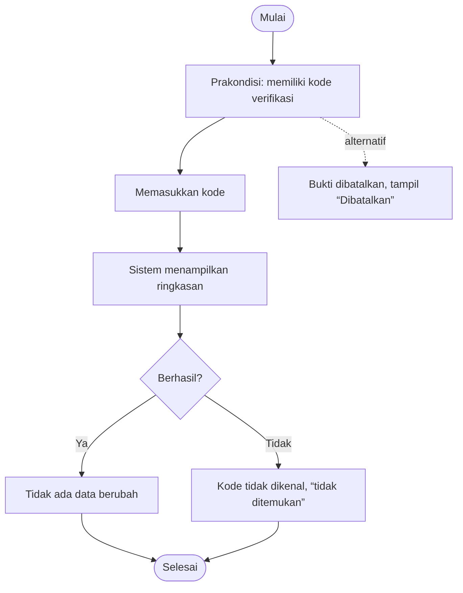{height=5in}

**Yang masih perlu dari BMTZ.** Apakah keaslian bukti perlu dapat diperiksa.

## FR-ADBD-09 Pembatasan akses dan login staf

**Prioritas:** Must. **Yang memakai:** Semua peran.

**Apa yang dilakukan fitur ini.** Staf masuk dengan akun Google (OpenID Connect) lalu verifikasi TOTP. ID token divalidasi di server. Akun yang belum terdaftar hanya melihat halaman awal kosong. Data dibatasi menurut peran dan kepemilikan, diperiksa terpusat di server.

**Contoh kejadian.**

- Bila akun Google belum terdaftar pada aplikasi, dan ketika pengguna masuk, maka hanya tampil halaman awal kosong.
- Bila pengguna berperan Donatur, dan ketika memanggil API kelola akun, maka ditolak 403.
- Bila kode TOTP salah, dan ketika staf mengirimnya, maka akses tidak diberikan.

**Tampilan usulan.**

{width=6in}

**Alur.**

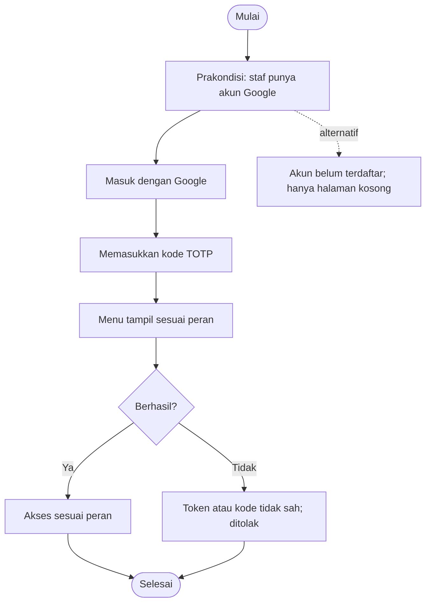{height=5in}

**Yang masih perlu dari BMTZ.** Siapa saja staf yang boleh membuka data donatur.

## FR-ADBD-10 Pengelolaan akun staf dan peran

**Prioritas:** Must. **Yang memakai:** Admin.

**Apa yang dilakukan fitur ini.** Admin mendaftarkan akun Google staf pada tabel pengguna aplikasi, menetapkan peran, dan menonaktifkan akun. Aplikasi tidak menyimpan kata sandi.

**Contoh kejadian.**

- Bila Admin mengisi email staf dan peran, dan ketika menyimpan, maka staf dapat masuk sesuai peran.
- Bila akun dinonaktifkan, dan ketika staf mencoba masuk, maka ditolak.
- Bila non-Admin, dan ketika membuat akun, maka ditolak 403.

**Tampilan usulan.**

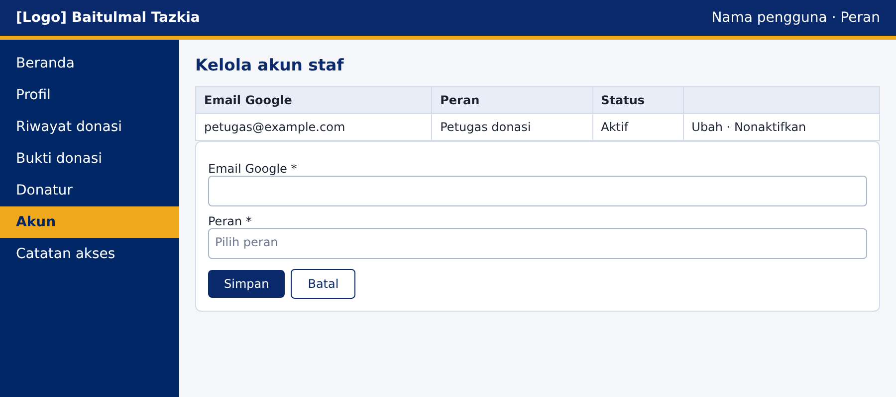{width=6in}

**Alur.**

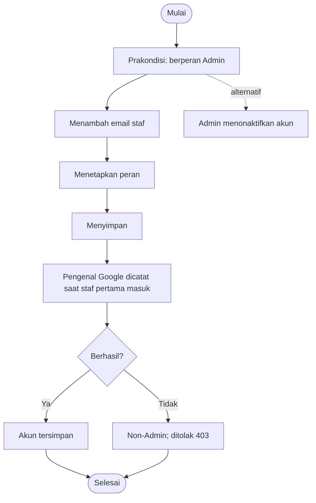{height=5in}

**Yang masih perlu dari BMTZ.** Siapa yang mengelola akun staf.

## FR-ADBD-11 Log akses data pribadi

**Prioritas:** Should. **Yang memakai:** Admin.

**Apa yang dilakukan fitur ini.** Sistem mencatat siapa membuka atau mengubah data donatur atau bukti siapa dan kapan.

**Contoh kejadian.**

- Bila petugas membuka profil donatur, dan ketika Admin membuka log, maka tercatat pengguna, donatur, dan waktu.

**Tampilan usulan.**

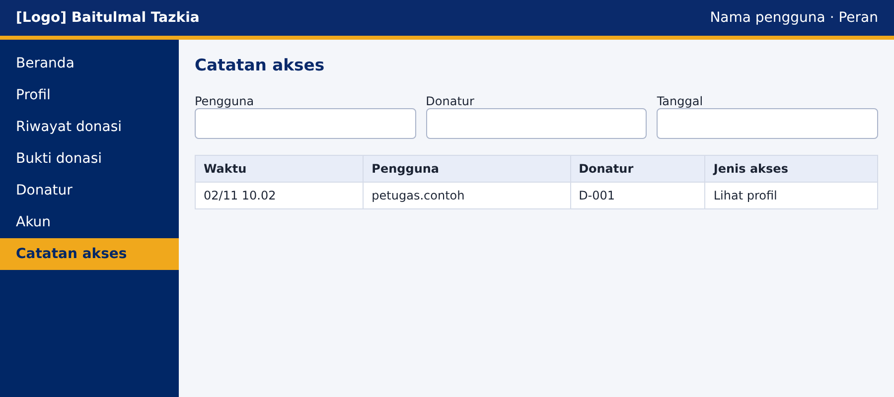{width=6in}

**Alur.**

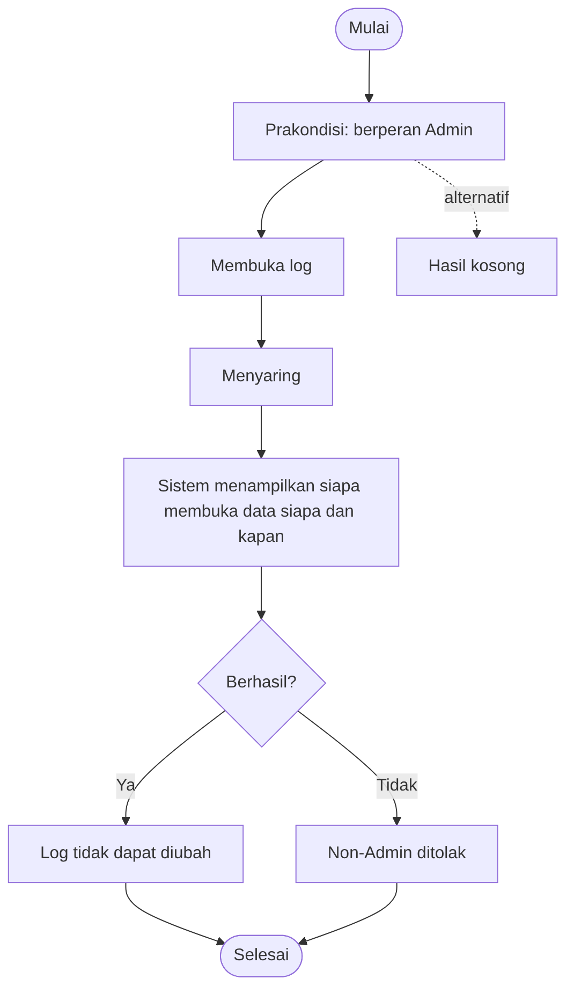{height=5in}

**Yang masih perlu dari BMTZ.** Masa simpan log akses.

## FR-ADBD-13 Rekapitulasi donasi tahunan

**Prioritas:** Must. **Yang memakai:** Donatur, petugas donasi.

**Apa yang dilakukan fitur ini.** Sistem menerbitkan rekapitulasi per tahun sebagai bukti setor zakat, memuat daftar donasi zakat Berhasil dan totalnya. Rekap yang sudah terbit disimpan apa adanya dengan nomor urut. Format yang diterima kantor pajak belum dikonfirmasi. Bila ada koreksi atas donasi yang sudah masuk rekap, rekap lama ditandai Dibatalkan dan rekap baru diterbitkan [USULAN].

**Contoh kejadian.**

- Bila donasi zakat Rp250.000 dan Rp750.000 pada 2026 serta infak Rp100.000, dan ketika rekap zakat 2026 diterbitkan, maka total Rp1.000.000.
- Bila tidak ada donasi zakat, dan ketika rekap diminta, maka sistem menolak.
- Bila rekap sudah terbit, dan ketika dibuka lagi, maka isinya sama dengan saat terbit.

**Tampilan usulan.**

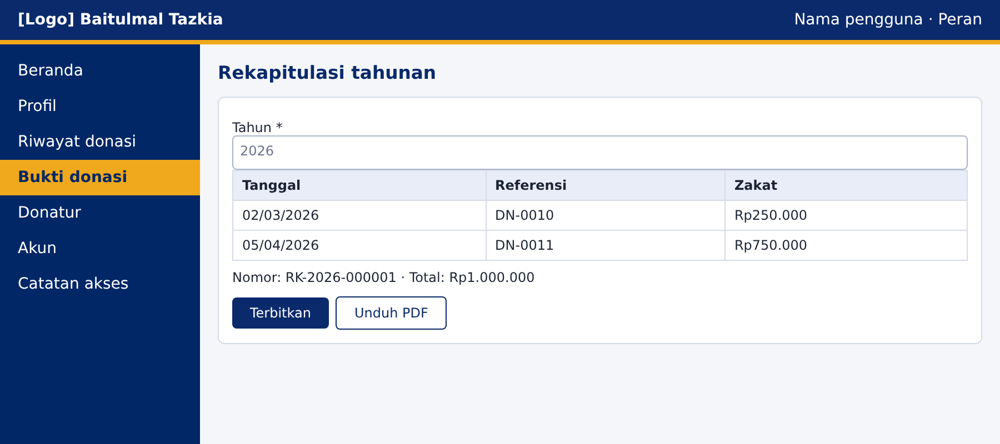{width=6in}

**Alur.**

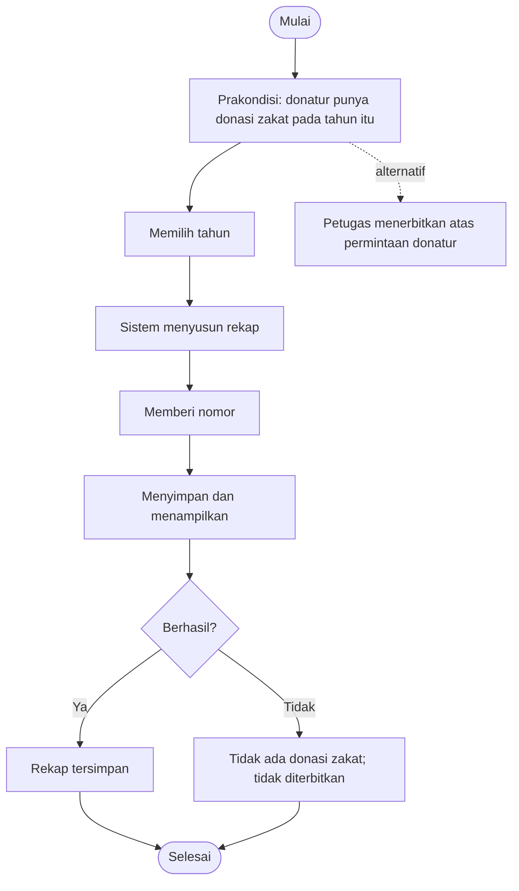{height=5in}

**Yang masih perlu dari BMTZ.** Format bukti setor zakat yang diterima kantor pajak; waktu puncak permintaan.

## FR-ADBD-14 Penghapusan akun donatur

**Prioritas:** Must. **Yang memakai:** Donatur, Admin.

**Apa yang dilakukan fitur ini.** Donatur dapat meminta akunnya dihapus. Sistem memutus hubungan akun dengan catatan donasi dan menghapus identitas login. Catatan donasi di Penerimaan Donasi tetap ada. Masa simpan bukti yang sudah terbit mengikuti ketentuan audit (belum dikonfirmasi).

**Contoh kejadian.**

- Bila donatur mengonfirmasi penghapusan, dan ketika sistem memproses, maka akun tidak dapat dipakai masuk.
- Bila akun sudah dihapus, dan ketika data donasi sumber diperiksa, maka catatan donasi tetap ada.
- Bila konfirmasi ulang gagal, dan ketika permintaan dikirim, maka akun tidak berubah.

**Tampilan usulan.**

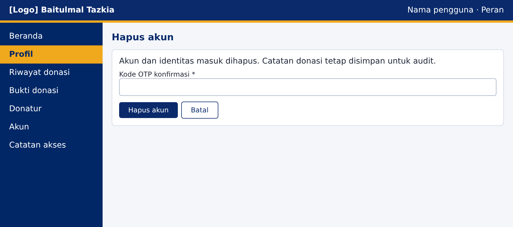{width=6in}

**Alur.**

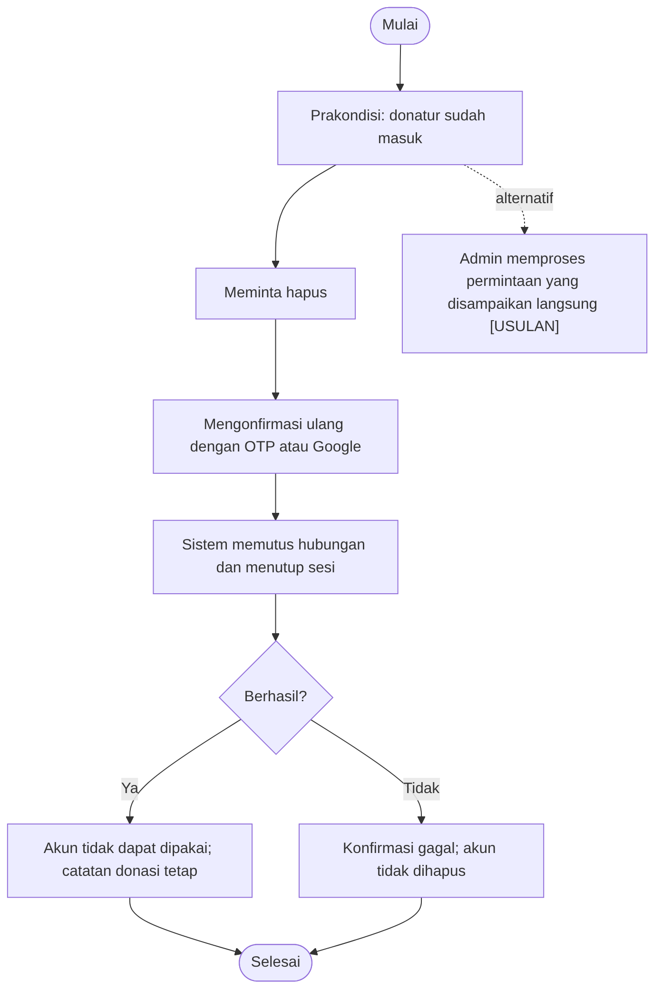{height=5in}

**Yang masih perlu dari BMTZ.** Data yang wajib tetap disimpan untuk audit.

## FR-ADBD-15 Kanal WhatsApp pada Aplikasi Notifikasi Tazkia

**Prioritas:** Should. **Yang memakai:** Aplikasi Notifikasi, subsistem pengirim.

**Apa yang dilakukan fitur ini.** Aplikasi pengirim WhatsApp membaca topic Kafka kanalnya lalu mengirim lewat API Meta memakai template yang disetujui Meta. Aplikasi template memetakan variabel bernama ke variabel bernomor. Status pengiriman diterbitkan ke topic yang dapat dibaca subsistem pengirim. Hanya pesan keluar.

**Contoh kejadian.**

- Bila template disetujui dan message valid, dan ketika message dibaca, maka dikirim dengan variabel pada urutan yang benar.
- Bila API Meta mengembalikan galat, dan ketika pengiriman dicoba, maka topic status memuat gagal.
- Bila template belum disetujui, dan ketika message dibaca, maka tidak dikirim dan status gagal diterbitkan.

**Tampilan usulan.** Tidak ada layar; kebutuhan antarsistem.

**Alur.**

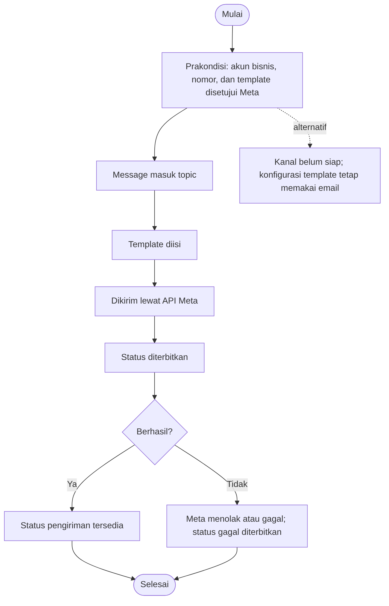{height=5in}

**Yang masih perlu dari BMTZ.** Pemilik akun bisnis Meta dan ketersediaan nomor terpisah.
